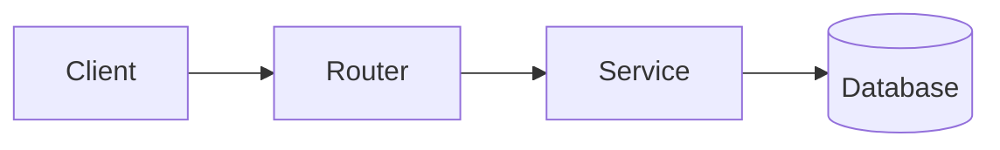

# PPT Helper

用 Markdown 写幻灯片，在浏览器里放着讲。零构建、零依赖，素材是一个 HTML 文件加几个静态资源。

风格参考 [jyywiki](https://jyywiki.cn/)：纯白底色 + 顶部紫色标题栏，灰阶排版，正文顶部对齐。画面按 16:9 等比缩放，也可以切成拉伸铺满。

## 开始

幻灯片默认放在 `decks/` 里，一个 `.md` 一份；想放在项目其他位置，用 `--dir` 指过去（见下面「放进自己的 Node 项目里」）。

```bash
npm start                   # 等价于 node server.js，打开选择页
node server.js 我的分享      # 直接打开 decks/我的分享.md（自动补 .md）
node server.js fastapi      # 名字不用写全，能唯一匹配就行
node server.js 我的分享 --no-open   # 不自动开浏览器
```

启动后会顺手用默认浏览器打开页面（macOS / Windows / Linux 都支持）。端口用 `--port` 或 `PORT` 环境变量改，默认 8000。

**没有 build 步骤。** 这个项目是零构建的：`index.html` + `slides.js` + `slides.css` + `vendor/` 直接由 `server.js` 原样发出。改完 `.md` 或样式刷新浏览器就生效，不需要打包、编译或迁移数据库。

编辑 `.md` 后刷新浏览器即可。想回到选择页，按 `L`。

不想开服务器也可以：直接用浏览器打开 `index.html`，把 `.md` 文件拖进窗口。

### 让它像一条命令一样顺手

在 `~/.bashrc` / `~/.zshrc` 里加个别名：

```bash
alias ppt='node /path/to/PPT-Helper/server.js'
```

之后在任何目录敲 `ppt 我的分享` 就能开讲。`server.js` 自带可执行头，也可以 `chmod +x server.js` 后 `./server.js 我的分享`，或者 `npm link` 一次，之后直接用 `ppt`。

想更省事，也可以把它绑成编辑器的快捷键（例如 VS Code 的 `.vscode/tasks.json`）：

```json
{
  "version": "2.0.0",
  "tasks": [{
    "label": "预览幻灯片",
    "type": "shell",
    "command": "node ${workspaceFolder}/server.js ${fileBasenameNoExtension}",
    "problemMatcher": []
  }]
}
```

## 放进自己的 Node 项目里

幻灯片目录和播放器是分开的：播放器（`index.html` / `slides.js` / `slides.css` / `vendor/`）留在本仓库，`.md` 可以放在任何位置，用 `--dir` 指过去。三种接入方式，按“想不想搬文件”选：

### A. 不搬，直接指目录（最省事）

```bash
# 在你的项目根目录
node ../PPT-Helper/server.js --dir ../PPT-Helper/decks
# 或装了链接之后
ppt --dir ../PPT-Helper/decks
```

适合只是想在项目里顺手放一下。`--dir` 也可以指向项目自己的 `slides/`：

```bash
ppt --dir ./slides            # 相对当前目录
ppt --dir ./slides --port 3000
```

### B. 装成本地依赖（推荐，命令固定）

```bash
# 在你的项目里
npm i -D file:../PPT-Helper
```

然后在 `package.json` 里加一条脚本：

```json
{
  "scripts": {
    "slides": "ppt --dir slides"
  }
}
```

之后一条命令：

```bash
npm run slides                 # 列出 slides/ 下所有幻灯片
npm run slides -- 我的分享      # 直接打开某一份
npm run slides -- --no-open    # 不自动开浏览器
npx ppt --dir slides           # 不想加脚本时也可以直接 npx
```

`file:` 依赖建立的是符号链接，改本仓库的播放器立刻生效，但改完 `package.json` 的 `bin` 字段后要重新 `npm i`。

### C. 整个复制过去

把 `server.js`、`index.html`、`slides.css`、`slides.js`、`vendor/` 拷进项目，`decks/` 换成你要讲的内容，然后 `node server.js`。适合想要一份完全独立的副本、不跟本仓库联动的情况。

### 迁移已有幻灯片时检查这几件事

1. `.md` 放哪都行，但要在启动时用 `--dir` 指到那个目录；默认仍是本仓库的 `decks/`。
2. 图片用**相对 md 文件**的路径（例如 `assets/x.png`），解析到 `--dir` 目录下的同名位置。别写成绝对路径 `/assets/x.png` 或相对项目根的路径。
3. 目录里只放 `.md` 和配图即可，文件名就是命令行里用的名字，标题取第一个 `# 标题`。
4. 迁移不需要 build、不需要数据库；只要 Node.js ≥ 18，没有 npm 依赖要装。
5. 端口被占用时换一个：`--port 3001` 或 `PORT=3001 npm run slides`。

## 写多份幻灯片

```
decks/
  操作系统.md
  组会分享.md
```

- 文件名就是命令行里用的名字（支持前缀匹配，不用写全），标题默认取文件第一个 `# 标题`
- 浏览器里的选择页会列出全部，点选或按数字键 1–9 打开
- 也可以直接改地址栏：`http://localhost:8000/?src=decks/组会分享.md`

## 写法

`decks/示例.md` 是一份完整的语法示例，把下面所有能力都用了一遍，可以直接改它。

用**单独一行**的 `---` 分页：

```markdown
# 第一页

正文……

---

# 第二页
```

其余就是普通 Markdown：

| 语法 | 说明 |
| --- | --- |
| `#` `##` `###` | 标题 |
| `-` / `1.` | 列表，可嵌套 |
| `**粗**` `*斜*` `` `代码` `` | 行内格式 |
| 表格、图片、引用 | 和平时一样 |
| ` ```c ` … ` ``` ` | 代码块，按语言高亮 |
| `$E=mc^2$`、`$$…$$` | 行内 / 独立公式 |

几个约定：

- 每页**第一个标题**（`#` / `##` / `###`）会显示在顶部紫色标题栏里，正文里不再重复。
- 只有 `#` 标题、副标题的短页面会被当作**封面**：不显示标题栏，标题居中放大。
- 代码块里的 `---` 不会被当成翻页符。
- 一页写太满时会自动缩小字号，尽量塞进一页（最小到 15px，再放不下就会裁掉）。
- 图片可以写相对路径，相对于 md 文件的位置解析。

写了章节后，每个页面会归入它前面最近的章节，页眉上方显示章节名。

### 章节与目录

**章节**：占单独一页，后面所有页面都归入这一章，直到下一个章节页。

````markdown
::: chapter 一、请求是怎么走通的
HTTP、REST 与第一个接口
:::
````

页面里只有这一个块时，它就是一张章节封面：大号章节序号 + 标题 + 一句说明，不显示页眉。

**目录**：`::: toc` 会列出所有章节和起始页；加 `pages` 连章节下的每一页也列出来。

````markdown
## 目录

::: toc pages
:::
````

目录里的条目可以直接点击跳页。没有写章节时，`::: toc` 退化成按页列出的目录。页面多的时候（超过 12 条）会自动分两列，避免被裁掉。

讲的时候按 `T` 可以随时调出目录面板，当前页会高亮。

### 排版增强

**卡片**：单张用 `::: card 标题`，并排多张用 `::: cards`（`|||` 分隔，默认等宽，`cards 3` 指定列数）

````markdown
::: card 配置状态
**已完成**：数据库连接正常，服务运行中。
:::

::: cards 3
### 前端
Vue / Svelte

|||

### 后端
FastAPI

|||

### 数据
PostgreSQL
:::
````

**状态标签**：每行「ok / info / warn / bad + 文字」，颜色对应成功、说明、注意、出错

````markdown
::: badges
ok 已完成
warn 待确认
bad 阻塞
:::
````

**分栏**：用独占一行的 `|||` 切分，栏宽可用 `1.2fr 1fr` 指定

````markdown
::: cols 1.2fr 1fr
左边内容（markdown 或代码块）

|||

右边内容
:::
````

**时间线**：用有序列表写步骤，每个条目可以是「标题：说明」

````markdown
::: timeline
1. **需求分析**：搞清楚要解决的问题
2. **架构设计**：定模块边界和依赖方向
3. **模块实现**：先跑通一条业务路径
:::
````

**提示框**：`note` 灰 / `tip` 绿 / `warn` 橙

````markdown
::: tip
简单项目可以省掉 Repository。
:::

::: warn
`check_same_thread=False` 是 SQLite 专属参数。
:::
````

**图表**：用 mermaid 写流程图、时序图、状态图，首次出现时才加载脚本

````markdown

````

图表默认按页面宽度铺开，超过 9.5em 高会自动等比缩小。如果整页只有一张图，图可以更高（24em）并垂直居中。建议用 `LR`（从左到右）而不是 `TB`，横向布局在 16:9 的画布上更清楚。

**柱状图 / 环形图**：每行写「标签 | 数值」，数值可以带单位；标题写在块参数里

````markdown
::: bars 学习时间分配
TypeScript | 40
Vue / Svelte | 30
其他 | 10
:::

::: pie 内容占比
概念 | 45
示例 | 35
练习 | 20
:::
````

`::: pie` 和 `::: donut` 等价，都是环形图，右侧自动生成图例和百分比。数据也可以放进分栏里并排展示。

**选项卡**：`::: tabs` 的参数是标签名，用 `|` 分隔；内容用 `|||` 分隔

````markdown
::: tabs 问题 | 方案
问题描述……

|||

方案说明……
:::
````

放映时可以直接点击标签切换，页面内容会自动重新排版。

卡片、分栏、图表、选项卡这些块可以互相嵌套（如在 `::: cols` 里放两个图表）。

拿不准用哪种形式时：

| 要表达的内容 | 适合的写法 |
| --- | --- |
| 并列概念、方案对比 | 卡片、分栏 |
| 步骤、阶段、演进 | 时间线、mermaid 流程图 |
| 数值比较、占比 | 柱状图、环形图 |
| 同一件事的不同角度 | 选项卡 |
| 补充说明、风险提示 | 提示框 |

**长代码**：单行超宽会自动折行，不会被裁掉。

## 播放

| 按键 | 作用 |
| --- | --- |
| `→` `↓` `空格` `PgDn` / 滚轮向下 | 下一页 |
| `←` `↑` `PgUp` / 滚轮向上 | 上一页 |
| `Home` / `End` | 首页 / 末页 |
| `F` | 全屏 |
| `O` | 缩略图概览，点击跳转 |
| `M` | 等比 / 拉伸 切换 |
| `D` | 深色 / 浅色 模式切换 |
| `T` | 目录面板，点击跳页 |
| `L` | 回到幻灯片选择页 |
| `Esc` | 退出全屏 / 目录 / 概览 |

右下角的按钮（或按 `M`）可以在两种填充方式间切换：

- **等比**（默认）：按 16:9 缩放，屏幕比例不符时两侧留白，画面不变形
- **拉伸**：铺满整个窗口，画面会被拉长或压扁

选择会记在浏览器的 localStorage 里，下次打开沿用。画面四周有一圈很淡的边界线，底边是一条紫色线，方便看清幻灯片范围。

滚轮是「一次手势翻一页」：触控板一划只会翻一页，松手后再滑可以立刻继续翻，连续快速滑动就能连续跳页。

底部的快捷键提示在非全屏时常驻显示，全屏后自动隐藏。

手机上可以左右滑动翻页。地址栏的 `#3` 表示第 3 页，可以直接分享某一页的链接。

## 改样式

- 配色和字号：`slides.css` 顶部的 CSS 变量；标题栏颜色是 `--violet`（默认 `#191970`），正文基准字号是 `.slide-body { --fs }`
- 依赖全部在本地：`vendor/` 里是 marked、highlight.js 和 KaTeX（含字体），断网也能完整使用

## 文件

```
decks/         幻灯片内容，一份一个 .md ← 主要改这里
index.html     页面骨架
slides.css     版式
slides.js      分页、渲染、翻页、缩放
server.js      本地服务器 + decks 列表接口 + 命令行启动（也是 bin，支持 --dir）
vendor/        marked 11 · highlight.js 11.9 · KaTeX 0.16 · mermaid 11
```
