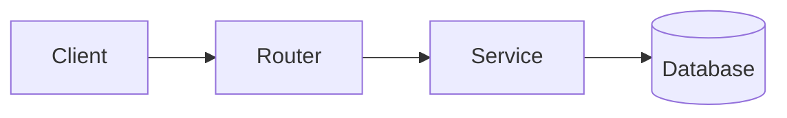

# PPT Helper 语法说明

返回 [README.md](README.md)。

[archive/示例.md](archive/示例.md) 是一份完整的语法示例，把下面所有能力都用了一遍，可以参考或直接改它。

## 基础写法

用**单独一行**的 `---` 分页：

```markdown
# 第一页

正文……

---

# 第二页
```

其余就是普通 Markdown：

| 语法 | 说明 |
| --- | --- |
| `#` `##` `###` | 标题 |
| `-` / `1.` | 列表，可嵌套 |
| `**粗**` `*斜*` `` `代码` `` | 行内格式 |
| 表格、图片、引用 | 和平时一样 |
| ` ```c ` … ` ``` ` | 代码块，按语言高亮 |
| `$E=mc^2$`、`$$…$$` | 行内 / 独立公式 |

几个约定：

- 每页**第一个标题**（`#` / `##` / `###`）会显示在顶部紫色标题栏里，正文里不再重复。
- 只有 `#` 标题、副标题的短页面会被当作**封面**：不显示标题栏，标题居中放大。
- 代码块里的 `---` 不会被当成翻页符。
- 一页写太满时会自动缩小字号，尽量塞进一页（最小到 15px，再放不下就会裁掉）。
- 图片可以写相对路径，相对于 md 文件的位置解析。

写了章节后，每个页面会归入它前面最近的章节，页眉上方显示章节名。

## 章节与目录

**章节**：占单独一页，后面所有页面都归入这一章，直到下一个章节页。

````markdown
::: chapter 一、请求是怎么走通的
HTTP、REST 与第一个接口
:::
````

页面里只有这一个块时，它就是一张章节封面：大号章节序号 + 标题 + 一句说明，不显示页眉。

**目录**：`::: toc` 会列出所有章节和起始页；加 `pages` 连章节下的每一页也列出来。

````markdown
## 目录

::: toc pages
:::
````

目录里的条目可以直接点击跳页。没有写章节时，`::: toc` 退化成按页列出的目录。页面多的时候（超过 12 条）会自动分两列，避免被裁掉。

讲的时候按 `T` 可以随时调出目录面板，当前页会高亮。

## 排版增强

**卡片**：单张用 `::: card 标题`，并排多张用 `::: cards`（`|||` 分隔，默认等宽，`cards 3` 指定列数）

````markdown
::: card 配置状态
**已完成**：数据库连接正常，服务运行中。
:::

::: cards 3
### 前端
Vue / Svelte

|||

### 后端
FastAPI

|||

### 数据
PostgreSQL
:::
````

**状态标签**：每行「ok / info / warn / bad + 文字」，颜色对应成功、说明、注意、出错

````markdown
::: badges
ok 已完成
warn 待确认
bad 阻塞
:::
````

**分栏**：用独占一行的 `|||` 切分，栏宽可用 `1.2fr 1fr` 指定

````markdown
::: cols 1.2fr 1fr
左边内容（markdown 或代码块）

|||

右边内容
:::
````

**时间线**：用有序列表写步骤，每个条目可以是「标题：说明」

````markdown
::: timeline
1. **需求分析**：搞清楚要解决的问题
2. **架构设计**：定模块边界和依赖方向
3. **模块实现**：先跑通一条业务路径
:::
````

**提示框**：`note` 灰 / `tip` 绿 / `warn` 橙

````markdown
::: tip
简单项目可以省掉 Repository。
:::

::: warn
`check_same_thread=False` 是 SQLite 专属参数。
:::
````

**图表**：用 mermaid 写流程图、时序图、状态图，首次出现时才加载脚本

````markdown

````

图表默认按页面宽度铺开，超过 9.5em 高会自动等比缩小。如果整页只有一张图，图可以更高（24em）并垂直居中。建议用 `LR`（从左到右）而不是 `TB`，横向布局在 16:9 的画布上更清楚。

**柱状图 / 环形图**：每行写「标签 | 数值」，数值可以带单位；标题写在块参数里

````markdown
::: bars 学习时间分配
TypeScript | 40
Vue / Svelte | 30
其他 | 10
:::

::: pie 内容占比
概念 | 45
示例 | 35
练习 | 20
:::
````

`::: pie` 和 `::: donut` 等价，都是环形图，右侧自动生成图例和百分比。数据也可以放进分栏里并排展示。

**选项卡**：`::: tabs` 的参数是标签名，用 `|` 分隔；内容用 `|||` 分隔

````markdown
::: tabs 问题 | 方案
问题描述……

|||

方案说明……
:::
````

放映时可以直接点击标签切换，页面内容会自动重新排版。

卡片、分栏、图表、选项卡这些块可以互相嵌套（如在 `::: cols` 里放两个图表）。

拿不准用哪种形式时：

| 要表达的内容 | 适合的写法 |
| --- | --- |
| 并列概念、方案对比 | 卡片、分栏 |
| 步骤、阶段、演进 | 时间线、mermaid 流程图 |
| 数值比较、占比 | 柱状图、环形图 |
| 同一件事的不同角度 | 选项卡 |
| 补充说明、风险提示 | 提示框 |

**长代码**：单行超宽会自动折行，不会被裁掉。
