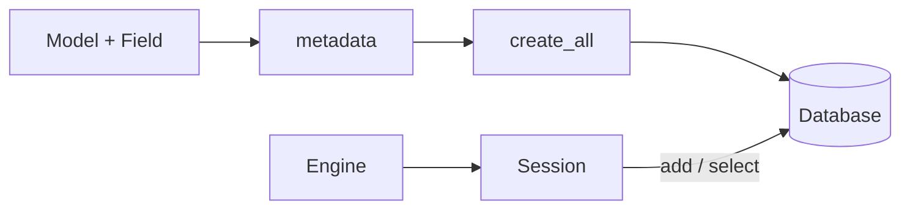
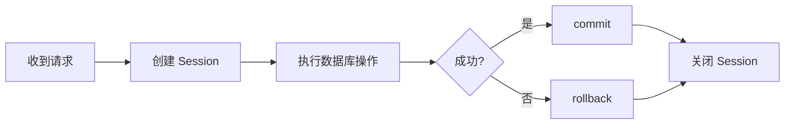

# SQLModel

## 建立 SQLAlchemy + Pydantic 之上的 ORM

---

## 先认清几个核心对象

不需要一上来就背所有 API，先理解它们之间的关系。

| 概念 | 作用 | 一句话 |
| --- | --- | --- |
| **Engine** | 管理连接基础设施 | 数据库连接入口 |
| **Session** | 执行操作、管理事务 | 一次操作的工作环境 |
| **SQLModel** | 定义数据模型 | 用类描述数据表 |
| `select` | 构造查询语句 | 声明要查什么 |
| `Relationship` | 定义表间关联 | 描述对象关系 |
| `metadata` | 保存表结构信息 | 表结构的登记簿 |

其中 **Engine、Session、Model** 构成最基本的使用链路。

---

## 它们怎么串起来



- Model 登记到 metadata
- metadata 负责建表
- Engine 提供连接，Session 干活

---

## 最后都要落到表上

传统写法里，同一份字段要写两遍：

```python
# SQLAlchemy 表模型
class Hero(Base):
    __tablename__ = "hero"
    id = Column(Integer, primary_key=True)
    name = Column(String)

# Pydantic 数据模型
class HeroSchema(BaseModel):
    id: int
    name: str
```

- 加一个字段要改两处，查出来还要手动转成 schema

---

## SQLModel 用一个类解决

```python
class Hero(SQLModel, table=True):
    id: int | None = Field(default=None, primary_key=True)
    name: str = Field(index=True)
    age: int | None = None
```

- `table=True` 声明它对应数据库表
- `Field()` 配置字段，`primary_key=True` 声明主键
- `Hero` 类对应 `hero` 表，字段对应列

---

## table=True 到底差在哪

```python
class Hero(SQLModel, table=True):    # 表模型
    id: int | None = Field(default=None, primary_key=True)
    name: str

class HeroCreate(SQLModel):          # 普通数据模型
    name: str
```

- `Hero` 能映射数据库表，`HeroCreate` 只用来校验输入
- 实际项目通常有创建 / 读取 / 更新多个模型
- 表模型常带 `password_hash` 这类字段，**别直接当响应模型**

---

## 1. Engine：连接基础设施

```python
from sqlmodel import create_engine

engine = create_engine("sqlite:///app.db", echo=True)
```

Engine 负责：

- **连接管理**：获取、释放，靠连接池复用（PostgreSQL 等）
- **底层入口**：Session 通过它和数据库交互

::: note
**Engine ≠ 一条已建立的连接**，它更像连接管理器。创建时通常不会立刻连库，需要时才取连接。
:::

---

## Engine 的两个要点

```python
# ✅ 模块级创建一次，全局复用
engine = create_engine("sqlite:///app.db")

def get_session():
    with Session(engine) as session:
        yield session
```

- 不要每个请求 `create_engine()`，否则连接池会被反复重建
- `echo=True` 只在开发时开，它会打印每条 SQL

---

## 2. Session：数据库操作的工作单元

```python
from sqlmodel import Session

with Session(engine) as session:
    ...
```

Session 负责：

- 执行查询，暂存新增 / 修改 / 删除等状态变化
- 管理事务（commit / rollback），跟踪已加载的对象
- 与 Engine 协作，真正执行数据库操作

**Session 不是全局共享对象**：它自身有状态，不能跨并发请求共用。

---

## Session 的生命周期



通常一个请求创建一个 Session，结束就关闭。在 FastAPI 里用 `yield` 依赖，退出时自动清理。

---

## Session 的常用方法

| 方法 | 作用 |
| --- | --- |
| `session.add(obj)` | 纳入 Session 管理，准备持久化 |
| `session.exec(stmt)` | 执行查询语句 |
| `session.get(Model, id)` | 按主键查询 |
| `session.commit()` | 提交事务 |
| `session.rollback()` | 回滚当前事务 |
| `session.refresh(obj)` | 从数据库重新加载对象 |
| `session.delete(obj)` | 标记删除 |
| `session.close()` | 关闭，释放资源 |

---

## 为什么 add 之后还要 commit

```python
hero = Hero(name="Spider-Man")
session.add(hero)
session.commit()
```

- `add()`：把对象纳入 Session 的工作集，此时通常**还没有写库**
- `commit()`：把当前事务的变化真正提交

可以用 Git 粗略类比：`add` 是暂存，`commit` 是提交。

::: note
对象已被 Session 管理时，直接改属性再 `commit()` 就行，**不需要再 add 一次**。
:::

---

## 3. 模型与数据表

```python
class Hero(SQLModel, table=True):
    id: int | None = Field(default=None, primary_key=True)
    name: str
```

- 类对应表，字段对应列
- ORM 负责 Python 对象和数据库记录之间的转换
- `id` 可以是 `None`，因为插入前还没有自增值

---

## metadata 与建表

```python
SQLModel.metadata.create_all(engine)
```

- `SQLModel.metadata` 是 SQLAlchemy 的 `MetaData`，登记了所有表结构
- `create_all()` 会创建**尚不存在**的表

::: warn
`create_all()` 不会改已有表。给模型加字段后，它不会自动修改旧表——这类变更要用 Alembic 迁移。
:::

---

## 4. select：构造查询

```python
from sqlmodel import select

statement = select(Hero)
# SELECT * FROM hero;

statement = select(Hero).where(Hero.name == "Spider-Man")
# SELECT * FROM hero WHERE name = 'Spider-Man';
```

`select()` 只负责**构造语句**，执行靠 Session：`session.exec(stmt)`。

- `.first()` 第一条，没有则 `None`
- `.all()` 全部结果
- `.one()` 唯一结果，不唯一或为空会报错

---

## 查出来的是什么

```python
with Session(engine) as session:
    heroes = session.exec(select(Hero)).all()
```

`heroes` 是 `Hero` 对象的列表，不是原始数据行。

- 可以直接访问 `hero.name`
- 也可以直接返回给 FastAPI 序列化
- `session.exec()` 是对 SQLAlchemy 查询接口的简化封装，类型提示更友好

---

## 5. Relationship：对象之间的关联

数据库层面用外键：`team_id = Field(foreign_key="team.id")`。

ORM 层面用 Relationship 建立对象关联：

```python
class Team(SQLModel, table=True):
    id: int | None = Field(default=None, primary_key=True)
    name: str
    heroes: list["Hero"] = Relationship(back_populates="team")
class Hero(SQLModel, table=True):
    id: int | None = Field(default=None, primary_key=True)
    name: str
    team_id: int | None = Field(default=None, foreign_key="team.id")
    team: Team | None = Relationship(back_populates="heroes")
```

---

## 外键 vs Relationship

| | Foreign Key | Relationship |
| --- | --- | --- |
| 层面 | 数据库 | ORM |
| 作用 | 记录如何引用另一张表 | 用 Python 对象访问关联 |
| 例子 | `team_id` 列 | `hero.team` / `team.heroes` |

```python
team = Team(name="Avengers")
hero = Hero(name="Iron-Man", team=team)
```

不用手写 JOIN，ORM 帮你处理关联。但它默认是懒加载，列表接口容易 N+1，用 `selectinload` 预加载。

---

## 6. 串起来：最小完整流程

```python
from sqlmodel import SQLModel, Field, Session, create_engine, select

class Hero(SQLModel, table=True):
    id: int | None = Field(default=None, primary_key=True)
    name: str

engine = create_engine("sqlite:///app.db")
SQLModel.metadata.create_all(engine)

def create_hero(name: str):
    with Session(engine) as session:
        hero = Hero(name=name)
        session.add(hero)
        session.commit()
        session.refresh(hero)
        return hero
```

---

## 7. 在 FastAPI 里怎么组织

```python
# database.py
def get_session():
    with Session(engine) as session:
        yield session

# router.py
@app.get("/heroes")
def get_heroes(session: Session = Depends(get_session)):
    return session.exec(select(Hero)).all()
```

- 每个请求拿到一个 Session，请求结束自动关闭
- `get_session` **不会**替你 commit，写操作要自己提交
- 用 `def` 而不是 `async def`，避免阻塞事件循环

---

## 表结构变了怎么办

```bash
alembic revision --autogenerate -m "add hero.age"
alembic upgrade head
```

- `create_all` 只建缺失的表，不改已有列
- 上线后改结构必须写迁移脚本，并提交到版本库

---

## 学习优先顺序

| 优先级 | 内容 |
| --- | --- |
| **1** | Engine、Session、Model、`select` |
| **2** | Relationship、事务、FastAPI 依赖 |
| **3** | Alembic、连接池、ORM 底层 |

::: tip
真正重要的只有三个：**Engine**（连接基础设施）、**Session**（工作单元）、**Model**（对象与表的映射）。理解这三者，后面的 CRUD 和依赖注入会顺很多。
:::

---

## 几个真实的坑

- 在 `async def` 里用同步 Session，会阻塞事件循环
- 关系懒加载导致 N+1，列表接口要 `selectinload`
- `table=True` 的模型直接当响应模型，容易泄露内部字段
- 长事务一直占着连接，别在事务里做网络请求
- SQLModel 仍是 **0.x**，升级前读 changelog

---

## 下一步：真正容易踩坑的地方

如果继续深入，建议专门搞清楚这三件事：

- **Session 的状态管理**：对象什么时候是 transient / pending / persistent
- **事务边界**：什么操作算一次事务，异常时怎么回滚
- **`commit` / `flush` / `refresh` 的区别**：各自什么时候真的发 SQL

这些才是日常写 SQLModel 时最容易出问题的地方。

---

## 参考

- 文档：[sqlmodel.tiangolo.com](https://sqlmodel.tiangolo.com/)
- Engine：[Create a Database Engine](https://sqlmodel.tiangolo.com/tutorial/connect/create-engine/)
- Select：[SQLModel · Select](https://sqlmodel.tiangolo.com/tutorial/select/)
- SQLAlchemy：[docs.sqlalchemy.org](https://docs.sqlalchemy.org/)
