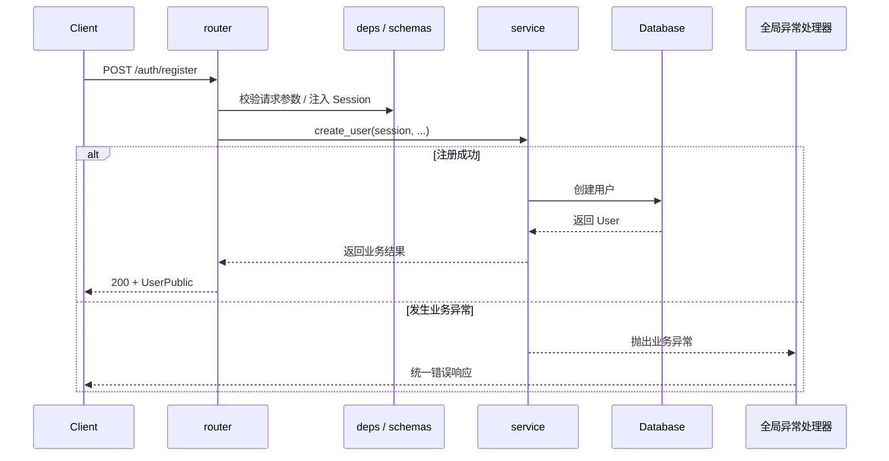

# 从零搭建一个业务模块

## 以 auth 为例：从文件组织到请求链路

---

## 目录

::: toc pages
:::

---

::: chapter 一、结构
一个模块怎么划，每个文件放什么
:::

---

## 先按业务拆分模块

按业务领域组织代码，而不是把所有路由、模型和服务集中放在一起。

::: cards 2
### auth/
管理认证相关的数据、业务逻辑和 API

|||

### core/
多个模块都会使用的能力：数据库、异常、安全工具
:::

::: tip
一个模块围绕一项业务组织，模块之间尽量通过清晰的接口协作。
:::

---

## 目录结构：一个模块，五个文件

```text
ta-backend/
├── main.py
├── core/
│   ├── database.py   # 数据库引擎 / SessionDep
│   ├── errors.py     # 全局异常处理
│   └── security.py   # 密码与 token 工具
└── modules/
    └── auth/
        ├── models.py
        ├── schemas.py
        ├── service.py
        ├── deps.py
        └── router.py
```

---

## 五个文件，各管一件事

::: cards 3
### models.py
定义数据库表和字段

|||

### schemas.py
定义请求、响应的数据结构与校验规则

|||

### service.py
实现业务规则，组织数据读写

|||

### deps.py
定义路由依赖：当前用户、权限检查

|||

### router.py
定义 API 路由：接收请求并返回响应
:::

---

## 先区分：公共能力与业务代码

::: cards 2
### core/
数据库连接、异常处理、安全工具等通用能力

|||

### modules/auth/
认证业务自身的数据模型、规则和接口
:::

- `main.py` 负责创建应用、注册公共处理器、挂载路由
- 判断依据：某段代码是否被多个业务模块共同使用？

::: note
公共能力下沉到 core/，业务规则留在模块里。
:::

---

::: chapter 二、数据与规则
先把数据、格式和业务规则定下来
:::

---

## 搭建顺序：从数据到接口

::: timeline
1. **models.py** 表结构与约束
2. **schemas.py** 请求和响应格式
3. **service.py** 业务规则与数据读写
4. **core/errors.py** 接入统一异常处理
5. **deps.py** 请求级依赖
6. **router.py** 定义接口并调用 service
7. **main.py** 注册处理器、挂载路由
8. **本地验证** 检查成功与失败路径
:::

::: note
先确定数据如何存储，再确定接口收发什么，最后把业务逻辑接入 HTTP 请求。
:::

---

## 第 1 步：models.py —— 定义数据表

```python
class User(SQLModel, table=True):
    id: int | None = Field(default=None, primary_key=True)
    username: str = Field(index=True, unique=True)
    password_hash: str
```

- `table=True` 表示这是数据库表模型
- 类的字段对应表的列，主键、唯一约束也在这里声明
- 只保存密码哈希，不保存明文密码

---

## 第 2 步：schemas.py —— 定义数据进出格式

```python
class UserCreate(BaseModel):
    username: str = Field(min_length=3, max_length=32)
    password: str = Field(min_length=6)

class UserPublic(BaseModel):
    id: int
    username: str
```

::: cards 2
### UserCreate
描述客户端可以提交什么，并校验输入

|||

### UserPublic
描述接口允许返回什么，避免暴露 password_hash 等内部字段
:::

::: tip
表模型描述数据库；Schema 描述 API 的数据格式。
:::

---

## 第 3 步：service.py —— 实现业务规则

业务逻辑集中在 service 中：

```python
def create_user(session: Session, username: str, password: str) -> User:
    # 校验业务规则，并完成数据读写
    ...
```

::: cards 3
### 注册
检查规则、哈希密码、创建用户

|||

### 登录
查询用户、校验密码、签发 token

|||

### 认证
解析 token，并确认对应用户存在
:::

::: note
service 接收 session 和普通参数，读写数据并返回结果；不直接处理 HTTP 请求。
:::

---

## 业务失败：定义统一的错误出口

::: cards 3
### service
发现业务失败时，抛出有明确含义的业务异常

|||

### core/errors.py
统一捕获异常，并转换成 API 错误响应

|||

### 响应体
用 `code`、`detail` 描述具体原因
:::

::: tip
业务代码只表达「发生了什么」，不负责决定 HTTP 状态码。
:::

---

## HTTP 状态码保持简单

::: badges
ok 200 正常
info 404 资源不存在
bad 业务失败
:::

- 200：请求正常处理，具体业务结果看响应体
- 404：请求的资源不存在
- 其他业务失败通过响应体中的 `code` 区分，不为每种错误单独增加状态码映射

::: note
FastAPI 自身的请求参数校验错误仍由框架处理。
:::

---

::: chapter 三、接口与组装
把模块接进 HTTP，再把应用装起来
:::

---

## 第 4 步：deps.py —— 准备请求所需的依赖

```python
def get_current_user(
    session: SessionDep,
    authorization: Annotated[str | None, Header()] = None,
) -> User:
    if not authorization or not authorization.lower().startswith("bearer "):
        raise service.Unauthorized("未登录或 token 无效")
    token = authorization.split(" ", 1)[1]
    return service.authenticate_token(session, token)
```

- 从请求头读取 token，并通过 `SessionDep` 获取数据库会话
- 调用 service 完成 token 验证和用户查询
- 把当前用户提供给需要登录态的路由

::: note
deps.py 负责依赖组织，不承载业务规则。
:::

---

## 第 5 步：router.py —— 定义 HTTP 接口

```python
@router.post("/register")
def register(user: UserCreate, session: SessionDep) -> UserPublic:
    result = service.create_user(session, user.username, user.password)
    return UserPublic.model_validate(result)
```

::: cards 3
### 接收参数
由 Schema 负责校验

|||

### 调用 service
业务规则在这里发生

|||

### 返回响应
转换成 UserPublic
:::

router 只负责这三件事。

---

## 第 6 步：main.py —— 把模块组装起来

```python
app = FastAPI(lifespan=lifespan)

install_error_handlers(app)
app.include_router(auth_router)
```

- 创建 FastAPI 应用，并在生命周期中初始化、释放资源；建表前确保模型已导入
- 注册全局异常处理器
- 使用 `include_router()` 挂载业务模块的路由

::: note
main 不写具体业务，只负责应用组装。
:::

---

::: chapter 四、链路与验证
一次请求到底经过了谁
:::

---

## 一次注册请求，如何走完整条链路？



正常路径经过 router 和 service；异常路径交给全局处理器收口。

---

## 正常路径与异常路径

::: tabs 正常路径 | 发生业务异常
1. router 接收 `POST /auth/register`
2. Schema 校验参数，注入 Session
3. service 创建用户并返回结果
4. router 返回 200 + UserPublic

|||

1. service 发现业务失败，抛出业务异常
2. 全局异常处理器捕获
3. 返回统一错误响应
4. router 不再自己拼接错误格式
:::

---

## 最后：本地验证

::: cards 2
### 成功路径
请求能走通，并返回预期结果

|||

### 失败路径
业务异常和参数错误都返回预期响应
:::

::: tip
两条路径都走一遍，再交给别人用。
:::

---

## 记住模块的分工

::: cards 3
### 数据
`models.py` 管数据表

`schemas.py` 管数据格式

|||

### 业务
`service.py` 管业务规则

|||

### 接口
`deps.py` 准备请求依赖

`router.py` 对接 HTTP

`main.py` 负责组装
:::

::: tip
新增业务时，复制的是模块组织方式，而不是把所有代码堆进一个文件。
:::
