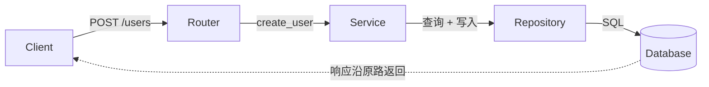
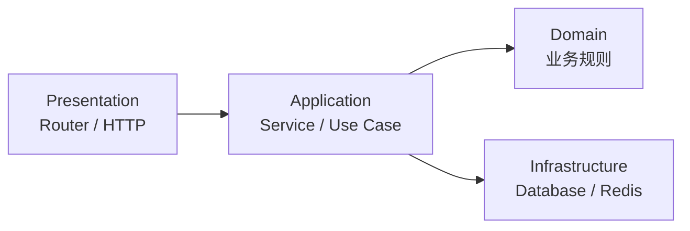
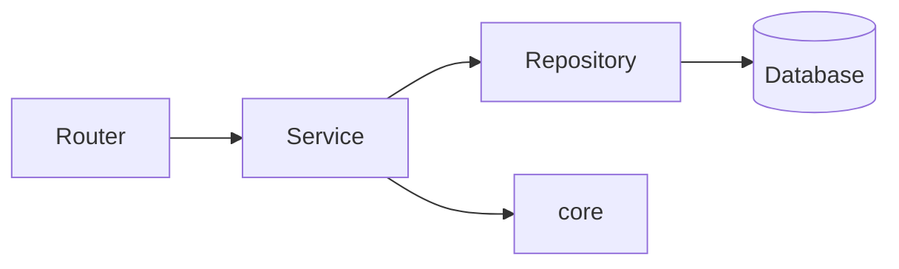
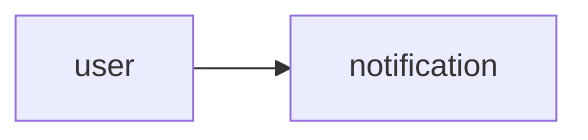

# 后端项目的文件组织

## Python · FastAPI · 从文件结构到架构设计

---

## 为什么需要组织文件

一个后端项目通常要处理五类事情：

- **HTTP 接口**：接收请求、返回响应
- **业务逻辑**：实现具体规则
- **数据访问**：查询和修改数据库
- **数据校验**：保证输入合法
- **基础设施**：数据库连接、日志、配置

全塞进一个文件，几周后就没人敢改了。

::: note
组织的目标不是目录好看，而是**职责明确、依赖清晰**。
:::

---

## 一个典型的结构

::: cols 1.15fr 1fr
```text
backend/
├── app/
│   ├── modules/        # 业务模块
│   │   ├── user/
│   │   └── auth/
│   ├── core/           # 公共能力
│   │   ├── config.py
│   │   └── security.py
│   ├── infrastructure/ # 外部系统
│   │   └── database.py
│   ├── dependencies.py
│   └── main.py
├── tests/
├── pyproject.toml
└── .env
```

|||

**modules/** 按业务切分，一个目录一个领域。

**core/** 多个模块共用的配置、安全、异常。

**infrastructure/** 数据库、缓存、邮件等具体技术实现。

**main.py** 应用入口，只做组装。
:::

---

## 一个业务模块内部

::: cols 1fr 1fr
```text
modules/user/
├── router.py
├── service.py
├── repository.py
├── models.py
└── schemas.py
```

|||

- **router.py** 接口定义
- **service.py** 业务流程
- **repository.py** 数据访问
- **models.py** 数据库表
- **schemas.py** 输入输出结构
:::

::: tip
不是每个项目都需要这五个文件。小项目里 service 和 repository 合并、models 和 schemas 合并，都很正常。
:::

---

## 两种组织方式

::: cols 1fr 1fr
**按技术职责**

```text
app/
├── routers/
├── services/
├── repositories/
└── schemas/
```

改一个功能，要在四个目录之间跳。

|||

**按业务模块**

```text
app/
└── modules/
    ├── user/
    │   ├── router.py
    │   └── service.py
    └── article/
```

一个功能和它的代码待在同一个地方。
:::

::: tip
中小型项目优先按业务模块组织；团队大、分层规范严格时，再考虑按技术职责。
:::

---

## 一次请求经过了谁

以用户注册为例：



每一层只做自己该做的事。

---

## Router：只处理 HTTP

```python
@router.post("/")
def create_user(
    data: schemas.UserCreate,
    session: Session = Depends(get_session),
):
    return service.create_user(session, data)
```

- 定义 URL 和 HTTP 方法
- 接收、校验请求参数
- 调用 Service，返回响应

::: warn
Router 里不要堆积业务逻辑。判断、分支、计算都应该下沉到 Service。
:::

---

## Schema：定义输入和输出

`schemas.py`

```python
class UserCreate(BaseModel):
    email: EmailStr
    password: str

class UserRead(BaseModel):
    id: int
    email: EmailStr
```

- 请求参数校验
- 响应结构约束
- 自动进入 OpenAPI 文档

---

## Model：定义数据库表

`models.py`

```python
class User(SQLModel, table=True):
    id: int | None = Field(default=None, primary_key=True)
    email: str = Field(index=True, unique=True)
    password_hash: str
```

- 定义表名、字段和约束
- 表达表之间的关系
- 由它生成建表和迁移

---

## Schema 不等于 Model

::: cols 1fr 1fr
**Model：数据库里存什么**

```python
class User(SQLModel, table=True):
    id: int | None = ...
    email: str
    password_hash: str
```

|||

**Schema：接口收发什么**

```python
class UserRead(BaseModel):
    id: int
    email: EmailStr
```

:::

::: warn
数据库里有 `password_hash`，接口返回里绝不能有。两者混用是泄露事故的常见来源。
:::

---

## Service：业务逻辑的组织位置

```python
def create_user(session: Session, data: schemas.UserCreate):
    if repository.get_by_email(session, data.email):
        raise ValueError("Email already exists")
    user = repository.create(
        session,
        email=data.email,
        password_hash=hash_password(data.password),
    )
    return schemas.UserRead.model_validate(user)
```

- 执行业务规则，协调多个数据操作
- 抛出的异常由 Router 转成 HTTP 响应
- 是业务逻辑的主要位置，但不是所有代码都得塞进来

---

## Repository：封装数据访问

```python
def get_by_email(session: Session, email: str):
    statement = select(User).where(User.email == email)
    return session.exec(statement).first()

def create(session: Session, email: str, password_hash: str):
    user = User(email=email, password_hash=password_hash)
    session.add(user)
    session.commit()
    session.refresh(user)
    return user
```

::: note
用 ORM 不意味着必须再包一层 Repository。简单项目直接在 Service 里用 Session 也完全成立。
:::

---

## Database：连接与 Session

```python
engine = create_engine(
    "sqlite:///./app.db", connect_args={"check_same_thread": False}
)
def get_session():
    with Session(engine) as session:
        yield session
```

- **Engine** 管理连接池，**Session** 管理一次交互
- **Dependency** 把 Session 交给处理函数

::: warn
`check_same_thread=False` 是 SQLite 专属，PostgreSQL 不要加。
:::

---

## Core：应用级通用能力

::: cols 1fr 1fr
```text
core/
├── config.py
├── security.py
└── exceptions.py
```

|||

- **config.py** 环境变量、数据库配置
- **security.py** 密码哈希、JWT
- **exceptions.py** 自定义异常、错误类型

:::

::: warn
不要把「暂时不知道放哪」的代码都塞进 `core/`。它是公共能力，不是杂物间。
:::

---

## Infrastructure：和外部系统打交道

::: cols 1fr 1fr
```text
infrastructure/
├── database.py
├── cache.py
├── storage.py
└── email.py
```

|||

- 数据库、Redis、对象存储、邮件服务
- 都是具体技术实现，不是业务规则
- 换技术时，改动应该集中在这里

:::

::: note
判断一个文件该不该放进来：它是否依赖某个外部系统？是，就放这里。
:::

---

## 分层：把职责再抽象一层



- **Presentation** 如何与外部交互
- **Application** 如何组织业务流程
- **Domain** 业务规则是什么
- **Infrastructure** 用什么技术实现

这是概念上的分层，不等于要建四个目录。

---

## 依赖方向比目录更关键



检查依赖时问四个问题：有没有循环依赖？模块是否过度依赖？
改一个模块会不会牵动一大片？业务逻辑能否脱离数据库单独测试？

::: note
调用关系和依赖方向并不总是一致。复杂项目里用接口 + 依赖注入来控制方向。
:::

---

## 高内聚与低耦合

::: cols 1fr 1fr
**高内聚**

模块内部围绕相近的职责组织：

```text
user/
├── router.py
├── service.py
├── repository.py
└── schemas.py
```

这些文件都围绕「用户管理」展开。

|||

**低耦合**

模块之间尽量减少不必要的依赖：



用户模块需要发通知时，依赖明确的通知能力，而不是直接操作通知模块的数据库。
:::

---

## 常见的架构概念

| 概念 | 解决的问题 |
| --- | --- |
| MVC | 如何组织请求处理和数据 |
| Layered | 如何按职责分层 |
| Clean Architecture | 如何控制依赖方向 |
| Hexagonal | 如何隔离外部系统 |
| DDD | 如何建模复杂业务 |
| CQRS | 如何分离读写模型 |

::: tip
先掌握模块化、分层和依赖管理这三件事。其余模式等真的遇到对应复杂度再引入。
:::

---

## 总结：设计文件结构时问什么

不要把它当成背诵固定目录。

每次创建一个文件或模块，先问自己：

1. 这个文件负责什么？
2. 为什么它需要独立存在？
3. 它依赖哪些模块？
4. 哪些模块会调用它？
5. 修改它会影响什么？

::: note
好的架构不是目录最多，而是**职责清晰、依赖合理、修改成本可控**。
:::
