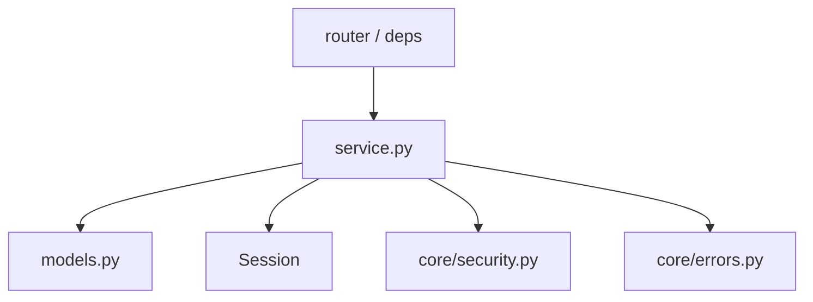
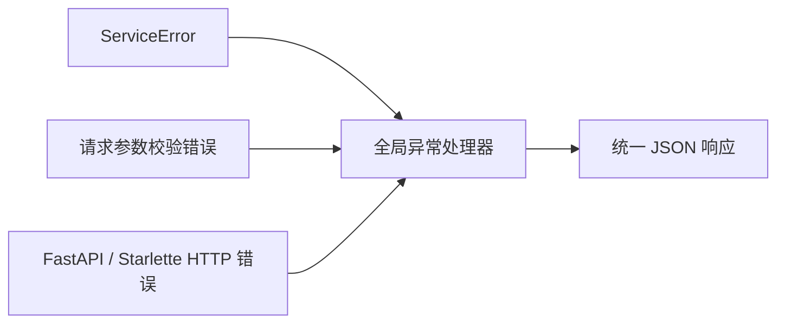
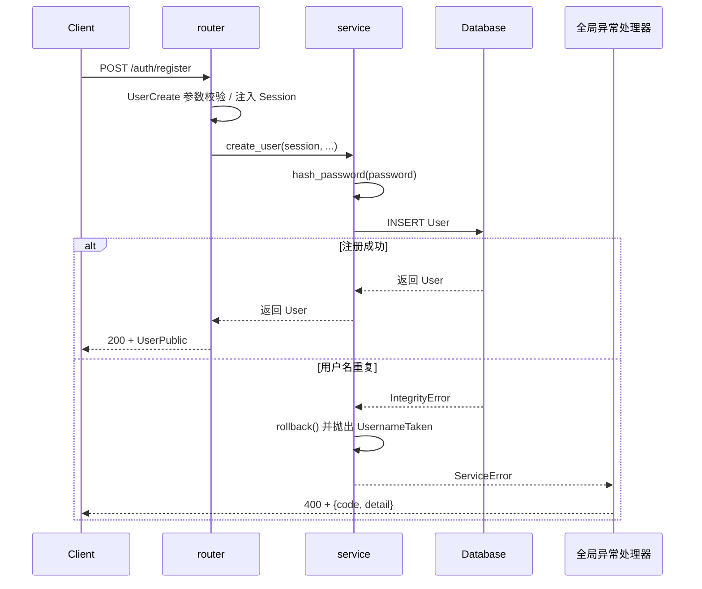

# 从零搭建一个业务模块

## 以 auth 为例：从公共能力到接口请求链路

---

## 先确定组织方式：按业务拆分

- `modules/` 按业务领域组织代码，例如 `auth` 管理认证相关功能。
- 每个模块包含自己的数据模型、数据结构、业务逻辑和 API。
- `core/` 放多个模块可以复用的基础能力。
- `main.py` 负责创建应用，并把各部分组装起来。

一个模块围绕一项业务组织，而不是把所有模型、路由和服务放进全局目录。

---

## 项目结构：公共能力与业务模块

```text
ta-backend/
├── main.py
├── core/
│   ├── config.py
│   ├── database.py
│   ├── errors.py
│   └── security.py
└── modules/
    └── auth/
        ├── models.py
        ├── schemas.py
        ├── service.py
        ├── deps.py
        └── router.py
```

| 位置 | 职责 |
| --- | --- |
| `core/` | 配置、数据库、统一错误处理、安全工具 |
| `modules/auth/` | 认证业务自身的数据、逻辑与接口 |
| `main.py` | 应用生命周期、全局处理器、路由注册 |

---

## 一个模块中的五个文件

| 文件 | 主要职责 |
| --- | --- |
| `models.py` | 定义数据库表及字段 |
| `schemas.py` | 定义请求、响应的数据结构与校验规则 |
| `service.py` | 实现业务规则，组织数据读写 |
| `deps.py` | 定义请求过程中需要注入的依赖 |
| `router.py` | 定义 API 路径，接收请求并返回响应 |

**核心分工：** `models` 描述数据如何存储，`schemas` 描述 API 如何收发数据，`service` 负责业务本身。

---

## 先准备公共能力：core/

- `config.py`：集中管理数据库地址、JWT 密钥、算法和有效期；当前硬编码值仅用于本地开发。
- `database.py`：创建数据库引擎，提供请求级 `Session`。
- `security.py`：提供密码哈希、密码校验和 JWT 操作。
- `errors.py`：定义统一错误类型，并转换成 HTTP 错误响应。

这些能力不属于某一个具体接口，由业务模块按需调用。

---

## 数据库连接：database.py

```python
def get_session() -> Iterator[Session]:
    with Session(engine) as session:
        yield session


SessionDep = Annotated[Session, Depends(get_session)]
```

- `get_session()` 为请求提供一个 `Session`，请求结束后自动关闭。
- `SessionDep` 是依赖别名，路由或依赖函数通过参数声明即可获得 Session。
- `init_db()` 先导入表模型，再调用 `SQLModel.metadata.create_all()` 建表。

模型必须先被导入，SQLModel 才能发现需要创建的表。

---

## 第 1 步：models.py —— 定义数据库表

```python
class User(SQLModel, table=True):
    id: int | None = Field(default=None, primary_key=True)
    username: str = Field(index=True, unique=True)
    password_hash: str
```

- `table=True` 表示 `User` 会映射为数据库表。
- 字段对应数据表中的列；`id` 是主键，`username` 有唯一约束和索引。
- 密码只保存哈希值，不保存明文。

先明确业务数据如何持久化，再围绕它设计接口。

---

## 第 2 步：schemas.py —— 定义 API 数据结构

::: cols 1fr 1fr

```python
class UserCreate(BaseModel):
    username: str = Field(min_length=3, max_length=32)
    password: str = Field(min_length=6)

class UserLogin(BaseModel):
    username: str
    password: str
```

**请求模型**：描述客户端可以提交什么，并声明输入校验规则。

|||

```python
class UserPublic(BaseModel):
    model_config = ConfigDict(from_attributes=True)
    id: int
    username: str

class Token(BaseModel):
    access_token: str
    token_type: str = "bearer"
```

**响应模型**：描述接口返回什么。`UserPublic` 不包含密码字段，避免泄露内部数据。

:::

---

## 第 3 步：security.py —— 封装安全操作

```text
密码
  hash_password()    -> 生成带随机盐的 scrypt 哈希
  verify_password()  -> 校验输入密码

Token
  create_access_token() -> 签发 JWT
  decode_token()        -> 验签并检查有效期
```

- 密码使用带随机盐的 scrypt 哈希后再存入数据库。
- JWT 将用户名放入 `sub`，并携带过期时间，由密钥签名。
- 具体密钥、算法和有效期从 `core/config.py` 读取。

`security.py` 只提供安全操作，何时调用由业务逻辑决定。

---

## 第 4 步：service.py —— 组织业务逻辑



`service.py` 负责把数据访问、安全操作和业务规则组织起来：

- 注册：哈希密码，创建用户并提交事务。
- 登录：查询用户、校验密码，签发 Token。
- 认证：解析 Token，再确认用户仍然存在。

它接收 `Session` 和普通参数，不直接处理 HTTP 请求。

---

## 注册处理：事务与业务异常

`create_user()` 展示了 service 的典型工作方式：

```python
def create_user(session: Session, username: str, password: str) -> User:
    user = User(username=username, password_hash=hash_password(password))
    session.add(user)
    try:
        session.commit()
    except IntegrityError:
        session.rollback()
        raise UsernameTaken("用户名已被占用") from None
    session.refresh(user)
    return user
```

- 先哈希密码，再创建并提交用户记录。
- 唯一约束冲突时回滚事务，并转换为业务异常。
- 提交成功后刷新对象，取得数据库生成的主键。

数据库异常在 service 内转换成业务语义，外层不需要了解数据库细节。

---

## 业务失败：用异常表达业务语义

```python
class UsernameTaken(ServiceError):
    code = ErrorCode.USERNAME_TAKEN

class InvalidCredentials(ServiceError):
    code = ErrorCode.INVALID_CREDENTIALS

class Unauthorized(ServiceError):
    code = ErrorCode.UNAUTHORIZED
```

- `ServiceError` 是统一的业务异常基类，定义在 `core/errors.py`。
- `auth/service.py` 为认证业务定义具体异常类型。
- service 遇到业务失败时直接 `raise`，不决定 HTTP 状态码。

业务层表达“发生了什么”，HTTP 层再决定“如何响应”。

---

## 统一错误出口：errors.py



- 通过 `ErrorCode` 标识具体错误，通过 `STATUS_BY_CODE` 映射状态码。
- 失败响应统一为 `{code, detail}`。
- 参数校验错误也被转换为 `400`；未找到资源返回 `404`。

正常响应为 `200`；业务错误映射到 `400`、`401` 或 `404`。HTTP 异常处理中，当前代码还会保留框架给出的 `403`。

---

## 第 5 步：deps.py —— 准备请求依赖

```python
def get_current_user(
    session: SessionDep,
    authorization: Annotated[str | None, Header()] = None,
) -> User:
    if not authorization or not authorization.lower().startswith("bearer "):
        raise service.Unauthorized("未登录或 token 无效")
    token = authorization.split(" ", 1)[1]
    return service.authenticate_token(session, token)
```

- 从 `Authorization` 请求头读取 Bearer Token。
- 通过 `SessionDep` 获取数据库会话。
- 调用 service 验证 Token 并查询用户，最后返回当前用户。

`deps.py` 负责从请求中准备依赖，不重复实现认证业务。

---

## 第 6 步：router.py —— 定义 HTTP 接口

| 路由 | 作用 | 返回模型 |
| --- | --- | --- |
| `POST /auth/register` | 注册用户 | `UserPublic` |
| `POST /auth/login` | 用户登录 | `Token` |
| `GET /auth/me` | 获取当前用户 | `UserPublic` |

```python
@router.post("/register")
def register(user: UserCreate, session: SessionDep) -> UserPublic:
    db_user = service.create_user(session, user.username, user.password)
    return UserPublic.model_validate(db_user)
```

`POST /register` 接收 `UserCreate`，通过 `SessionDep` 注入数据库会话，再调用 service。

`GET /me` 则通过 `Depends(get_current_user)` 注入当前用户；依赖函数负责鉴权，router 只需返回 `UserPublic`。

router 负责接收参数、调用 service、组织响应；具体业务规则不写在路由函数里。

---

## 第 7 步：main.py —— 组装应用

```python
app = FastAPI(lifespan=lifespan)
install_error_handlers(app)
app.include_router(auth_router)
```

- `lifespan`：启动时调用 `init_db()`，关闭时释放数据库连接池。
- `install_error_handlers()`：注册统一异常处理器。
- `include_router()`：把 auth 路由挂载到应用，前缀为 `/auth`。

`main.py` 不实现业务，只负责初始化资源和组装应用。

---

## 一次注册请求：从接口到数据库



参数校验由框架完成，业务操作由 service 完成，异常统一交给全局处理器。

---

## 新模块可以沿用这套搭建顺序

| 顺序 | 位置 | 主要工作 |
| --- | --- | --- |
| 1 | `core/` | 准备配置、数据库、错误处理等公共能力 |
| 2 | `models.py` | 定义业务数据表 |
| 3 | `schemas.py` | 定义请求和响应结构 |
| 4 | `service.py` | 实现业务规则与数据读写 |
| 5 | `deps.py` | 定义请求级依赖（需要时再加） |
| 6 | `router.py` | 定义接口并调用 service |
| 7 | `main.py` | 注册异常处理器、初始化资源、挂载路由 |

**记住分工：** `models` 管持久化，`schemas` 管数据格式，`service` 管业务，`deps` 管请求依赖，`router` 管 HTTP，`main` 管组装。
