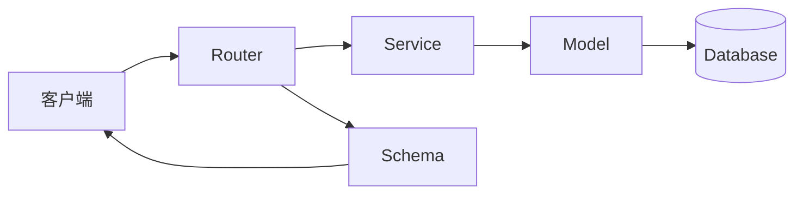
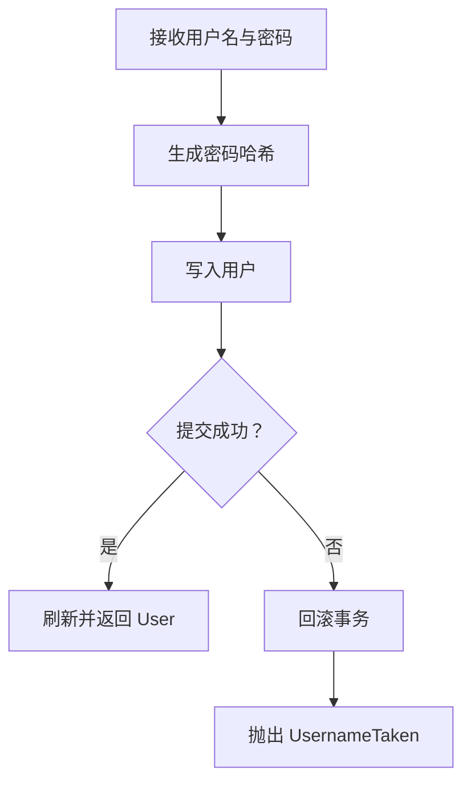

# FastAPI 模块开发流程

以 `modules/auth/` 为例，介绍如何在 `core/ + modules/<domain>/` 结构中开发一个业务模块。

从接口契约开始，逐步落实数据模型、业务逻辑和 HTTP 入口。每一层只负责自己的事情。

---

# 一、先理解整体结构

项目按职责分为两部分：

- `core/`：数据库、配置、错误处理、安全工具等共享基础设施。
- `modules/`：按业务领域组织代码，每个目录负责一组相对独立的业务职责。

`auth` 是认证模块，负责注册、登录和当前用户识别。

---

# 项目结构

```text
core/
  config.py       配置
  database.py     Engine、Session、建表
  errors.py       统一错误处理
  security.py     密码哈希与 JWT

modules/
  auth/
    deps.py       鉴权依赖
    models.py     用户表
    schemas.py    请求与响应模型
    service.py    认证业务逻辑
    router.py     HTTP 接口

main.py           应用入口与模块注册
```

目录按业务组织，文件按职责划分；不要为了文件数量而拆模块。

---

# 请求是怎样走通的



`Router` 接收请求，`Service` 执行业务，`Model` 对应数据库表，`Schema` 控制接口数据。

---

# 模块开发顺序

::: timeline
1. **确认边界**：判断是否需要独立业务模块
2. **定义接口**：明确入口、输入、输出和失败情况
3. **定义数据**：设计模型与数据库约束
4. **定义错误**：补充业务错误码
5. **定义 Schema**：落实请求与响应结构
6. **实现 Service**：编写业务规则与数据操作
7. **实现 Router**：将 HTTP 请求接到业务逻辑
8. **注册验证**：接入应用并检查主要路径
:::

先确定调用方需要什么，再决定内部如何实现。

---

# 二、确认模块边界

一个模块代表一组相对独立的业务职责，有自己的规则和清晰的边界。

- `auth`：注册、登录、身份验证。
- `resource`：资源相关的业务规则与操作。
- `core`：多个模块共同使用的基础设施。

不要仅因为代码多就拆模块，也不要把业务代码随意放进 `utils.py`。

---

# 三、先定义接口契约

先用文字确定接口，不急着写代码：

- 入口：请求方法与路径。
- 访问要求：公开接口，还是必须登录。
- 输入：字段、类型、必填项与约束。
- 输出：允许返回哪些字段。
- 失败：可能出现哪些业务错误。

接口是调用方与实现之间的边界，越晚修改，影响范围通常越大。

---

# auth 的接口

| 接口 | 用途 | 访问要求 |
| --- | --- | --- |
| `POST /auth/register` | 注册用户 | 公开 |
| `POST /auth/login` | 用户登录 | 公开 |
| `GET /auth/me` | 获取当前用户 | Bearer Token |

注册和登录接收用户名、密码；当前用户接口返回用户公开信息。

---

# 四、定义数据模型

`models.py` 描述数据库中的数据结构。`auth` 目前只有一张用户表：

```python
class User(SQLModel, table=True):
    id: int | None = Field(default=None, primary_key=True)
    username: str = Field(index=True, unique=True)
    password_hash: str
```

`table=True` 表示映射为数据库表；`id` 是自增主键。

---

# 数据约束交给数据库

`username` 使用 `unique=True`，由数据库保证用户名唯一。

- 插入前查询可以改善提示，但无法避免并发竞争。
- 唯一约束能在最终写入时拦截重复数据。
- `service` 捕获 `IntegrityError`，回滚事务并转换为业务错误。

`create_all()` 只创建缺失的表，不负责修改已有表结构；结构变更应使用迁移工具。

---

# 五、定义请求与响应 Schema

`schemas.py` 描述 API 的输入和输出，不负责数据库操作。

```python
class UserCreate(BaseModel):
    username: str = Field(min_length=3, max_length=32)
    password: str = Field(min_length=6)

class UserLogin(BaseModel):
    username: str
    password: str
```

注册时校验密码长度；登录只验证凭据，不重新要求旧密码满足注册规则。

---

# 响应只暴露需要的字段

```python
class UserPublic(BaseModel):
    model_config = ConfigDict(from_attributes=True)
    id: int
    username: str
```

响应模型不声明 `password` 和 `password_hash`，因此不会将它们作为公开字段输出。

`from_attributes=True` 允许从 ORM 对象读取字段；`Token` 则定义登录返回的 `access_token` 和 `token_type`。

---

# 六、统一业务错误

业务层只表达“发生了什么错误”，不决定 HTTP 响应。

```python
class UsernameTaken(ServiceError):
    code = ErrorCode.USERNAME_TAKEN
```

`core/errors.py` 集中维护错误码、状态码映射和异常处理器。

| 错误 | HTTP 状态码 |
| --- | ---: |
| 参数校验失败、用户名重复、凭据错误 | 400 |
| 未登录或 Token 无效 | 401 |
| 路径或资源不存在 | 404 |

失败响应统一为 `{ "code": "...", "detail": "..." }`。

---

# 错误由全局处理器转换

`ServiceError` 由业务代码抛出，全局处理器根据 `ErrorCode` 转换响应。

- Pydantic 请求校验错误默认是 422，项目处理器将其统一转换为 400。
- Router 不需要为每种业务错误编写 `try/except`。
- 新增业务错误时，同时登记 `ErrorCode` 和 `STATUS_BY_CODE`。
- 当前代码对框架层的 403 有单独保留分支；若严格限制为四种状态码，需要同步调整该分支。

错误映射集中维护，业务逻辑不需要依赖 FastAPI 的状态码。

---

# 七、实现业务逻辑

`service.py` 只处理业务规则与数据，不导入 FastAPI、不读取请求头，也不构造 JSON 响应。

```python
def create_user(
    session: Session,
    username: str,
    password: str,
) -> User:
    ...
```

依赖通过参数显式传入；业务失败抛出 `ServiceError` 子类。

`auth.service` 提供查找用户、创建用户、登录和 Token 对应用户等操作。

---

# Service 处理数据与异常

注册流程由 Service 负责：



Service 可以返回本模块的 ORM 对象；跨模块调用时，不要让其他模块依赖它的内部模型结构。

---

# 八、处理认证依赖

`deps.py` 负责 HTTP 层的身份提取：

1. 从 `Authorization` 请求头读取 Bearer Token。
2. 检查请求头格式。
3. 调用 `service.authenticate_token()` 获取当前用户。

Token 的签发、验签和密码哈希由 `core/security.py` 提供；业务判断仍由 Service 完成。

---

# 九、实现 Router

Router 是 HTTP 适配层，只负责收参数、调用 Service、返回 Schema。

```python
@router.post("/register")
def register(user: UserCreate, session: SessionDep) -> UserPublic:
    db_user = service.create_user(
        session, user.username, user.password
    )
    return UserPublic.model_validate(db_user)
```

业务规则留在 Service；统一错误交给全局处理器，不在 Router 中重复处理。

---

# 十、接入应用

`main.py` 负责创建应用、安装错误处理器、注册 Router，并管理应用生命周期。

```python
app = FastAPI(lifespan=lifespan)
install_error_handlers(app)
app.include_router(auth_router)
```

应用启动时调用 `init_db()`；关闭时释放 Engine。`SessionDep` 为请求提供 Session。

---

# 不要漏掉模型注册

`init_db()` 中需要先导入所有 `table=True` 模型，再调用：

```python
SQLModel.metadata.create_all(enging)
```

导入模型是为了让 SQLModel 将表登记到 metadata；否则 `create_all()` 不知道需要创建哪些表。

新增模块时，也要把该模块的模型加入初始化导入。

---

# 十一、验证主要路径

按接口实际可能发生的情况验证，不必让每个接口机械覆盖所有错误类型。

| 场景 | 预期结果 |
| --- | --- |
| 注册成功 | 200，返回公开用户信息 |
| 用户名重复 | 400，`USERNAME_TAKEN` |
| 请求字段不合法 | 400，`VALIDATION_ERROR` |
| 登录凭据错误 | 400，`INVALID_CREDENTIALS` |
| 未携带或携带无效 Token | 401，`UNAUTHORIZED` |
| 请求不存在的路径 | 404，`NOT_FOUND` |

当前代码可先用 curl 做冒烟验证；长期维护应补充 pytest + TestClient。

---

# 开发时记住这些边界

::: cards 2
### Router

只处理 HTTP、依赖和 Schema 转换。

|||

### Service

只处理业务规则、数据读写和业务错误。

|||

### Models

描述数据库结构与持久化约束。

|||

### Schemas

描述 API 接收和允许返回的数据。
:::

模块内部可以使用自己的 ORM 模型；模块之间通过公开 Service 接口协作。

---

# 总结

**先定边界，再定接口；先明确数据与错误，再实现业务和 HTTP 入口。**

- 不为小函数创建模块，也不把业务逻辑塞进 `utils`。
- 数据库约束负责兜底，Service 将底层异常转换为业务错误。
- Schema 明确输入与输出，避免意外暴露内部字段。
- Router 保持薄，模块之间不依赖对方的内部模型。
