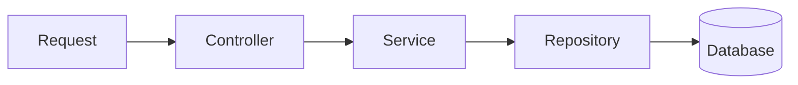
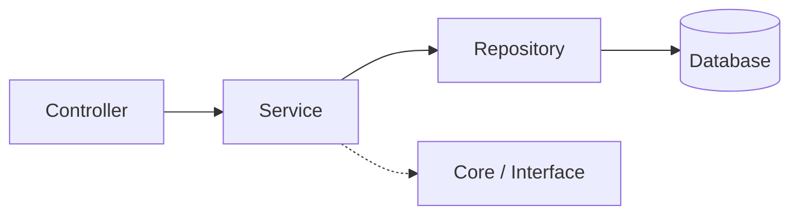

# 软件设计与架构

## Software Design & Architecture · 后端开发学习路线

---

## 这是什么领域

主要属于 **Software Engineering**，集中在两个方向：

- **Software Design**：如何设计代码、模块和组件
- **Software Architecture**：如何组织整个软件系统

::: note
软件工程的范围远不止架构，还包括需求分析、项目管理、测试、部署和维护。
:::

> 核心目标：设计职责清晰、依赖合理、易于测试和维护的软件。

---

## 知识地图

::: cols 1fr 1fr 1fr
**Design**

- Modularity
- Cohesion & Coupling
- Separation of Concerns
- SOLID
- Design Patterns

|||

**Architecture**

- Architectural Styles
- Layered
- Clean / Hexagonal
- DDD
- CQRS

|||

**Practices**

- Testing
- Refactoring
- Dependency Management
:::

---

## 一、模块化设计

**Modularity**：研究如何把复杂系统拆成职责明确的模块。

::: cols 1fr 1fr
- **Module** 模块及其边界
- **Cohesion** 高内聚
- **Coupling** 低耦合

|||

- **Information Hiding** 信息隐藏
- **Interface** 接口设计
- **Encapsulation** 封装
:::

::: tip
这是最值得优先学习的内容。文件组织、模块划分和架构设计都离不开模块化思想。
:::

---

## 二、职责分离

**Separation of Concerns**：把不同性质的问题分开处理。



后端系统里可以区分：HTTP 请求与响应、业务逻辑、数据访问、数据校验、外部服务交互。

::: note
职责分离不意味着每一种职责都必须拥有独立的目录、类或者文件。
:::

---

## 三、文件组织策略

::: cols 1fr 1fr 1fr
**按技术职责**

```text
app/
├── controllers/
├── services/
├── repositories/
├── models/
└── schemas/
```

|||

**按业务模块**

```text
app/
├── user/
│   ├── router.py
│   └── service.py
└── article/
    ├── router.py
    └── service.py
```

|||

**按用例**

```text
app/
├── users/
│   ├── create.py
│   └── delete.py
└── articles/
    └── publish.py
```
:::

---

## 四、架构模式

::: cols 1fr 1fr
- **MVC** Model / View / Controller
- **Layered** 按职责划分层次
- **Clean** 控制依赖方向
- **Hexagonal** Ports and Adapters

|||

- **DDD** 围绕业务领域建模
- **CQRS** 分离读写模型
- **Event-Driven** 通过事件组织交互
- **Microservices** 按服务拆分
:::

::: note
架构模式与文件组织策略不是同一回事。一个项目可以同时采用业务模块组织和 Clean Architecture。
:::

---

## 五、依赖管理



- Dependency / Dependency Injection / Inversion of Control
- Dependency Inversion Principle
- Circular Dependency（循环依赖）

::: note
重点：调用关系不一定等于依赖方向。
:::

---

## 六、软件设计原则

::: cols 1fr 1fr
| 原则 | 含义 |
| --- | --- |
| SRP | 单一职责 |
| OCP | 开闭 |
| LSP | 里氏替换 |

|||

| 原则 | 含义 |
| --- | --- |
| ISP | 接口隔离 |
| DIP | 依赖倒置 |

**其他**

- Composition over Inheritance
- DRY / KISS / YAGNI
:::

::: warn
设计原则是帮助权衡的指导思想，不是增加抽象层的理由。
:::

---

## 七、设计模式

::: cols 1fr 1fr
| 类别 | 示例 |
| --- | --- |
| 创建型 | Factory、Builder |
| 结构型 | Adapter、Decorator |
| 行为型 | Strategy、Observer |

|||

```python
def calculate(price, strategy):
    return strategy(price)

def discount(price):
    return price * 0.8

calculate(100, discount)  # 80
```
:::

::: tip
先理解要解决的问题，再学习对应的模式。不要为了用模式而用模式。
:::

---

## 八、领域驱动设计

**Domain-Driven Design**：围绕复杂业务领域组织软件。

::: cols 1fr 1fr
- **Domain** 领域 / 子领域
- **Bounded Context** 限界上下文
- **Entity** 实体
- **Value Object** 值对象
- **Aggregate** 聚合

|||

```text
E-commerce
├── Identity
├── Catalog
├── Ordering
├── Payment
└── Inventory
```
:::

::: note
DDD 不等于某种固定目录结构。它主要解决复杂业务的建模和边界划分。
:::

---

## 九、工程实践

::: cols 1fr 1fr
**要掌握**

- Unit / Integration / E2E Testing
- Refactoring 重构
- Mock / Stub 测试替身
- ADR 架构决策记录

|||

**要持续追问**

1. 模块能否独立测试？
2. 改一个模块会影响哪些其他模块？
3. 是否存在不必要的依赖？
4. 当前的抽象是否真的解决了问题？
:::

---

## 推荐学习顺序

::: cols 1fr 1fr
1. Modularity 模块化设计
2. Cohesion & Coupling
3. Separation of Concerns
4. Code Organization
5. Layered Architecture

|||

6. Dependency Management
7. SOLID 设计原则
8. Design Patterns
9. Clean / Hexagonal
10. DDD / CQRS
:::

::: tip
不需要一开始就学微服务、CQRS、DDD。先把单体应用的模块边界设计好。
:::

---

## 推荐资料：架构基础

**Fundamentals of Software Architecture** · Mark Richards、Neal Ford

[O'Reilly 页面](https://www.oreilly.com/library/view/fundamentals-of-software-architecture/9781492043454/)

适合建立整体的架构认知：

- 架构特征与架构风格
- 架构决策与权衡
- 架构如何演进

---

## 推荐资料：真实项目分析

**The Architecture of Open Source Applications**

[aosabook.org](https://aosabook.org/en/)

通过真实开源项目了解架构设计。重点不是记住目录结构，而是研究：

- 为什么采用这种组织方式？
- 模块边界如何确定？

---

## 推荐资料：代码重构

**Refactoring** · Martin Fowler

[martinfowler.com](https://martinfowler.com/books/refactoring.html)

重点学习：

- 提取函数与模块
- 移动函数与字段
- 简化条件逻辑、改善依赖关系

---

## 推荐资料：设计模式

**Refactoring Guru**

[refactoring.guru](https://refactoring.guru/design-patterns)

提供图示、解释和代码示例。建议重点学习：

- Strategy、Adapter
- Factory、Decorator
- Observer

---

## 实践：用 Python 建立认知

::: cols 1fr 1fr
```text
backend/
├── app/
│   ├── modules/
│   │   ├── user/
│   │   └── article/
│   ├── core/
│   ├── infrastructure/
│   └── main.py
├── tests/
└── pyproject.toml
```

|||

围绕一个小型 FastAPI 项目逐步尝试：

1. 实现基本 CRUD
2. 拆分 HTTP、业务逻辑和数据访问
3. 调整业务模块边界
4. 消除不必要的模块依赖
5. 编写测试并尝试重构
:::

---

## 学习目标

希望最终具备这些能力：

- 根据业务划分模块
- 判断代码应该放在哪里
- 理解模块之间的依赖关系
- 根据项目复杂度选择架构
- 识别过度设计与不必要的抽象
- 持续重构和改善项目结构

> 最重要的不是记住某种架构，而是理解为什么这样设计。
