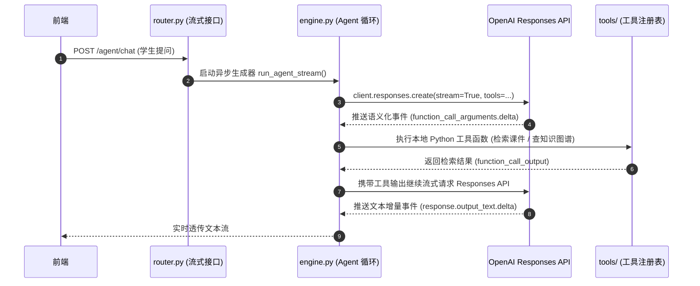
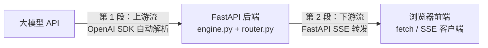
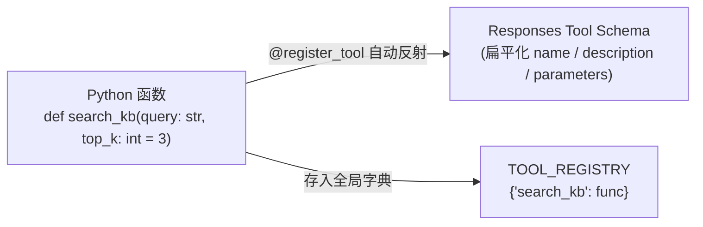

# 教学智能体 Agent 核心模块设计与实现
基于 OpenAI Responses API 流式输出与声明式工具框架的工程实践

---

## 目录

::: toc
:::

---

::: chapter 一、核心设计：教学智能体与普通聊天机器人的区别
为什么不能只写一个“一问一答”的接口？
:::

---

## 教学场景对 Agent 的三大工程要求

如果只是调用大模型接口转发文字，学生体验会非常差。一个合格的**教学智能体**必须在架构上解决三个核心问题：

::: cards 3
### 1. 极致的响应速度
讲解复杂知识点时，LLM 生成完一整段话往往需要 10–15 秒。**必须采用流式输出（Streaming）**，让前端像打字机一样逐字渲染，甚至攒够一句就送入 TTS 合成语音。

|||

### 2. 拒绝“瞎编”与“直接给答案”
教学 Agent 需要查课程大纲、检索知识图谱、批改代码或绘制结构图。**必须引入工具调用（Tool Calling）**，让模型按需查询资料后再回答。

|||

### 3. 可控的教学状态流转
苏格拉底式教学不能一上来就把作业答案吐出来。**需要清晰的多轮思考与上下文机制**，让模型先检索、推理，再组织教学语言。
:::

---

## 整体请求链路与模块划分

延续项目的分层思想，我们在 `modules/agent/` 下将 Agent 拆分为**流式接口层 $\rightarrow$ 编排循环层 $\rightarrow$ 工具注册表**：



---

::: chapter 二、OpenAI Responses API 流式输出机制
先看清“两段流式接力”的全局分工，再掌握每一层的标准用法
:::

---

## 为什么会有两套流式代码？看清“流式二传手”模型

出于**安全隔离**（不能把 API Key 暴露在前端）和**业务增强**（需要查课程知识库），浏览器不能直连大模型，必须由我们的 FastAPI 后端做中继。整条数据流分为**职责完全不同的两段**：



::: cards 2
### 第 1 段：后端 $\leftarrow$ 大模型（消费流）
* **用来做什么**：向大模型发请求，并接住它源源不断吐出的思考事件与文字碎片。
* **用什么工具**：**官方 `AsyncOpenAI` SDK**。它已经把底层网络字节流封装成了强类型的 Python 异步迭代器，直接 `async for` 即可。

|||

### 第 2 段：前端 $\leftarrow$ 后端（转发流）
* **用来做什么**：把后端拿到的文字碎片，以标准 HTTP 流的形式实时推送给浏览器渲染。
* **用什么工具**：后端用 **FastAPI `StreamingResponse`** 打包成 SSE 格式；前端用 **`fetch`（或 SSE 库）** 逐块读取。
:::

::: tip 为什么必须用 `AsyncOpenAI` 而不是同步的 `OpenAI`？
FastAPI 运行在单线程异步事件循环上。如果用同步的 `OpenAI()` 阻塞等待模型吐字，一个学生在提问时，其他所有用户的请求都会被卡死。
:::

---

## 第 1 段用法：用 `AsyncOpenAI` SDK 消费大模型流

在 `engine.py` 中，我们直接用官方 SDK 的 `responses.create(..., stream=True)` 发起请求。SDK 会自动帮我们完成网络解析，吐出带有明确 `type` 的事件对象：

```python
from openai import AsyncOpenAI

# 1. 初始化异步客户端（生产环境自动读取 OPENAI_API_KEY / OPENAI_BASE_URL）
client = AsyncOpenAI()

async def stream_from_llm(prompt: str):
    # 2. 开启 stream=True，返回的是一个异步事件流
    stream = await client.responses.create(
        model="gpt-4.1",
        input=prompt,
        stream=True,
    )
    # 3. 像遍历普通列表一样消费实时到达的事件
    async for event in stream:
        if event.type == "response.output_text.delta":
            yield event.delta  # 每收到几个字，立刻向上层吐出

```

---

## Responses API 的核心事件类型速查

相比旧版 Chat Completions 需要自己从 `choices[0].delta` 里猜字段，Responses API 的事件语义非常清晰，开发时只需关注这四个事件：

| 事件名称 (`event.type`) | 触发时机 | 我们在代码里拿它做什么 |
| :--- | :--- | :--- |
| **`response.output_text.delta`** | 模型每生成几个新字符时 | 取出 `event.delta`，立刻转发给前端渲染打字机效果 |
| **`response.output_item.done`** | 某个输出项（如工具调用）完整生成时 | 判断若为 `function_call`，取出完整函数名与参数去执行本地工具 |
| **`response.completed`** | 本轮大模型推理彻底结束时 | 记录 `event.response.id`，作为下一轮对话的 `previous_response_id` |
| **`error`** | 上游模型报错或限流时 | 捕获异常并向前端发送友好的错误提示帧 |

---

## 第 2 段用法（后端出口）：用 FastAPI 包装 SSE 协议

`engine.py` 已经通过 `yield` 源源不断吐出文本碎片了，但 HTTP 协议本身不知道什么时候算“一条消息”。**SSE（Server-Sent Events）就是用来给字节流划定边界的轻量级协议**——规定每条消息必须长成 `data: <内容>\n\n`：

::: cols 1.3fr 1fr

```python
# modules/agent/router.py
import json
from fastapi import APIRouter
from fastapi.responses import StreamingResponse
from modules.agent.engine import run_agent_stream

router = APIRouter(prefix="/agent", tags=["agent"])

@router.post("/chat")
async def chat_stream(req: ChatRequest, user: CurrentUser):
    async def sse_wrapper():
        async for delta in run_agent_stream(req.question, req.previous_response_id):
            # 一条 data: 加一个空行，才是一个合法的 SSE 帧
            yield f"data: {json.dumps({'delta': delta}, ensure_ascii=False)}\n\n"
        yield "data: [DONE]\n\n"  # 显式结束帧，前端据此收尾

    return StreamingResponse(
        sse_wrapper(),
        media_type="text/event-stream",
        headers={"Cache-Control": "no-cache", "X-Accel-Buffering": "no"},
    )

```

|||

::: warn 生产环境避坑：关闭代理缓冲
响应头必须带上 **`X-Accel-Buffering: no`**！否则 Nginx 等反向代理会把流式响应攒成一大块再一次性发给前端，导致界面卡顿数秒后瞬间刷屏。
:::

::: tip 语音联动扩展点
在 `sse_wrapper()` 里转发文本时，一旦累积的文本遇到句号（`。`、`？`、`！`），即可异步推入 Fish Speech TTS 队列，实现**边生成文字边语音讲解**。
:::
:::

---

## 第 2 段用法（前端入口）：浏览器如何接收流？

由于浏览器自带的 `EventSource` API **只支持 `GET` 请求且不能带 `Authorization` 登录头**，前端统一使用开源库 **`@microsoft/fetch-event-source`** 来发起带鉴权的 `POST` 流式请求（无需手写底层字节解码）：

```typescript
import { fetchEventSource } from "@microsoft/fetch-event-source";

await fetchEventSource("/agent/chat", {
  method: "POST",
  headers: { "Content-Type": "application/json", Authorization: `Bearer ${token}` },
  body: JSON.stringify({ question: "什么是红黑树？" }),
  onmessage(ev) {
    if (ev.data === "[DONE]") return;
    const { delta } = JSON.parse(ev.data);
    answerText += delta; // 响应式框架会自动触发打字机逐字渲染
  },
});

```

---

::: chapter 三、搭建可扩展的工具框架（Tool Framework）
拒绝手写冗长的 JSON Schema，用装饰器实现“写函数即注册工具”
:::

---

## 为什么不要手写 OpenAI Tool JSON Schema？

每次给教学 Agent 增加新技能（查课件、查学生进度、运行代码沙箱），如果都要手写几十行描述参数的 JSON Schema，代码会迅速膨胀且极易与函数签名不一致。

**工程最佳实践**：利用 Python 的 **类型注解（Type Hints）+ 文档字符串（Docstring）+ Pydantic**，通过 `@register_tool` 装饰器自动反射生成 Responses API 所需的工具定义。



---

## 工具注册表核心实现（`modules/agent/tools.py`）

不到 40 行代码即可构建一个高内聚、类型安全的工具框架（注意 Responses API 的工具结构比 Chat API 更扁平）：

::: cols 1.3fr 1fr

```python
# modules/agent/tools.py
from typing import Callable, Any
from pydantic import TypeAdapter
import inspect

TOOL_REGISTRY: dict[str, Callable] = {}
TOOL_SCHEMAS: list[dict[str, Any]] = []

def register_tool(func: Callable) -> Callable:
    """装饰器：自动将 Python 函数注册为 Responses API 工具"""
    name = func.__name__
    doc = inspect.getdoc(func) or ""
    # 利用 Pydantic 自动从函数类型注解生成 JSON Schema
    schema = TypeAdapter(func).json_schema()

    TOOL_REGISTRY[name] = func
    TOOL_SCHEMAS.append({
        "type": "function",
        "name": name,
        "description": doc,
        "parameters": schema,
    })
    return func

```

|||

### 业务开发者如何新增工具？

未来团队成员只需要像写普通函数一样加上装饰器，Agent 就能立刻学会新技能：

```python
@register_tool
def search_course_material(keyword: str, chapter: int | None = None) -> str:
    """检索课程讲义与课件内容。当学生询问具体课程概念或例题时调用。"""
    # 调用本地向量库或知识图谱
    results = kb_service.search(keyword, chapter=chapter)
    return "\n".join(results) if results else "未找到相关课件记录"

```

:::

---

## 编排循环（一）：发起一轮流式请求（`modules/agent/engine.py`）

Responses API 的流式事件与工具框架，靠 `previous_response_id` 串成多轮思考。代码分三页看：**发请求 → 收事件 → 回灌结果**。

```python
async def run_agent_stream(
    user_input: str, prev_id: str | None = None, max_turns: int = 5
):
    current_input: str | list[dict] = user_input
    response_id = prev_id

    for _ in range(max_turns):  # 限制思考轮数，防止模型死循环调工具
        stream = await client.responses.create(
            model="gpt-4.1",
            instructions=TEACHER_PROMPT,  # 教学人设：单独传，不进对话历史
            input=current_input,
            previous_response_id=response_id,
            tools=TOOL_SCHEMAS,
            stream=True,
        )
        pending_calls = []  # 本轮攒下的工具调用

```

---

## 编排循环（二）：边收事件边吐字

```python
        async for event in stream:
            if event.type == "response.output_text.delta":
                yield event.delta  # 正文增量：立刻吐给前端
            elif event.type == "response.output_item.done" \
                    and event.item.type == "function_call":
                pending_calls.append(event.item)  # 工具调用：先攒着，别执行
            elif event.type == "response.completed":
                response_id = event.response.id  # 记下上下文指针

        if not pending_calls:
            break  # 模型没要工具，本轮回答已全部生成

```

---

## 编排循环（三）：执行工具，把结果喂回下一轮

```python
        # 有工具调用：执行后封装成 function_call_output，回到循环顶部
        current_input = [
            {
                "type": "function_call_output",
                "call_id": call.call_id,
                "output": str(await execute_tool(call.name, call.arguments)),
            }
            for call in pending_calls
        ]

```

---

::: chapter 四、教学智能体进阶补充建议
让 Agent 从“能用”走向“像一位真正的助教”
:::

---

## 三个能显著提升教学体验的工程细节

在基础的 `Responses API + Tools` 跑通后，建议按优先级补充以下三个机制：

::: timeline

1. **指令与上下文分离（`instructions` 动态注入）**：利用 Responses API 的 `instructions` 参数单独传递教学人设与当前章节大纲，它不会被污染进多轮对话历史中，保证每轮推理都牢记“引导而非直接给答案”的红线。
2. **工具执行超时与降级兜底**：在 `execute_tool()` 中必须包裹 `try/except` 和 `asyncio.timeout(10)`。一旦知识库检索超时，将 `"工具暂时不可用，请基于通用知识引导学生"` 作为 `output` 返回给模型，避免流式响应中途崩溃。
3. **语义断句驱动 TTS 合成**：在 `run_agent_stream` 外层包一层按标点切分的缓冲区，每当 `event.delta` 拼出完整的一句话就异步请求 Fish Speech，把端到端首字语音延迟压缩到 1.5 秒以内。
:::
