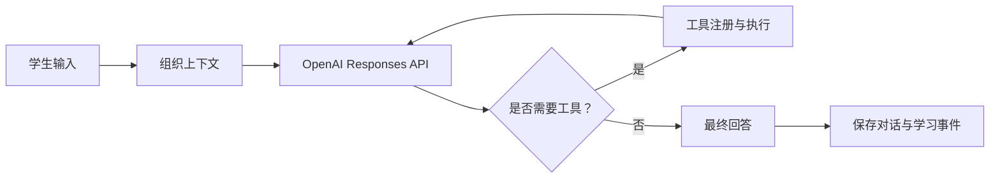
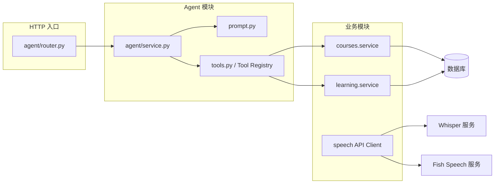
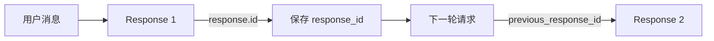
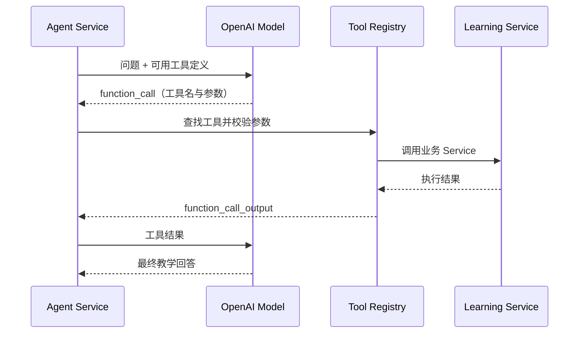
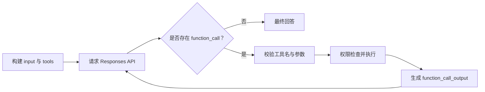
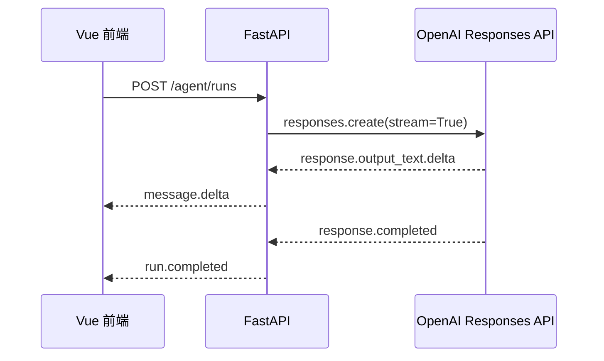
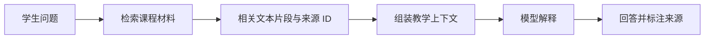
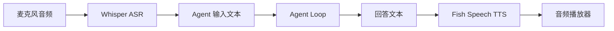

# 教学智能体 Agent 模块构建指南

从一次模型调用开始，构建具备上下文、工具和流式交互能力的教学 Agent

---

## 目录

::: toc
:::

---

::: chapter 一、先建立 Agent 的整体心智模型
Agent 不只是一次 LLM 请求，而是由后端控制的一段工作流
:::

---

## 真实开发者的第一步：不是先写一个聊天接口

最简单的聊天接口只是把用户文本发给模型，再把模型回答返回。教学智能体还需要知道学生正在学什么、当前课程进度如何、答题结果是什么，以及下一步应该调用什么能力。



::: tip 核心认知
模型负责理解问题、生成回答和提出工具调用请求；**后端负责状态、权限、工具执行、数据持久化和整个运行循环**。不要把控制权交给模型。
:::

---

## 教学智能体与普通聊天机器人的区别

| 普通聊天 | 教学智能体 |
| --- | --- |
| 主要维护对话历史 | 还要读取课程与学习状态 |
| 回答问题即可 | 解释、提问、练习、反馈、追踪进度 |
| 上下文以聊天记录为主 | 上下文还包括知识点、材料和学习证据 |
| 结束于一条回复 | 可能经过多轮工具调用后才完成一轮教学 |

教学智能体不是“接入一个更聪明的模型”就完成了。真正的业务价值来自课程材料、教学流程和学习状态的可靠组织。

---

## 推荐的整体模块边界



---

## 推荐的整体模块边界（续）

以 FastAPI 后端为例，Agent 不应该直接接管课程、学习记录和语音服务的全部代码。

建议职责：

- `agent`：模型调用、工具循环、上下文组装、流式事件。
- `courses`：课程、章节、课件和知识点数据。
- `learning`：学生进度、答题记录、掌握程度和学习事件。
- `speech`：Whisper / Fish Speech 的 HTTP 客户端与音频处理。
- `core`：配置、数据库会话、日志和统一错误处理。

模块之间调用公开 Service，不要让 Agent 工具直接跨模块操作对方的 ORM 模型。

---

::: chapter 二、先把一次 Agent 运行设计清楚
从请求契约到上下文，再到模型与工具
:::

---

## 一次教学对话需要哪些上下文？

不要把所有信息都塞进一条超长 Prompt。先区分“当前请求需要什么”，再按需加载。

::: cards 2

### 对话上下文

- 最近几轮对话
- 当前用户输入
- 当前会话和消息 ID
- 需要时附加历史摘要

|||

### 教学上下文

- 当前课程、章节和知识点
- 教师提供的材料片段
- 学生当前学习进度
- 已有答题记录与掌握证据

:::

一个关键原则：**聊天历史不等于学习状态。** 学生说“我懂了”不代表知识点已经掌握；学习状态应由练习、评估和学习事件形成可追溯的记录。

---

## 先定义 Agent 的 HTTP 契约

建议先让前端只负责提交一次用户输入，后端负责组织上下文和运行 Agent。

```text
POST /agent/runs

请求：
{
  "session_id": "会话 ID",
  "message": "什么是数据库事务？"
}

响应：text/event-stream
```

后端根据登录用户识别学生身份，并从数据库加载课程与学习状态。不要相信前端传入的 `user_id`、掌握程度或权限字段。

::: note Session 与 Run 的区别
**Session** 是一段长期对话；**Run** 是这段对话中的一次执行过程。一次 Run 可能包含多轮模型请求、多个工具调用和一条最终回答。
:::

---

## 一次 Run 的完整生命周期

::: timeline

1. **接收请求**：验证用户身份、会话归属和输入格式。
2. **组装上下文**：读取课程内容、学习状态和近期对话。
3. **请求模型**：通过 OpenAI SDK 调用 Responses API。
4. **处理增量事件**：把文本增量转成应用自己的 SSE 事件。
5. **执行工具**：校验参数与权限，调用课程或学习模块。
6. **继续模型循环**：把工具结果交还模型，直到生成最终回答。
7. **持久化**：保存消息、工具结果、学习事件和运行状态。
:::

---

::: chapter 三、使用 OpenAI Python SDK 调用模型
先掌握 Responses API，再增加工具和流式输出
:::

---

## 第一步：初始化 SDK，不要把密钥放进前端

后端安装官方 Python SDK：

```bash
pip install openai
```

密钥通过环境变量注入，配置文件只保存变量名，不保存真实密钥：

```bash
export OPENAI_API_KEY="替换为自己的 API Key"
export OPENAI_MODEL="项目实际使用的模型 ID"
```

使用 `AsyncOpenAI` 适配 FastAPI 异步路由：

```python
from openai import AsyncOpenAI

client = AsyncOpenAI()
```

生产项目应在应用生命周期中创建并复用 Client，在应用关闭时释放连接；不要每个请求都重新创建一个客户端。

---

## 第二步：先跑通最普通的一次 Responses API 请求

Responses API 是当前 OpenAI SDK 文档重点推荐的接口。先不加工具、不做流式输出，确认密钥、网络和模型权限都正常。

```python
response = await client.responses.create(
    model=settings.OPENAI_MODEL,
    instructions="你是一名循序渐进的数据库课程助教。",
    input="用一个简单例子解释数据库事务。",
)

print(response.output_text)
```

这里需要理解三个概念：

| 参数 | 作用 |
| --- | --- |
| `model` | 使用哪个模型 |
| `instructions` | 本次模型请求的行为约束 |
| `input` | 本次输入，可以是文本或结构化消息 |

先验证一次完整请求，再处理工具调用和流式事件。这样出现问题时，可以明确是模型连接问题还是 Agent 逻辑问题。

官方文档：[OpenAI Python SDK](https://developers.openai.com/api/reference/python) · [Responses API](https://developers.openai.com/api/docs/guides/text)

---

## 第三步：理解多轮上下文如何延续

模型 API 不会自动知道你的数据库里有哪些会话。应用必须决定如何保存和恢复上下文。

一种方式是由应用维护消息历史，每轮把必要的历史重新传入；另一种方式是使用 Responses API 的 `previous_response_id` 或 Conversations API 延续上下文。



::: warn 不要只依赖模型端的对话历史
课程进度、学生答题记录和知识点掌握状态必须保存在自己的数据库。模型端的会话上下文只是对话延续机制，不应该成为项目唯一的数据来源。
:::

还要注意数据保留策略：Responses 对象默认有保留行为；对学生数据应明确评估是否设置 `store=False`，并根据所选上下文方案决定由应用持久化哪些消息和事件。示例 Agent Loop 使用 `previous_response_id` 延续响应；若关闭存储，就要由应用保存并按 API 要求重放上下文，不能只保留一个 Response ID。

参考：[Conversation State](https://developers.openai.com/api/docs/guides/conversation-state)

---

::: chapter 四、工具框架：让模型请求能力，而不是直接执行代码
Function Calling 只描述调用意图，真正执行权始终在后端
:::

---

## Function Calling 到底做了什么？

模型可以根据工具定义，返回一个结构化的函数调用请求。但它不会替你的服务器执行 Python 函数。



因此至少要区分三件事：**工具声明、工具执行、工具结果回传**。把这三件事混在 Router 里，会很快失去边界。官方参考：[Function Calling](https://developers.openai.com/api/docs/guides/function-calling)

---

## 教学智能体第一批应该有哪些工具？

工具应该围绕教学任务设计，而不是把数据库每个 CRUD 接口都暴露给模型。

| 工具 | 用途 | 类型 |
| --- | --- | --- |
| `get_current_lesson` | 获取当前课程与教学目标 | 只读 |
| `search_course_materials` | 搜索教师课件和参考资料 | 只读 |
| `get_learner_progress` | 获取知识点学习状态 | 只读 |
| `submit_answer` | 提交练习答案并触发评估 | 写入 |
| `record_learning_event` | 记录练习、提示和学习行为 | 写入 |

MVP 不需要一次实现十几个工具。先选择一个能支撑完整教学闭环的组合：读取当前课程、搜索材料、出题、提交答案、记录结果。

::: tip 工具不是越多越好
工具数量越多，模型越容易选错，Prompt 和参数也越难维护。先做少量、命名清晰、输入输出稳定的工具。
:::

---

## 每个工具都应该有明确的输入、执行器和权限

建议工具注册表统一保存工具名称、说明、参数 Schema 和执行函数。参数使用 Pydantic 校验，执行函数调用对应模块的公开 Service。

```python
from pydantic import BaseModel

class LessonArgs(BaseModel):
    lesson_id: str

async def get_current_lesson(ctx, args: LessonArgs):
    # ctx 中的 user_id 来自后端认证结果，不由模型决定
    return await courses.service.get_lesson(
        ctx.session,
        lesson_id=args.lesson_id,
        user_id=ctx.user_id,
    )
```

```python
TOOL_REGISTRY = {
    "get_current_lesson": {
        "args_model": LessonArgs,
        "handler": get_current_lesson,
        "permission": "course:read",
    }
}
```

这里的 `ctx` 是运行上下文，负责提供当前用户、数据库 Session、课程范围和授权信息。模型只提供工具参数，不应该决定自己是谁、可以访问谁的数据。

---

## 工具 Schema：告诉模型能传什么参数

Responses API 的 Function Tool 定义包含 `name`、`description` 和 `parameters`。开启 Strict Mode 时，参数 Schema 必须满足严格格式要求。

```python
lesson_tool = {
    "type": "function",
    "name": "get_current_lesson",
    "description": "获取当前学生正在学习的课程内容。",
    "parameters": {
        "type": "object",
        "properties": {
            "lesson_id": {"type": "string"}
        },
        "required": ["lesson_id"],
        "additionalProperties": False
    },
    "strict": True
}
```

::: warn Strict Mode 不等于权限控制
Strict Mode 只能约束模型生成的参数结构，不能证明用户有权访问对应课程。执行器仍然必须检查当前用户、资源归属和操作权限。
:::

---

## 工具执行器：绝不直接相信模型给出的参数

模型返回的参数是外部输入。服务端必须先检查工具是否存在，再解析参数、验证权限，最后执行函数。

```python
async def execute_tool(name: str, raw_arguments: str, ctx):
    spec = TOOL_REGISTRY.get(name)
    if spec is None:
        raise UnknownToolError(name)

    args = spec["args_model"].model_validate_json(raw_arguments)
    authorize(ctx.user, spec["permission"])

    result = await spec["handler"](ctx, args)
    # handler 应返回 dict / list / Pydantic 数据，而不是 ORM 对象
    return result
```

工具结果应先转换成普通 JSON 数据（Pydantic 对象可用 `model_dump(mode="json")`），再以 `function_call_output` 返回模型；`call_id` 必须与原始调用一致：

```python
{
    "type": "function_call_output",
    "call_id": tool_call.call_id,
    "output": json.dumps(result, ensure_ascii=False)
}
```

初期建议禁用并行工具调用，先把执行顺序、错误处理和学习记录跑稳定；之后再允许互不依赖的只读工具并行执行。

---

::: chapter 五、Agent Loop：把模型与工具连接起来
模型请求、工具执行、结果回传，直到出现最终回答
:::

---

## Agent Loop 是整个模块的核心

一次模型请求可能没有工具调用，也可能要求调用一个或多个工具。后端需要循环处理，直到模型给出最终回答或达到轮数上限。



工具调用不是最终回答。**拿到工具结果后还要继续请求模型**，让模型结合真实结果组织教学表达。

---

## Agent Loop 的最小代码骨架

下面展示核心控制流程，省略数据库读写、异常映射和 SSE 编码。使用 `previous_response_id` 延续模型上下文；每次请求都重复传入 `instructions`，避免把本轮规则误认为会自动应用于后续请求。

```python
async def run_agent(user_text: str, ctx):
    response_id = None
    pending_input = [{"role": "user", "content": user_text}]

    for _ in range(MAX_TOOL_ROUNDS):
        stream = await client.responses.create(
            model=settings.OPENAI_MODEL,
            instructions=build_instructions(ctx),
            input=pending_input,
            tools=TOOL_SCHEMAS,
            parallel_tool_calls=False,
            previous_response_id=response_id,
            stream=True,
        )

        tool_calls = []
        async for event in stream:
            if event.type == "response.created":
                response_id = event.response.id
            elif event.type == "response.output_text.delta":
                yield {"type": "text_delta", "text": event.delta}
            elif event.type == "response.output_item.done":
                if event.item.type == "function_call":
                    tool_calls.append(event.item)
            elif event.type in ("response.failed", "response.incomplete", "error"):
                raise AgentModelError("模型请求未能正常完成")

```

---

## Agent Loop 的最小代码骨架（续）

```python
        if not tool_calls:
            yield {"type": "message_completed", "message_id": ctx.assistant_message_id}
            yield {"type": "run_completed"}
            return

        pending_input = []
        for call in tool_calls:
            yield {"type": "tool_started", "tool_name": call.name, "call_id": call.call_id}
            result = await execute_tool(call.name, call.arguments, ctx)
            yield {"type": "tool_completed", "tool_name": call.name, "call_id": call.call_id}
            pending_input.append({
                "type": "function_call_output",
                "call_id": call.call_id,
                "output": json.dumps(result, ensure_ascii=False),
            })

    raise AgentTurnLimitError("工具调用轮数超限")
```

::: warn 生产实现还要补齐
需要处理 `response.failed` / `response.incomplete`、工具超时、未知工具、无效参数、断线取消、运行轮数上限和持久化。上面的代码用于理解循环，不是完整生产代码。
:::

官方参考：[Responses Streaming Events](https://developers.openai.com/api/docs/guides/streaming-responses) · [Function Calling](https://developers.openai.com/api/docs/guides/function-calling)

---

::: chapter 六、流式输出与 SSE
把模型内部事件转换成前端稳定、简单的事件协议
:::

---

## 为什么不能等模型完整回答后再返回？

教学回答可能较长。普通 JSON 接口需要等模型生成完成才返回，用户只能看到一个持续转圈的页面。

开启流式输出后，模型生成一段文字，后端就可以把这段增量发给前端。



---

## OpenAI 的流事件，不要直接暴露给前端

Responses API 会发出语义化事件。常见事件包括：

| OpenAI 事件 | 含义 |
| --- | --- |
| `response.created` | 本轮 Response 已创建 |
| `response.output_text.delta` | 一段新增文本 |
| `response.function_call_arguments.done` | 工具参数生成完成 |
| `response.output_item.done` | 一个输出项完成 |
| `response.completed` | 本轮 Response 完成 |
| `response.failed` / `error` | 本轮失败 |

前端不应该绑定 OpenAI 的内部事件名称。后端应把它们映射成项目自己的事件协议，避免以后更换模型供应商时改动整个 Vue 页面。

---

## 设计一套前端稳定的 SSE 事件

建议第一版只保留几个事件类型：

| 应用事件 | 作用 | 典型数据 |
| --- | --- | --- |
| `run.started` | 本次执行开始 | `run_id` |
| `message.delta` | 文本增量 | `text` |
| `tool.started` | 开始执行工具 | `tool_name`、`call_id` |
| `tool.completed` | 工具执行完成 | `tool_name`、`summary` |
| `message.completed` | 最终消息完成 | `message_id` |
| `run.completed` | 本次执行结束 | `run_id`、状态 |
| `error` | 发生错误 | `code`、`message` |

SSE 每个事件都应包含明确的事件名和 JSON 数据。工具参数可以留在后端日志中，不必全部暴露给学生。

---

## FastAPI 如何把事件变成 SSE？

SSE 是一种文本事件流格式，每条消息以空行结束。FastAPI 的 `StreamingResponse` 可以直接消费生成器。

```python
import json
from fastapi import Request
from fastapi.responses import StreamingResponse

def encode_sse(event: str, data: dict) -> str:
    payload = json.dumps(data, ensure_ascii=False)
    return f"event: {event}\ndata: {payload}\n\n"

@router.post("/runs")
async def create_run(payload: RunRequest, request: Request, ctx: AgentContextDep):
```

---

## FastAPI 如何把事件变成 SSE？（续）

```python
    async def event_stream():
        yield encode_sse("run.started", {"run_id": ctx.run_id})
        try:
            async for item in run_agent(payload.message, ctx):
                if await request.is_disconnected():
                    return
                if item["type"] == "text_delta":
                    yield encode_sse("message.delta", {"text": item["text"]})
                elif item["type"] == "tool_started":
                    yield encode_sse("tool.started", item)
                elif item["type"] == "tool_completed":
                    yield encode_sse("tool.completed", item)
                elif item["type"] == "message_completed":
                    yield encode_sse("message.completed", item)
                elif item["type"] == "run_completed":
                    yield encode_sse("run.completed", {"run_id": ctx.run_id})
        except AgentError as exc:
            yield encode_sse("error", {"code": exc.code, "message": exc.detail})

    return StreamingResponse(
        event_stream(),
        media_type="text/event-stream",
        headers={"Cache-Control": "no-cache", "X-Accel-Buffering": "no"},
    )
```

真实项目还要增加工具开始 / 完成事件、错误事件、客户端断开检查，以及最终消息和运行状态的持久化。

---

## 前端为什么优先使用 fetch，而不是 EventSource？

浏览器原生 `EventSource` 适合连接一个 GET 事件流，但聊天接口通常需要 POST 请求体来提交用户消息和会话 ID，而 `EventSource` 本身不能携带任意 POST Body。因此，第一版推荐：**POST + fetch + ReadableStream + SSE 格式**。

```javascript
const response = await fetch("/agent/runs", {
  method: "POST",
  headers: { "Content-Type": "application/json" },
  body: JSON.stringify({ session_id, message }),
});

if (!response.ok || !response.body) {
  throw new Error("Agent 请求失败");
}

const reader = response.body.getReader();
const decoder = new TextDecoder();
let buffer = "";

while (true) {
  const { value, done } = await reader.read();
  if (done) break;

  buffer += decoder.decode(value, { stream: true });
  // 生产代码应按空行切分 SSE frame，保留未完整的 buffer。
  // 再解析 event 与 data，并按事件类型更新界面。
}
```

---

## 流式连接还需要考虑哪些边界？

::: cards 2

### 服务端

- 客户端断开时取消模型流
- 工具执行要有超时
- 长时间无事件时发送心跳注释
- 不要在代理层缓冲整个响应

|||

### 前端

- 处理不完整的 SSE frame
- 区分增量、完成和错误事件
- 用户主动停止时取消请求
- 页面卸载后释放读取器

:::

不要把 `response.completed` 直接等同于 Agent 完成：如果这一轮模型返回了工具调用，Agent 还要执行工具并继续下一轮模型请求。只有没有待执行工具且最终结果已保存，才发送 `run.completed`。

::: note EventSource 什么时候合适？
如果先创建 Run，再通过 `GET /agent/runs/{run_id}/events` 订阅事件，并且认证方式适配 EventSource，那么原生 `EventSource` 也可以使用。只是它不是最直接的聊天 POST 方案。
:::

---

::: chapter 七、让 Agent 真正具备教学能力
把课程材料、学习状态和教学流程纳入运行闭环
:::

---

## 课程材料检索：回答要有依据

如果教师提供了 PPT、讲义和视频转录，Agent 应先从课程材料中取回相关内容，再组织解释，而不是完全依赖模型记忆。



MVP 可以先用数据库中的章节文本和关键词检索，不必立刻搭建完整向量数据库。先保证材料可追溯，再根据检索效果引入 Embedding 和向量检索。

---

## 学习状态：不要让模型直接宣布学生掌握了知识

一次教学活动应形成可追溯的学习事件，例如：看过讲解、回答了练习、答错后接受提示、再次尝试并答对。

| 记录 | 示例 |
| --- | --- |
| 学习对象 | 事务隔离级别 |
| 活动类型 | 概念练习 |
| 学生答案 | `READ COMMITTED` |
| 评估结果 | 正确 / 部分正确 / 错误 |
| 证据 | 评分理由、题目 ID、时间 |
| 状态变化 | 掌握度更新或待复习 |

评估可以由规则、测试用例或模型辅助完成，但最终写入学习状态必须经过后端业务规则。不要给模型一个无约束的 `set_mastery(100)` 工具。

这里要区分两种能力：**Function Calling 用于请求执行动作**；**Structured Outputs 用于约束模型返回的数据结构**。例如让模型按固定 JSON 结构给出答案评价、理由和建议，再由后端校验并决定是否记录学习结果。结构合法不等于评价一定正确，业务规则仍然要兜底。

---

## 工具写操作需要更严格的边界

只读工具通常风险较低；写入学习记录、修改课程进度等工具会改变真实数据。

::: cols 1fr 1fr

### 只读工具

- 搜索课件
- 获取当前课程
- 查询知识点进度
- 获取最近答题记录

|||

### 写入工具

- 提交学生答案
- 记录一次练习结果
- 更新学习事件
- 完成课程单元

:::

写操作至少要检查用户权限、数据归属和参数范围；重要操作要设计幂等键，防止重试造成重复记录。模型提出操作，不代表业务规则允许执行。

---

## 语音接入：把 ASR / TTS 放在 Agent 外围

语音服务属于输入输出适配，不应该塞进 Agent Loop 的核心逻辑。



第一阶段先完成“录音上传 → 识别文字 → Agent 回答 → 生成音频”的完整链路。等文本交互可靠后，再考虑边识别边响应、句子级 TTS 和 WebSocket 实时语音。

不要直接把每个 token 都送去 TTS：文本分块、标点、句子边界和音频生成速度都需要协调，否则容易出现碎片化语音和播放顺序问题。

---

::: chapter 八、把它做成可维护的模块
最后补上安全、可观测性和测试
:::

---

## 推荐的 Agent 模块文件结构

初期保持少量文件；工具变多后再拆目录，不要一开始就造一套框架。

```text
modules/agent/
  router.py          # HTTP 入口与 SSE 响应
  schemas.py         # Run 请求、事件数据结构
  service.py         # Agent Loop 与上下文组装
  prompts.py         # 教学指令模板
  tools.py           # 工具 Schema、注册表与执行器
```

后续工具数量明显增长，再拆成 `tools/registry.py`、`tools/schemas.py`、`tools/handlers.py`。课程和学习业务仍留在各自模块。

---

## 安全与可靠性：模型输出始终是不可信输入

::: badges
bad API Key 不能发给浏览器
bad 不允许模型任意执行 Python / Shell
warn 工具参数必须重新校验
warn 每个工具都要检查用户与资源权限
ok 设置最大工具轮数、超时和取消机制
ok 记录 run_id、tool_call_id 和错误码
:::

此外，检索到的课件内容也应视为数据，而不是系统指令。不要让材料里的文字覆盖系统 Prompt 或绕过工具权限。

---

## 可观测性：一次 Run 发生了什么，必须能还原

建议每次运行至少记录：

- `run_id`、`session_id`、`user_id`
- 模型名称、Prompt 版本和开始 / 结束时间
- 输入输出 Token 用量与整体耗时
- 工具名称、参数摘要、执行结果和耗时
- 完成、失败、超时或取消状态

不要无差别记录完整音频、密钥和所有学生隐私内容。日志以排错所需为准，并按项目的数据保护要求设置保留期限。

---

## 测试应该围绕完整运行链路

| 测试层级 | 重点验证 |
| --- | --- |
| 工具单测 | 参数校验、权限、业务结果和异常 |
| Agent Loop | 无工具、单工具、多工具、达到轮数上限 |
| SSE | 事件顺序、增量文本、错误和结束事件 |
| 取消行为 | 前端断开后停止模型流与工具任务 |
| 教学流程 | 答错后提示、重新练习、学习记录更新 |
| 集成测试 | 使用 Mock 模型验证端到端请求 |

不要每次测试都调用真实模型。工具与循环逻辑可以使用 Mock 响应固定输入，只有少量集成测试需要真实 API。

---

## 开发推进顺序：先闭环，再增强

::: timeline

1. **最小对话**：完成一次 Responses API 请求和普通 JSON 返回。
2. **单工具调用**：实现一个只读课程工具，跑通 function calling。
3. **Agent Loop**：把工具结果交还模型，支持多轮调用和上限。
4. **SSE 输出**：流式返回文本增量、工具状态、完成和错误事件。
5. **学习状态**：增加答题、评估与学习事件写入。
6. **课程检索**：让解释基于教师材料，并能追溯来源。
7. **语音接入**：连接 Whisper 与 Fish Speech，形成语音闭环。
:::

::: tip 不要急着上多智能体
一个 Agent 加一组清晰工具，足以完成第一版教学闭环。只有当讲解、出题、评估等角色确实需要独立指令、模型配置和运行边界时，再考虑多 Agent 协作。
:::

---

## Agent 模块交付 Checklist

::: cards 2

### 核心运行

- [ ] OpenAI SDK 配置安全
- [ ] Responses API 可调用
- [ ] 上下文从业务模块加载
- [ ] Agent Loop 支持工具往返
- [ ] 最大轮数与超时生效

|||

### 交互与教学

- [ ] SSE 事件协议稳定
- [ ] 前端能解析增量文本
- [ ] 错误、取消和完成状态明确
- [ ] 课程材料能被检索
- [ ] 学习事件可持久化
- [ ] ASR / TTS 可独立调用

:::

---

## 补充：什么时候考虑 OpenAI Agents SDK？

OpenAI Python SDK 提供模型 API；**OpenAI Agents SDK** 则在其上增加 Agent、Runner、工具、Guardrails、Handoffs 和 Tracing 等更高层抽象。它不是同一个包，也不是实现 Agent 的前置条件。

当前项目建议先自己实现最小 Agent Loop，因为教学流程、学习状态和工具执行规则需要清晰可控。等出现多 Agent 委派、统一审批、复杂 Guardrails 或追踪需求时，再评估 Agents SDK 是否能减少维护成本。

参考：[OpenAI Agents SDK](https://openai.github.io/openai-agents-python/) · [Tools](https://openai.github.io/openai-agents-python/tools/) · [Tracing](https://openai.github.io/openai-agents-python/tracing/)

---

## 官方资料

- [OpenAI Python SDK](https://developers.openai.com/api/reference/python)：同步 / 异步 Client 与 Responses API。
- [Responses API Streaming](https://developers.openai.com/api/docs/guides/streaming-responses)：模型事件与流式输出。
- [Function Calling](https://developers.openai.com/api/docs/guides/function-calling)：工具定义、调用与结果回传。
- [Conversation State](https://developers.openai.com/api/docs/guides/conversation-state)：多轮上下文与 Response 延续。
- [FastAPI StreamingResponse](https://fastapi.tiangolo.com/advanced/custom-response/)：后端流式响应。
- [MDN Server-Sent Events](https://developer.mozilla.org/en-US/docs/Web/API/Server-sent_events/Using_server-sent_events)：SSE 事件格式与浏览器行为。
