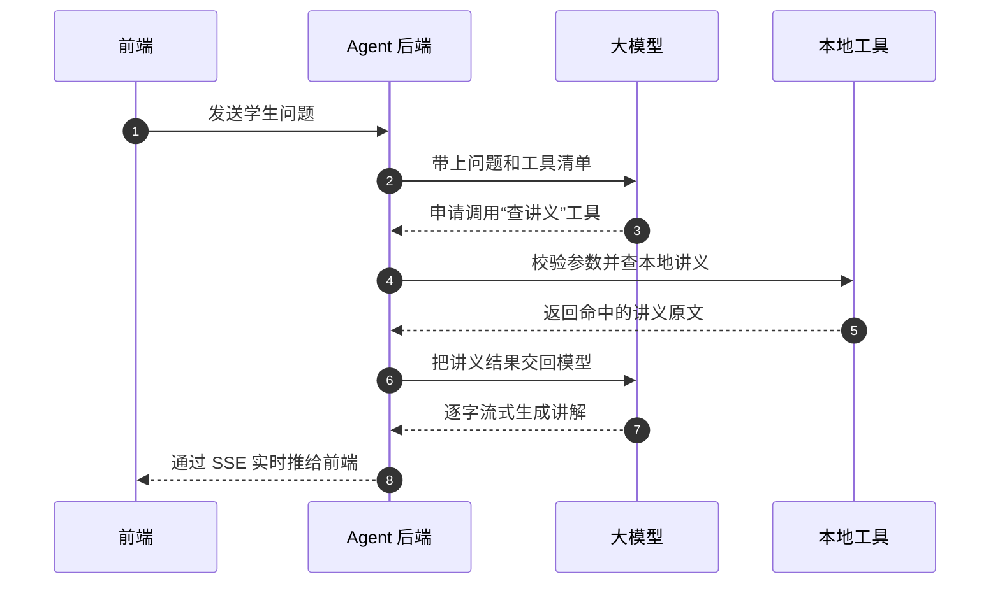
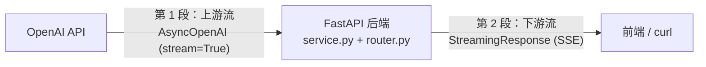
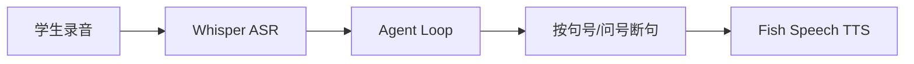

# Agent 模块设计与实现

从最小可用版本（MVP）起步，一步步搭建具备工具调用与流式输出的教学智能体 Agent

---

## 目录

::: toc
:::

---

::: chapter 一、先想清楚教学智能体是什么、第一版做到哪
先建立整体画面，再把第一版范围切小，保证很快能跑出一个可演示的闭环
:::

---

## 教学智能体和普通聊天接口差在哪？

如果只是把学生的话转发给大模型、等它写完再原样返回，教学体验会很差。一个可用的教学智能体，核心要解决三件事：

::: cards 3

### 响应要快，靠流式输出
讲解一道题或一个概念，模型写完往往要 10–15 秒。必须边生成边往前端推送，让界面逐字显示，后续也能按句送给语音合成。

|||

### 回答要有据，靠工具调用
不能全靠模型记忆讲课。要允许模型按需查课程讲义、查学生进度，拿到真实资料后再组织讲解。

|||

### 流程要可控，由后端掌权
模型负责理解问题、生成讲解和**提出**工具调用请求；真正的权限校验、工具执行、数据落库和循环控制始终由后端掌握。

:::

---

## 先定义一个能很快跑通的最小版本

教学 Agent 涉及大模型、工具、流式协议、数据库、检索和语音，一次性全做很容易卡在半路。更好的推进方式是**先切一个最小闭环（MVP）跑通，再一轮轮往上加能力**：

::: cols 1fr 1fr

### 第一版要做到

1. 后端能调用 OpenAI Responses API 回答问题；
2. 接入 **1 个只读工具**（先用内存里的几段示例讲义模拟课件检索），跑通“查资料 → 再回答”的循环；
3. 支持 **SSE 流式输出**，能实时推送工具状态和逐字文本。

|||

### 先不做，留到后续迭代

- 真实课程表和向量数据库（MVP 先用内存列表代替）；
- 答题评分、知识点掌握度更新等写入工具；
- 对话历史入库、语音（ASR / TTS）联动、多 Agent 分工。

:::

> **MVP 验收标准**：在终端用 `curl -N` 发出一个课程问题，能按顺序看到 `tool.started` → `tool.completed` → 逐字冒出的 `message.delta` → `run.completed`。

---

## 它在后端中的位置与整体链路

收到一个学生问题后，**模型只负责思考和提出“要查什么资料”，真正查讲义、控流程和往前端推字都由后端完成**：

::: tabs 一次提问的完整流程 | 模块目录结构



- 后端在中间做“**两段流中继**”：对上消费大模型流，对下转成项目自己的 SSE 事件，同时把工具执行过程（如“正在查阅课件…”）实时通知前端。

|||

沿用 `ta-backend` 的模块划分，在 `modules/agent/` 下按职责拆成 5 个文件：

```text
modules/agent/
  router.py   # HTTP 入口与 SSE 流式响应封装
  schemas.py  # 请求体与事件数据结构
  service.py  # Agent 循环：与大模型对话、调度工具、转发流
  prompts.py  # 助教角色与教学引导提示词
  tools.py    # 本地工具注册表与执行入口
```

- **路由层极薄**：`router.py` 只负责鉴权、收参和返回流，不写模型循环。
- **工具层独立**：`tools.py` 统一管理提供给模型的工具定义与执行，便于单独测试。

:::

---

::: chapter 二、一步步实现最小版本
拆成五小步，每完成一步就立刻验证一次，确认跑通再往后走
:::

---

## 第一步 装依赖、配密钥、准备异步客户端

沿用 `ta-backend` 的 `pydantic-settings` 配置体系，通过 `.env` 注入密钥和模型名：

::: cols 1.15fr 1fr

```bash
cd ta-backend
uv add openai
```

```ini
# ta-backend/.env（不要提交到仓库，同步在 .env.example 留模板）
OPENAI_API_KEY=替换为你的 API Key
OPENAI_MODEL=gpt-4.1
```

```python
# core/config.py（Settings 追加字段）
openai_api_key: str
openai_model: str = "gpt-4.1"
```

|||

```python
# 在应用启动时（main.py 的 lifespan）创建并复用，关闭时释放
from openai import AsyncOpenAI
from core.config import settings

client = AsyncOpenAI(api_key=settings.openai_api_key)
```

- **为什么用 `AsyncOpenAI` 而不是 `OpenAI`？** FastAPI 运行在单线程异步事件循环上，用同步客户端等模型吐字会卡住其他请求。
- **为什么放进 `lifespan`？** 连接池可跨请求复用，避免每次请求重复建连。

:::

---

## 第二步 先跑通一次最普通的对话

先排除网络、密钥和模型名的问题，建好 `modules/agent/` 并写一个最简单的 `POST /agent/chat`，挂到 `main.py` 里：

::: tabs schemas.py & router.py | service.py | 立刻验收第二步

```python
# modules/agent/schemas.py
class ChatRequest(BaseModel):
    message: str = Field(min_length=1)

class ChatReply(BaseModel):
    reply: str
```

```python
# modules/agent/router.py
@router.post("/chat")
async def chat(req: ChatRequest) -> ChatReply:
    reply = await service.chat_once(req.message)
    return ChatReply(reply=reply)
```

|||

```python
# modules/agent/service.py
async def chat_once(message: str) -> str:
    resp = await client.responses.create(
        model=settings.openai_model,
        instructions="你是计算机课程助教，优先引导学生思考。",
        input=message,
    )
    return resp.output_text
```

|||

1. 在 `main.py` 里执行 `app.include_router(agent_router)`；
2. 启动服务：`uv run dev`；
3. 打开 `http://127.0.0.1:3000/docs`，调用 `POST /agent/chat`，传入 `{"message": "用一句话解释什么是数据库事务"}`。

能正常收到一段教学回答，说明模型链路已打通，可以进入下一步。

:::

---

## 第三步 加上第一个工具，先用内存模拟课件检索

Function Calling 的本质是：**模型不会替你运行 Python 函数**，它只返回“想调哪个工具 + 参数 JSON”，真正校验和执行的是我们后端。下面两栏均写在同一个文件 `modules/agent/tools.py` 中：

::: cols 1.2fr 1fr

### 1. 注册表与执行入口（`tools.py`）

```python
TOOL_REGISTRY: dict[str, tuple[type[BaseModel], Callable]] = {}
TOOL_SCHEMAS: list[dict] = []

def register_tool(args_model: type[BaseModel]):
    def decorator(func: Callable):
        schema = args_model.model_json_schema()
        schema["additionalProperties"] = False
        TOOL_REGISTRY[func.__name__] = (args_model, func)
        TOOL_SCHEMAS.append({
            "type": "function", "name": func.__name__,
            "description": inspect.getdoc(func) or "",
            "parameters": schema, "strict": True,
        })
        return func
    return decorator

async def execute_tool(name: str, raw_args: str, ctx) -> str:
    args_model, func = TOOL_REGISTRY[name]
    return await func(ctx, args_model.model_validate_json(raw_args))
```

|||

### 2. 注册第一个只读工具（`tools.py`）

```python
# MVP 示例讲义（后续迭代替换成查数据库）
DEMO_NOTES = [
    "【第3章 事务】事务是不可分割的操作序列，满足 ACID 特性。",
    "【第3章 隔离级别】包括读未提交、读已提交、可重复读和串行化。",
]

class SearchArgs(BaseModel):
    keyword: str

@register_tool(SearchArgs)
async def search_course_materials(ctx, args: SearchArgs) -> str:
    """按关键词检索课程讲义。学生问具体课程概念时调用。"""
    hits = [n for n in DEMO_NOTES if args.keyword in n]
    return "\n".join(hits) if hits else "未找到匹配讲义"
```

:::

---

## 第四步 写通多轮调用循环，让模型“查完再答”

在 `modules/agent/service.py` 新增 `run_agent_once()`，把“调用模型 → 执行工具 → 回传结果”串成循环：

::: cols 1.4fr 0.9fr

```python
# modules/agent/service.py
async def run_agent_once(user_text: str, ctx, max_turns: int = 5) -> str:
    pending_input: str | list[dict] = user_text
    response_id: str | None = None

    for _ in range(max_turns):
        resp = await client.responses.create(
            model=settings.openai_model,
            instructions=TEACHER_PROMPT,
            input=pending_input,
            previous_response_id=response_id,
            tools=TOOL_SCHEMAS,
            parallel_tool_calls=False,   # 初期关闭并行，先把日志跑稳
        )
        response_id = resp.id
        calls = [i for i in resp.output if i.type == "function_call"]
        if not calls:
            return resp.output_text      # 无工具调用，返回最终回答
        pending_input = [
            {
                "type": "function_call_output",
                "call_id": c.call_id,
                "output": await execute_tool(c.name, c.arguments, ctx),
            }
            for c in calls
        ]
    raise AgentTurnLimitError("工具调用轮数超限")
```

|||

### 循环机制与验收

- 收到 `function_call` 后执行本地工具，把 `function_call_output` 交回模型，循环直至给出最终回答或达轮数上限。
- **立刻验收第四步**：将 `/agent/chat` 改为调用 `run_agent_once()`，在 `/docs` 提问“第 3 章有哪些隔离级别？”，确认终端打印工具调用日志且回复引用了 `DEMO_NOTES`。

:::

---

## 第五步 升级为流式输出，设计两段流与事件协议

工具循环跑稳后，把一次性返回改成流式。浏览器不能直连 OpenAI（会暴露密钥、也调不到本地工具），因此由后端做中继，整条流分成两段：



后端不要把 OpenAI 内部事件直接透传给前端，而是翻译成项目自己稳定、简洁的 SSE 事件，这样以后换模型供应商前端一行都不用改：

| 上游 OpenAI 事件 | 后端动作 | 推给前端的 SSE 事件 |
| --- | --- | --- |
| `response.output_text.delta` | 取出 `event.delta` 立即转发 | `message.delta` (`{"text": "..."}`) |
| `response.output_item.done` | 若为 `function_call` 则暂存，随后执行 | `tool.started` / `tool.completed` |
| `response.completed` | 记下 `event.response.id`；若无待执行工具则结束 | `run.completed` (`{"run_id": "..."}`) |
| `response.failed` / `error` | 捕获异常并通知前端收尾 | `error` (`{"code": "...", "detail": "..."}`) |

---

## 第五步 实现流式循环、路由封装与终端验收

::: tabs 流式循环（service.py） | 流式路由（router.py） | 终端与前端验收

```python
# modules/agent/service.py
async def run_agent_stream(user_text: str, ctx, max_turns: int = 5):
    pending_input, response_id = user_text, ctx.last_response_id
    for _ in range(max_turns):
        stream = await client.responses.create(
            model=settings.openai_model, instructions=build_teacher_prompt(ctx), input=pending_input,
            previous_response_id=response_id, tools=TOOL_SCHEMAS, parallel_tool_calls=False, stream=True)
        pending_calls = []
        async for ev in stream:
            if ev.type == "response.output_text.delta":
                yield {"event": "message.delta", "data": {"text": ev.delta}}
            elif ev.type == "response.output_item.done" and ev.item.type == "function_call":
                pending_calls.append(ev.item)
            elif ev.type == "response.completed":
                response_id = ev.response.id
            elif ev.type in ("response.failed", "response.incomplete", "error"):
                raise AgentModelError("模型请求未正常完成")
        if not pending_calls:
            yield {"event": "run.completed", "data": {"run_id": ctx.run_id}}; return
        pending_input = []
        for c in pending_calls:
            yield {"event": "tool.started", "data": {"tool": c.name}}
            out = await execute_tool(c.name, c.arguments, ctx)
            yield {"event": "tool.completed", "data": {"tool": c.name}}
            pending_input.append({"type": "function_call_output", "call_id": c.call_id, "output": out})
    raise AgentTurnLimitError("工具调用轮数超限")
```

|||

每条 SSE 帧由 `event:`、`data:` 和一个空行组成；响应头加上 `X-Accel-Buffering: no` 防止 Nginx 攒包：

```python
# modules/agent/router.py
def encode_sse(event: str, data: dict) -> str:
    return f"event: {event}\ndata: {json.dumps(data, ensure_ascii=False)}\n\n"

@router.post("/runs")
async def create_run(req: RunRequest, request: Request, user: CurrentUser):
    async def event_stream():
        try:
            async for ev in service.run_agent_stream(req.message, ctx):
                if await request.is_disconnected():
                    return
                yield encode_sse(ev["event"], ev["data"])
        except ServiceError as exc:
            yield encode_sse("error", {"code": exc.code, "detail": exc.detail})

    return StreamingResponse(
        event_stream(),
        media_type="text/event-stream",
        headers={"Cache-Control": "no-cache", "X-Accel-Buffering": "no"},
    )
```

|||

**先用 `curl -N`（关闭缓冲）在终端直接验流**：

```bash
curl -N -X POST http://127.0.0.1:3000/agent/runs \
  -H "Content-Type: application/json" \
  -H "Authorization: Bearer <token>" \
  -d '{"message": "第3章有哪些隔离级别？"}'
```

**前端对接**（原生 `EventSource` 只支持 GET 且不能带 `Authorization` 头，改用 `@microsoft/fetch-event-source`）：

```typescript
await fetchEventSource("/agent/runs", {
  method: "POST",
  headers: { "Content-Type": "application/json", Authorization: `Bearer ${token}` },
  body: JSON.stringify({ session_id, message }),
  onmessage(ev) {
    const data = JSON.parse(ev.data);
    if (ev.event === "message.delta") answer += data.text;
    if (ev.event === "tool.started") status = "正在查阅课件...";
  },
});
```

:::

---

::: chapter 三、在最小版本上逐步完善成真正的教学助教
MVP 跑稳之后，按四轮迭代把“能跑”逐步升级成“有据、可控、安全、带语音”
:::

---

## 迭代一 接入真实课程检索与数据库持久化

MVP 里用的是内存讲义和临时会话，第一轮完善把数据真正落到 `ta-backend` 的业务模块和数据库里：

::: cards 2

### 替换成真实课件检索
- 把 `search_course_materials` 改成调用 `courses.service` 的查询函数（不跨模块直接查 `courses` 的 ORM 表）。
- 前期直接用数据库章节文本 + 关键词检索把“回答标注出处”跑稳，不必一开始硬搭向量库；检索召回不够准时再引入 Embedding。

|||

### 把会话与学习记录落进自己库
- `previous_response_id` 只是 OpenAI 侧的对话延续指针（若开启 `store=False` 还需后端自己重放历史），**不能当成业务数据库**。
- `instructions` 不会被 `previous_response_id` 自动继承，每轮都要传入——正好用来动态注入当前章节大纲和教学引导要求。

:::

---

## 迭代二 补齐教学工具与读写权限边界

在第一个只读工具跑顺后，再按教学闭环逐步补齐到 5 个核心工具（工具宜少而稳，别把整库 CRUD 全扔给模型）：

| 工具名 | 用途 | 读写属性 |
| --- | --- | --- |
| `get_current_lesson` | 获取当前课程章节与教学目标 | 只读 |
| `search_course_materials` | 检索教师讲义、PPT 与例题 | 只读 |
| `get_learner_progress` | 查询学生当前知识点掌握情况 | 只读 |
| `submit_answer` | 提交练习答案并触发评估 | **写入** |
| `record_learning_event` | 记录提示、练习或作答事件 | **写入** |

两条关键设计原则：
- **身份只从后端 `ctx` 拿**：路由通过 `Depends(get_current_user)` 拿到的 `user_id` 放进 `ctx` 交给工具，模型只填业务参数；`strict: True` 只保证 JSON 格式合法，不等于用户有权访问。
- **聊天历史 ≠ 掌握知识**：学生说“我懂了”不算掌握。可以让模型用 **Structured Outputs** 按固定 JSON 输出答案评语和理由，最终是否更新掌握度仍由后端业务规则决定，不提供无约束的 `set_mastery(100)`。

---

## 迭代三 可靠性、安全与低成本测试

随着调用量上来，给循环和工具补齐容错与观测能力：

::: cols 1.15fr 1fr

### 容错与可观测性

- **工具超时降级**：在迭代期把 MVP 的 `execute_tool()` 升级为带 `asyncio.timeout(10)` 与异常捕获的包装层。检索超时或报错时，把 `"工具暂时不可用，请基于已有信息引导学生"` 作为 `output` 喂回模型，避免把整条 SSE 流直接中断。
- **运行留痕**：每次 Run 记录 `run_id`、`user_id`、调用了哪些工具、耗时和 Token 用量，方便复盘排错。
- **低成本测试**：工具单测和 Agent Loop（无工具 / 多轮工具 / 超轮数 / 断线）用 Mock 响应跑，只留少量集成测试调真实 API。

|||

### 安全边界

::: badges
bad API Key 绝不进入前端
bad 不允许模型随意跑 Shell / Python
warn 检索出的课件视为数据，不能覆盖系统指令
warn 写工具必须校验资源归属与幂等
ok 设好最大轮数、单工具超时与断线取消
:::

:::

---

## 迭代四 接入语音与后续演进

::: cols 1.15fr 1fr

### 语音放在智能体外围

Whisper（ASR）和 Fish Speech（TTS）属于输入输出适配，不要揉进 Agent Loop 核心代码：



文本流稳定后，在 `router` 外围加一层标点断句缓冲，攒出一句完整的话就异步送给 TTS，不要逐个 token 送。

> **什么时候考虑 OpenAI Agents SDK？** 前期自写几十行循环最透明、也最好嵌进 `ta-backend` 的权限与学习状态里；等未来真出现多 Agent 委派、统一审批或复杂 Guardrails 需求时，再评估引入框架。

|||

### 继续阅读其他文档

- [后端架构与开发指南](?src=decks/intro.md)
- [前端架构与开发指南](?src=decks/intro-webui.md)
- [课程与资源模块设计与实现](?src=decks/course-resource.md)
- [语音服务部署与模块开发指南](?src=decks/speech.md)
- 按 `L` 或 [返回选择页](./)

:::
