# GPU 集群使用指南

从登录平台、申请算力，到连接服务器、配置环境与善后清理的 13 步实操

---

## 目录

::: toc
:::

---

## 整体使用流程

完整流程共 13 步，分为四个阶段：


开始前记住三条基本约定：

::: cards 3

### 网络与工具前提
仅限**校园网**访问平台；Windows 连接服务器使用 **PowerShell** 并需提前安装 OpenSSH 客户端。

|||

### 资源配额上限
交互式开发最多同时运行 **2** 个实例；单用户最多申请 **3 块 RTX 3090**，内存一般 **16G** 够用。

|||

### 环境复用与释放
配好 Python / PyTorch 后建议**保存成镜像**下次复用；实验结束**务必删除环境**释放算力。

:::

---

::: chapter 一、登录平台与查看资源
步骤 1–3：使用校园网登录集群用户界面 → 点确认就行 → 看看是否有可用资源
:::

---

## 1. 使用校园网登录集群用户界面

::: cols 1fr 1.05fr

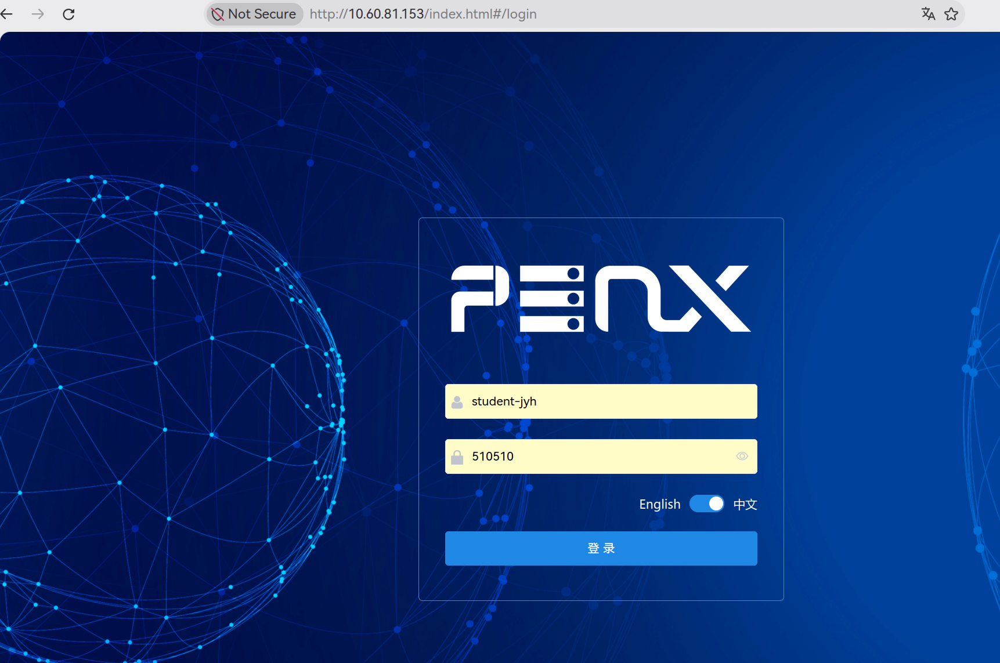

|||

- 在**校园网**环境下打开 `http://10.60.81.153`
- 输入分配的账号和密码，按需切换中/英文
- 点击「**登录**」进入集群平台

::: note
内网 HTTP 地址栏显示 `Not Secure` 属于正常现象，直接登录即可。
:::

:::

---

## 2. 点确认就行

::: cols 1fr 1.05fr

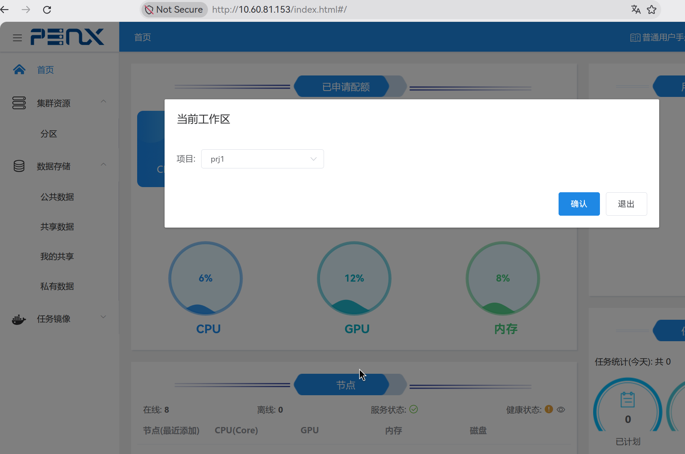

|||

- 登录后弹出「**当前工作区**」提示框
- 默认已选中所属项目（如 `prj1`）
- 直接点击蓝色「**确认**」进入首页

:::

---

## 3. 看看是否有可用资源

::: cols 1fr 1.05fr

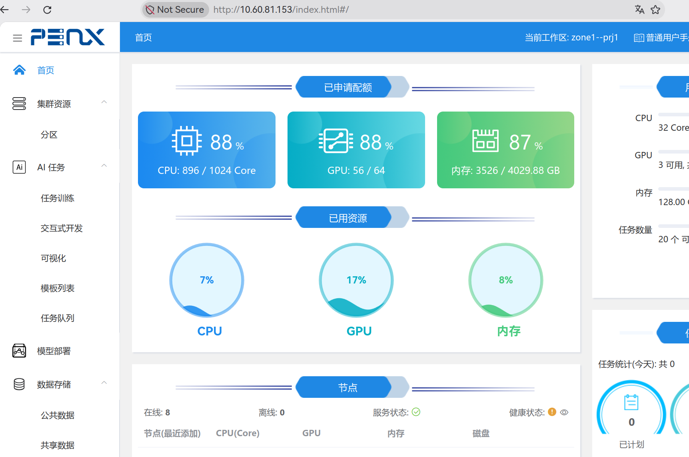

|||

- 中间区域查看集群**已申请配额**与**已用资源**（CPU / GPU / 内存）
- 右侧面板核对个人可用余量（如可用 GPU 卡数、内存、任务数量）
- 底部确认在线节点与服务状态正常

::: tip
确认有剩余 GPU 资源后，再进入下一步申请实例。
:::

:::

---

::: chapter 二、申请交互式开发资源
步骤 4–7：交互式开发点击创建 → 申请资源 1 / 2 / 3
:::

---

## 4. 交互式开发，点击创建

::: cols 1fr 1.05fr

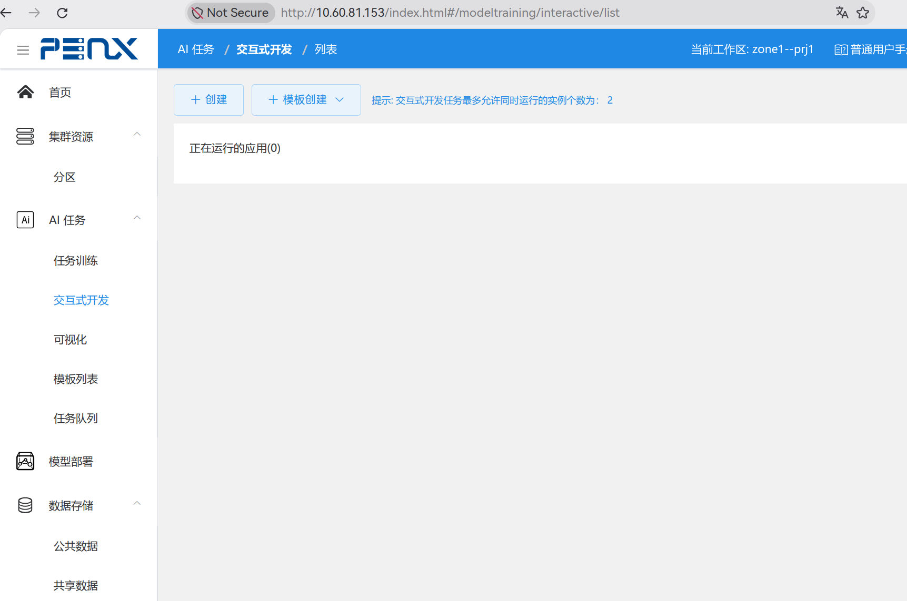

|||

- 左侧导航栏选择 **AI 任务 → 交互式开发**
- 点击左上角「**+ 创建**」（有模板时可选「模板创建」）

::: warn
交互式开发任务最多允许同时运行 **2** 个实例。
:::

:::

---

## 5. 申请资源-1（基础配置与选显卡）

::: cols 1.05fr 1fr

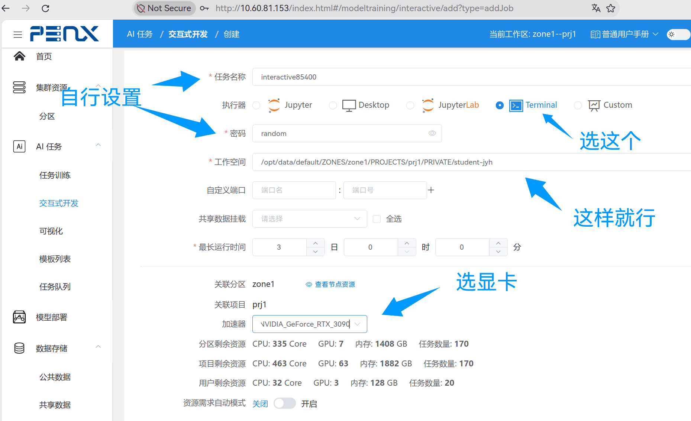

|||

- **任务名称 / 密码**：自行设置（SSH 登录时会用到密码）
- **执行器**：选 **Terminal**
- **工作空间**：保持默认路径即可
- **加速器**：选显卡（如 `NVIDIA_GeForce_RTX_3090`），下方同步显示剩余资源

:::

---

## 6. 申请资源-2（规格与镜像）

::: cols 1fr 1.15fr

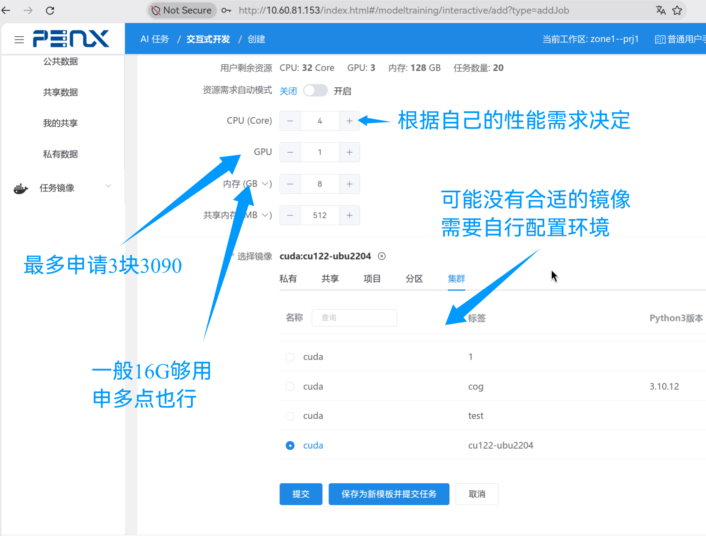

|||

- **CPU (Core)**：根据自己的性能需求决定
- **GPU**：最多申请 **3 块 3090**
- **内存 (GB)**：一般 **16G** 够用，申多点也行
- **选择镜像**：在「集群」里选基础镜像（如 `cuda:cu122-ubu2204`）后点击「**提交**」

::: note
可能没有现成的合适镜像，后续按步骤自行配置环境即可。
:::

:::

---

## 7. 申请资源-3（确认容器 Ready）

::: cols 1.05fr 1fr

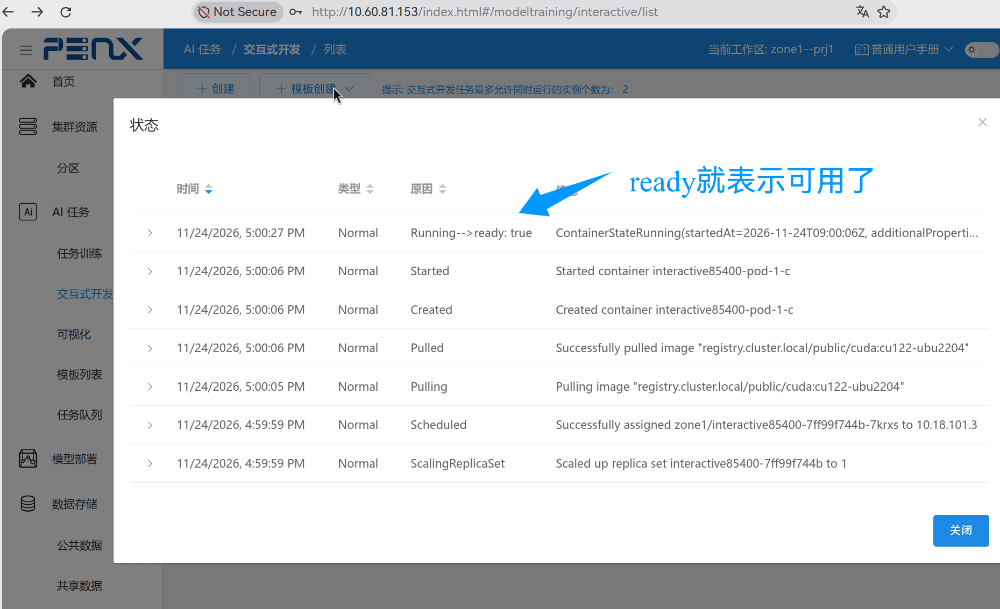

|||

提交后点「**状态**」查看容器事件：

- `Scheduled` → `Pulling` → `Pulled` → `Created` → `Started`
- 看到 **`Running-->ready: true`** 就表示可用了

:::

---

::: chapter 三、登录服务器与配置环境
步骤 8–12：登录服务器 1 / 2 → 检查显卡状况 → 安装 Python → 安装 PyTorch
:::

---

## 8. 登录服务器-1（复制 SSH 命令）

::: cols 1.05fr 1fr

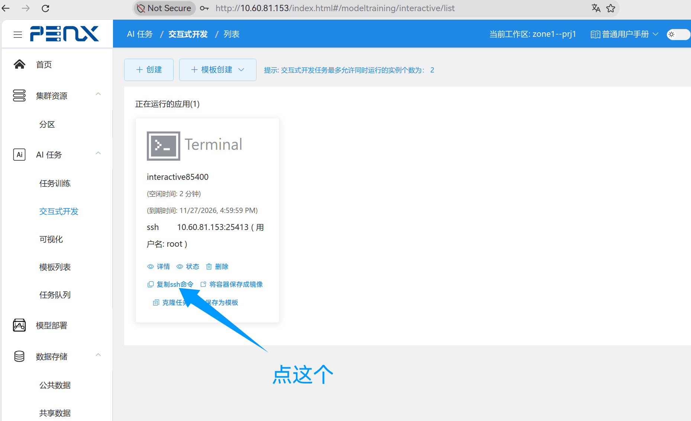

|||

- 回到 **交互式开发** 列表，找到刚建好的 `Terminal` 卡片
- 卡片会显示连接地址、端口、用户名（`root`）及到期时间
- 点击「**复制ssh命令**」即可

:::

---

## 9. 登录服务器-2（终端连接）

::: cols 1.15fr 1fr

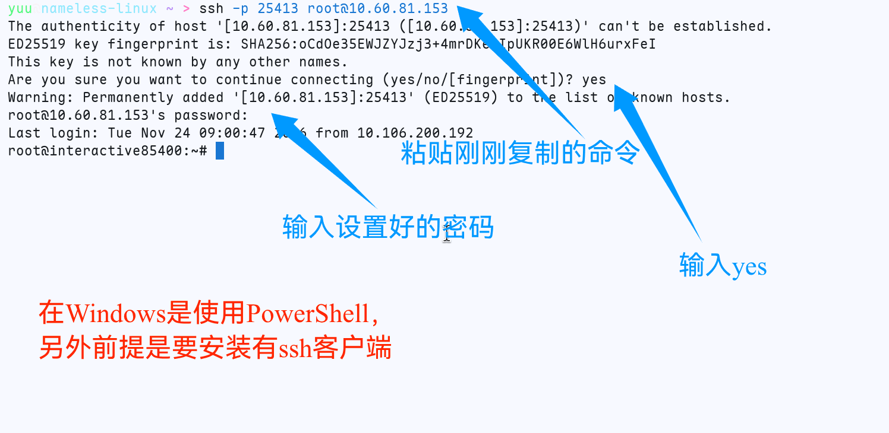

|||

1. 在本地终端粘贴刚刚复制的命令（如 `ssh -p 25413 root@10.60.81.153`）
2. 首次连接提示确认指纹时输入 **`yes`** 回车
3. 输入创建任务时设置好的密码即可登录

::: warn
在 **Windows** 是使用 **PowerShell**，前提是系统已安装 SSH 客户端。
:::

:::

---

## 10. 检查显卡状况

::: cols 1.05fr 1fr

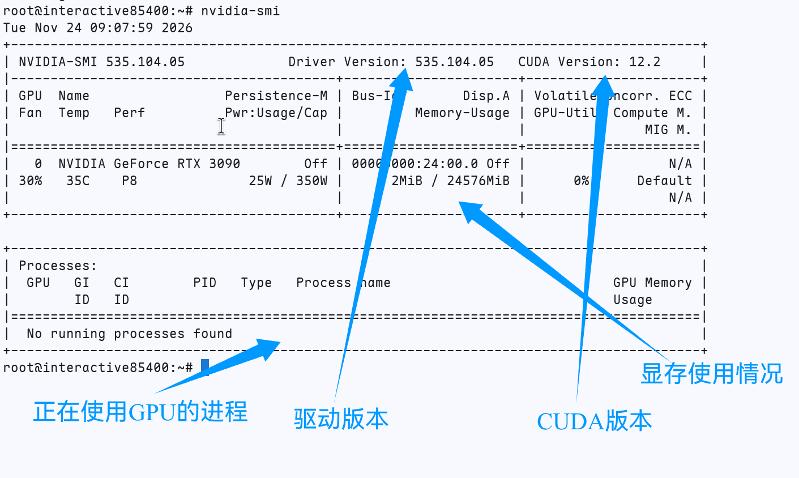

|||

执行 `nvidia-smi`，重点看四处信息：

- **驱动版本**：如 `535.104.05`
- **CUDA 版本**：如 `12.2`
- **显存使用情况**：RTX 3090 为 `24576MiB`
- **Processes**：当前正在使用 GPU 的进程

:::

---

## 11. 安装 Python

::: cols 1.15fr 1fr

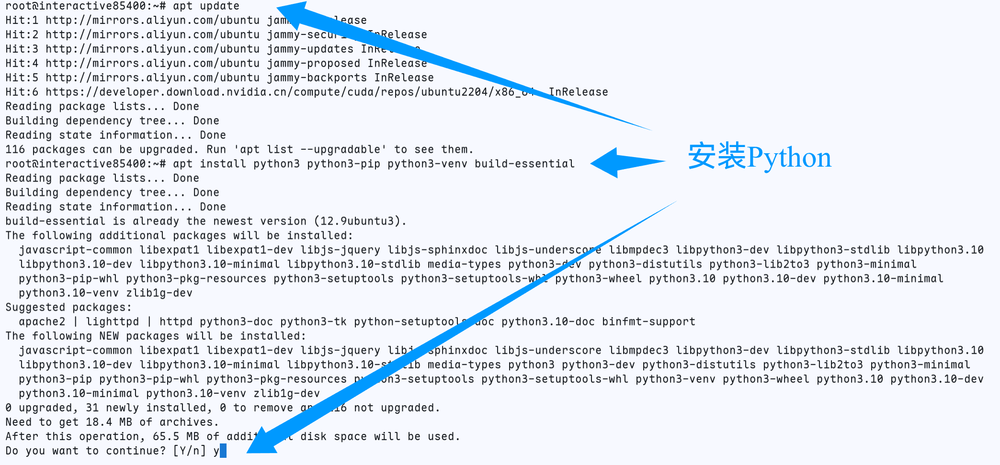

|||

若基础镜像未自带 Python，依次执行：

```bash
apt update
apt install python3 python3-pip python3-venv build-essential
```

- 提示 `Do you want to continue? [Y/n]` 时输入 **`y`** 回车
- 随后建议用 `python3 -m venv <名称>` 建立虚拟环境

:::

---

## 12. 安装 PyTorch

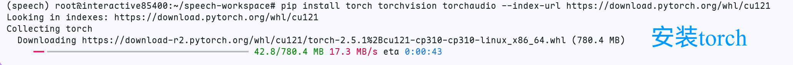

激活虚拟环境后，按 `nvidia-smi` 查看到的 CUDA 版本安装对应 wheel（例如 CUDA 12.2 可选 `cu121`）：

```bash
pip install torch torchvision torchaudio --index-url https://download.pytorch.org/whl/cu121
```

::: tip
安装完成后运行 `python3 -c "import torch; print(torch.cuda.is_available())"`，输出 `True` 即表示 GPU 加速已就绪。
:::

---

::: chapter 四、善后
步骤 13：保存环境镜像，用完及时删除实例
:::

---

## 13. 善后

::: cols 1fr 1.05fr

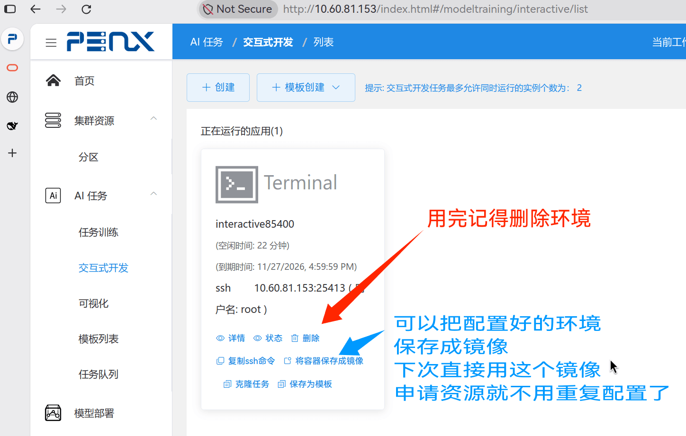

|||

1. **将容器保存成镜像**
   可以把配置好的环境保存成镜像，下次直接用这个镜像申请资源，就不用重复配置了。
2. **用完记得删除环境**
   确认代码与数据已存好后，点击「**删除**」释放 GPU 资源。

::: warn
实例未删除会持续占用集群 GPU 配额，**用完请务必删除环境**！
:::

:::
