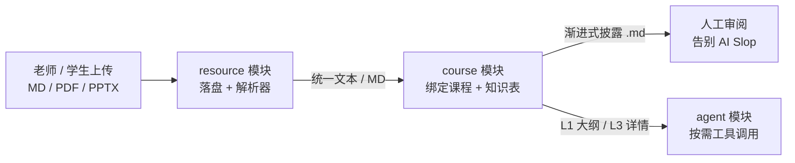

# 课程与资源模块设计与实现

基于教学智能体后端统一架构，从 MVP 起步构建资源解析（`resource`）与渐进式披露知识表（`course`）

---

## 目录

::: toc
:::

---

::: chapter 一、先想清楚两个模块管什么、怎么协作、第一版做到哪
对齐家庭教师式教学智能体的愿景，划清模块边界，先把最小闭环跑通
:::

---

## 为什么拆成资源和课程两个模块？

教学智能体要做到“**博览群书**”且“**讲解有据、过程可审阅**”，底层必须把**原始学习材料**和**结构化教学知识**拆开管理：

::: cards 2

### 资源模块负责内容存储与解析
- **职责**：接收并存储各种格式的学习材料（Markdown、PDF、PPTX，后续扩展音视频与图片），把异构文件统一解析成干净的文本 / Markdown。
- **关注点**：文件安全落盘、解析器分发、解析状态追踪、向其他模块提供原文内容。
- **不关心**：这份资料属于哪门课的哪一章、学生有没有学会。

|||

### 课程模块负责课程与知识表
- **职责**：以**课程**为单元组织教学，绑定课程资料，并为每门课维护一张**结构化知识表**。
- **关注点**：课程与知识树表结构、知识点溯源、**渐进式披露的 Markdown 渲染**（方便人工审阅，也方便 Agent 按层读取）。
- **不关心**：PDF 怎么抽文字、文件存在磁盘哪个路径。

:::

> **团队协作约定**：开发前先从 `main` 切出自己的功能分支（如 `git checkout -b feat/resource`、`feat/course`），不要直接向 `main` 提交；两个模块之间只通过公开 `service` 函数协作，**禁止跨模块直接查对方的 ORM 表**。

---

## 整体链路与第一版范围



::: cols 1fr 1fr

### 第一版要做到

1. `resource`：上传 `.md`/`.txt`/`.pdf`/`.pptx`，落盘并同步解析入库，支持列表、正文、删除；
2. `course`：建课、绑定资源、维护知识树（章 → 知识点）及审阅状态；
3. 按**渐进式披露**导出 `knowledge.md`，并提供轻量 L1 大纲接口。

|||

### 先不做，留到后续完善

- 音视频转写（Whisper）、OCR、大文件异步队列；
- LLM 自动从资料抽草稿写入知识表；
- 全文检索 / 向量切块（`ResourceChunk`）与对象存储；
- 学生掌握度表（`LearnerMastery`）与每日学习计划。

:::

> **MVP 验收**：上传 `.pdf`/`.pptx` 拿解析文本 → 建课并绑定 → 录 2 章 3 知识点 → 访问 `GET /courses/{id}/knowledge.md` 得到可折叠审阅的 Markdown。

---

::: chapter 二、构建资源模块，让文件存得住、解得出
沿用 `ta-backend` 的 5 文件约定，再加一个专门的 `parsers.py` 承接多格式解析
:::

---

## 资源模块的目录结构与三个核心设计决策

仓库里已经预留了 `ta-backend/modules/resource/` 目录，按职责拆成 5 个文件：

::: cols 0.95fr 1.25fr

```text
modules/resource/
  models.py    # Resource 表 + 解析状态枚举
  schemas.py   # 出参契约（绝不泄露磁盘路径）
  parsers.py   # 按扩展名分发的格式解析器
  service.py   # 校验、落盘、解析、对外查询函数
  router.py    # 上传、列表、取内容、删除路由
```

|||

### 动手前定好的三条底线

1. **文件存磁盘，元数据存库**：绝不把几十 MB 的 PDF / PPTX 塞进 SQLite BLOB；文件落本地目录，库里只存相对路径、大小、状态和解析出的文本。
2. **用 UUID 重命名防路径穿越**：用户上传的 `filename` 只做展示用；真实落盘名一律用 `uuid4().hex + 后缀`，且接口出参不暴露 `storage_path`。
3. **解析出口统一为 Markdown**：不管来源是 PDF 还是 PPTX，解析器都返回带页码标记的 Markdown 文本，下游无需关心原始格式。

:::

---

## 第一步 切分支、装依赖、扩展全局配置

FastAPI 接收 `UploadFile` 需要 `python-multipart`；MVP 阶段再装上轻量的 PDF 和 PPTX 解析库即可：

::: cols 1.1fr 1.15fr

```bash
# 1. 从 main 切出自己的开发分支
git checkout -b feat/resource

# 2. 在 ta-backend 下安装上传与解析依赖
cd ta-backend
uv add python-multipart pypdf python-pptx
```

```text
# ta-backend/.gitignore 追加（避免上传文件进 Git）
storage/
```

|||

```python
# ta-backend/core/config.py（在现有 Settings 中追加）
class Settings(BaseSettings):
    ...
    # 资源本地存储目录（相对于 ta-backend 根目录）
    upload_dir: str = "storage/resources"
    # 单文件大小上限（MB）
    max_upload_mb: int = 20
```

> 同步把 `UPLOAD_DIR` / `MAX_UPLOAD_MB` 补进 `.env.example`，保持环境变量模板与 `core/config.py` 一致。

:::

---

## 第二步 定义数据表与接口契约

列表接口只返回轻量元数据，解析后的长文本单独走内容接口，避免拉列表时一次传输几兆文字：

::: tabs 数据表模型 | 接口契约

```python
# modules/resource/models.py
from datetime import UTC, datetime
from enum import StrEnum
from sqlmodel import Field, SQLModel

class ParseStatus(StrEnum):
    PENDING = "pending"
    PARSED = "parsed"
    FAILED = "failed"

class Resource(SQLModel, table=True):
    id: int | None = Field(default=None, primary_key=True)
    owner_id: int = Field(foreign_key="user.id", index=True)
    filename: str
    file_ext: str = Field(index=True)          # 如 ".pdf" / ".pptx" / ".md"
    size_bytes: int
    storage_path: str                          # 相对 upload_dir 的内部文件名
    status: ParseStatus = Field(default=ParseStatus.PENDING)
    parsed_markdown: str = ""                  # 统一解析产物
    error_message: str | None = None           # 解析失败时记录原因
    created_at: datetime = Field(default_factory=lambda: datetime.now(UTC))
```

|||

```python
# modules/resource/schemas.py
from datetime import datetime
from pydantic import BaseModel, ConfigDict
from modules.resource.models import ParseStatus

class ResourcePublic(BaseModel):
    """列表与详情出参：刻意不包含 storage_path 和超长的 parsed_markdown。"""
    model_config = ConfigDict(from_attributes=True)

    id: int
    filename: str
    file_ext: str
    size_bytes: int
    status: ParseStatus
    error_message: str | None
    created_at: datetime

class ResourceContent(BaseModel):
    """按需获取解析后的 Markdown 正文。"""
    model_config = ConfigDict(from_attributes=True)

    id: int
    filename: str
    status: ParseStatus
    parsed_markdown: str
```

:::

---

## 第三步 编写可扩展的格式解析器

用「扩展名 → 解析函数」注册表隔离文件格式；后续加 `.docx` 或音频转写，只需新增函数并登记到 `PARSERS`：

::: cols 1.3fr 0.85fr

```python
# modules/resource/parsers.py
from collections.abc import Callable
from pathlib import Path
from pptx import Presentation
from pypdf import PdfReader

def _parse_pdf(path: Path) -> str:
    reader = PdfReader(path)
    pages = [
        f"## 第 {i} 页\n\n{t}"
        for i, p in enumerate(reader.pages, 1)
        if (t := (p.extract_text() or "").strip())
    ]
    return "\n\n".join(pages)

def _parse_pptx(path: Path) -> str:
    prs = Presentation(str(path))
    slides = []
    for i, slide in enumerate(prs.slides, 1):
        lines = [s.text.strip() for s in slide.shapes if s.has_text_frame and s.text.strip()]
        if lines:
            slides.append(f"## Slide {i}\n\n" + "\n".join(lines))
    return "\n\n".join(slides)
```

|||

```python
ParserFn = Callable[[Path], str]

def _parse_text(path: Path) -> str:
    return path.read_text(
        encoding="utf-8", errors="replace"
    ).strip()

PARSERS: dict[str, ParserFn] = {
    ".md": _parse_text,
    ".txt": _parse_text,
    ".pdf": _parse_pdf,
    ".pptx": _parse_pptx,
}
```

- 统一返回带页码的 Markdown
- 未登记扩展名在 `service.py` 拦截

:::

---

## 第四步 业务逻辑、路由与全局接入

::: tabs 校验与落盘解析 | 路由层 | 接入全局与验收

```python
# modules/resource/service.py（核心异常：UnsupportedFileType / FileTooLarge / ResourceNotFound）
def upload_and_parse(session: Session, owner_id: int, filename: str, data: bytes) -> Resource:
    ext = Path(filename).suffix.lower()
    if ext not in PARSERS:
        raise UnsupportedFileType(f"暂不支持的文件格式: {ext or '无后缀'}")
    if len(data) > settings.max_upload_mb * 1024 * 1024:
        raise FileTooLarge(f"文件超过 {settings.max_upload_mb}MB 上限")

    root = Path(settings.upload_dir)
    root.mkdir(parents=True, exist_ok=True)
    stored_name = f"{uuid4().hex}{ext}"
    file_path = root / stored_name
    file_path.write_bytes(data)

    res = Resource(owner_id=owner_id, filename=filename, file_ext=ext, size_bytes=len(data), storage_path=stored_name)
    try:
        res.parsed_markdown, res.status = PARSERS[ext](file_path), ParseStatus.PARSED
    except Exception as exc:  # 解析失败保留原文件，方便排查与重试
        res.status, res.error_message = ParseStatus.FAILED, str(exc)
    session.add(res); session.commit(); session.refresh(res)
    return res

def get_owned_resource(session: Session, resource_id: int, owner_id: int) -> Resource:
    res = session.exec(select(Resource).where(Resource.id == resource_id, Resource.owner_id == owner_id)).first()
    if res is None:
        raise ResourceNotFound("资源不存在或无权访问")
    return res
```

|||

```python
# modules/resource/router.py
router = APIRouter(prefix="/resources", tags=["resource"])
CurrentUser = Annotated[User, Depends(get_current_user)]

@router.post("/upload")
async def upload_resource(session: SessionDep, user: CurrentUser, file: UploadFile = File(...)) -> ResourcePublic:
    assert user.id is not None
    data = await file.read()
    return ResourcePublic.model_validate(
        service.upload_and_parse(session, user.id, file.filename or "untitled.txt", data)
    )

@router.get("/{resource_id}/content")
def read_content(resource_id: int, session: SessionDep, user: CurrentUser) -> ResourceContent:
    assert user.id is not None
    return ResourceContent.model_validate(service.get_owned_resource(session, resource_id, user.id))
```

再顺手补上 `GET /resources`（列表）和 `DELETE /resources/{resource_id}`（删库同时清磁盘文件）即可构成完整 CRUD。

|||

### 接入后端的两处改动

1. **`core/database.py`**：在 `init_db()` 中用别名导入模型（避免多个 `models` 重名触发 ruff 警告）：
   ```python
   from modules.auth import models as auth_models          # noqa: F401
   from modules.resource import models as resource_models  # noqa: F401
   ```
2. **`main.py`**：`app.include_router(resource_router)`。

> 注：`UnsupportedFileType`、`FileTooLarge`、`ResourceNotFound` 直接在 `modules/resource/service.py` 继承 `ServiceError` 并声明 `code` 即可，无需改动 `core/errors.py`（全局处理器默认返回 **400**，404 仅留给框架路径不存在）。

### 立刻验收资源模块
- `uv run dev`，先调用 `/auth/register` 与 `/auth/login` 拿 Token；
- 在 `/docs` 上传一份 `.md`、`.pdf`、`.pptx`，再调 `GET /resources/{id}/content` 确认拿到清晰的 Markdown 文本；
- 试传一个 `.exe` 或超大文件，确认统一返回 `400 {"code": "...", "detail": "..."}`。

:::

---

::: chapter 三、构建课程模块的知识表与渐进式披露
以课程为单元设计知识表结构，让一份知识树同时服务「人眼审阅」与「Agent 按需读取」
:::

---

## 什么是渐进式披露的知识表？

如果一门课的 50 个知识点全部平铺成几万字长文，人根本审不过来（很容易变成失控的 AI Slop），Agent 一次塞进 Prompt 也会爆上下文。**渐进式披露（Progressive Disclosure）**把同一张知识表按三层展开：

::: cards 3

### 第一层，默认展示课程全貌
课程名称、简介、审阅进度统计，以及**章节目录与一句话摘要**。打开文档 5 秒就能确认骨架对不对。

|||

### 第二层，按章展开知识点清单
每章下面按顺序列出知识点名称、难度、前置依赖、审阅状态（`draft` / `approved`）和来源资料编号。

|||

### 第三层，按需点开详细内容
完整概念解释、公式、例题与易错点，包裹在 `<details><summary>` 折叠块中；**人点开才审阅，Agent 调工具才加载**。

:::

```markdown
# 数据库系统原理
> 审阅进度：2 / 3 已确认 · 关联资料：2 份

## 一、事务与并发控制
> 理解事务的原子性、隔离性与并发异常（`approved`）

<details>
<summary><b>1.1 ACID 特性</b> · 难度 2/5 · [approved] · 来源: <code>#1 讲义.pdf</code></summary>

- **一句话摘要**：保证并发与故障下数据一致性的四项基本约束。
- **详细讲解**：原子性（Atomicity）、一致性（Consistency）……
</details>
```

---

## 第一步 自行设计表结构

围绕“课程 → 知识树 → 资料溯源”拆出 **3 张表**；知识表用 `parent_id` 自引用支持任意层级（MVP 先用「章 → 知识点」两层，后续无痛扩展）：

::: cols 1.3fr 0.95fr

```python
# modules/course/models.py
class ReviewStatus(StrEnum):
    DRAFT = "draft"
    APPROVED = "approved"

class Course(SQLModel, table=True):
    id: int | None = Field(default=None, primary_key=True)
    owner_id: int = Field(foreign_key="user.id", index=True)
    title: str = Field(index=True)
    description: str = ""
    created_at: datetime = Field(default_factory=lambda: datetime.now(UTC))

class KnowledgeNode(SQLModel, table=True):
    id: int | None = Field(default=None, primary_key=True)
    course_id: int = Field(foreign_key="course.id", index=True)
    parent_id: int | None = Field(default=None, foreign_key="knowledgenode.id", index=True)
    order_index: int = 0
    title: str                                   # L1：节点标题
    summary: str = ""                            # L1/L2：一句话摘要
    content_md: str = ""                         # L3：完整 Markdown 正文
    prerequisites: str = ""                      # 前置知识点，如 "1.1, 1.2"
    difficulty: int = Field(default=2, ge=1, le=5)
    source_resource_id: int | None = Field(default=None, foreign_key="resource.id")
    review_status: ReviewStatus = Field(default=ReviewStatus.DRAFT)
```

|||

```python
class CourseResource(SQLModel, table=True):
    """课程与资源的多对多绑定表。"""
    course_id: int = Field(foreign_key="course.id", primary_key=True)
    resource_id: int = Field(foreign_key="resource.id", primary_key=True)
```

### 表结构设计要点

- **L1/L2/L3 落到字段**：`title` + `summary` 支撑概览，`content_md` 承载详细内容。
- **审阅流内置在表里**：默认 `draft`，人工核对后改为 `approved`，防 AI Slop。
- **资料溯源**：`source_resource_id` 标明出处。

:::

---

## 第二步 把渐进式披露体现在接口契约里

API 出参同样区分**摘要层（`NodeSummary`）**和**详情层（`NodeDetail`）**，避免大纲接口吐出整本教材：

::: cols 1fr 1.15fr

```python
# modules/course/schemas.py（入参模型）
from pydantic import BaseModel, ConfigDict, Field
from modules.course.models import ReviewStatus

class CourseCreate(BaseModel):
    title: str = Field(min_length=1, max_length=100)
    description: str = ""

class NodeCreate(BaseModel):
    parent_id: int | None = None
    order_index: int = 0
    title: str = Field(min_length=1, max_length=120)
    summary: str = ""
    content_md: str = ""
    prerequisites: str = ""
    difficulty: int = Field(default=2, ge=1, le=5)
    source_resource_id: int | None = None

class NodeReviewUpdate(BaseModel):
    review_status: ReviewStatus
```

|||

```python
# modules/course/schemas.py（出参分层）
class CoursePublic(BaseModel):
    model_config = ConfigDict(from_attributes=True)
    id: int
    title: str
    description: str

class NodeSummary(BaseModel):
    """L1/L2 轻量出参：不含 content_md，用于大纲树与快速浏览。"""
    model_config = ConfigDict(from_attributes=True)
    id: int
    parent_id: int | None
    order_index: int
    title: str
    summary: str
    difficulty: int
    review_status: ReviewStatus
    source_resource_id: int | None
    children: list["NodeSummary"] = []

class NodeDetail(NodeSummary):
    """L3 完整出参：按需点开单个节点时再加载正文与前置依赖。"""
    content_md: str
    prerequisites: str
```

:::

---

## 第三步 业务逻辑与跨模块协作

关键点有两个：**一次查询在内存拼树**（避免递归查库产生 N+1 问题），以及**跨模块调用 `resource.service` 做资源校验**：

::: tabs 课程与知识树操作 | 跨模块绑定资源

```python
# modules/course/service.py（异常：CourseNotFound / KnowledgeNodeNotFound）
def get_owned_course(session: Session, course_id: int, owner_id: int) -> Course:
    course = session.exec(select(Course).where(Course.id == course_id, Course.owner_id == owner_id)).first()
    if course is None:
        raise CourseNotFound("课程不存在或无权访问")
    return course

def list_course_nodes(session: Session, course_id: int) -> list[KnowledgeNode]:
    return list(session.exec(
        select(KnowledgeNode).where(KnowledgeNode.course_id == course_id)
        .order_by(KnowledgeNode.order_index, KnowledgeNode.id)
    ).all())

def build_outline_tree(nodes: list[KnowledgeNode]) -> list[NodeSummary]:
    """一次查询后在内存组装知识树，不触发 N+1 SQL。"""
    by_id = {n.id: NodeSummary.model_validate(n) for n in nodes if n.id is not None}
    roots: list[NodeSummary] = []
    for item in by_id.values():
        if item.parent_id and item.parent_id in by_id:
            by_id[item.parent_id].children.append(item)
        else:
            roots.append(item)
    return roots
```

|||

```python
# modules/course/service.py（续）
def attach_resource(session: Session, course_id: int, resource_id: int, owner_id: int) -> None:
    """把已上传的资源绑定到课程：两边都校验归属权。"""
    get_owned_course(session, course_id, owner_id)
    resource_service.get_owned_resource(session, resource_id, owner_id)  # 跨模块调用 service
    if session.get(CourseResource, (course_id, resource_id)) is None:
        session.add(CourseResource(course_id=course_id, resource_id=resource_id))
        session.commit()

def create_node(session: Session, course_id: int, owner_id: int, data: NodeCreate) -> KnowledgeNode:
    get_owned_course(session, course_id, owner_id)
    if data.parent_id is not None:
        parent = session.get(KnowledgeNode, data.parent_id)
        if parent is None or parent.course_id != course_id:
            raise KnowledgeNodeNotFound("父知识点不存在")
    if data.source_resource_id is not None:
        resource_service.get_owned_resource(session, data.source_resource_id, owner_id)
    node = KnowledgeNode(course_id=course_id, **data.model_dump())
    session.add(node); session.commit(); session.refresh(node)
    return node
```

:::

---

## 第四步 渐进式披露文档渲染器

单独放一个 `modules/course/markdown.py`，把数据库里的 `KnowledgeNode` 树渲染成两种文本视图——一份给**人审阅**，一份给 **Agent 省 Token**：

::: cols 1.35fr 0.95fr

```python
# modules/course/markdown.py
def render_review_markdown(course: Course, nodes: list[KnowledgeNode]) -> str:
    """供人工审阅的渐进式披露 Markdown：顶层总览 + <details> 折叠细节。"""
    children: dict[int | None, list[KnowledgeNode]] = defaultdict(list)
    for n in nodes:
        children[n.parent_id].append(n)
    approved = sum(1 for n in nodes if n.review_status == ReviewStatus.APPROVED)
    lines = [
        f"# {course.title}", f"> 审阅进度：`{approved}/{len(nodes)}` 已确认\n",
        "## 课程总览（L1）\n", "| 节点 | 摘要 | 难度 | 状态 |", "| --- | --- | :---: | :---: |",
    ]
    for r in children[None]:
        lines.append(f"| {r.title} | {r.summary or '-'} | {r.difficulty}/5 | `{r.review_status}` |")
    for r in children[None]:
        lines.append(f"\n---\n## {r.title}\n")
        for leaf in children[r.id]:
            src = f" · 来源: `#{leaf.source_resource_id}`" if leaf.source_resource_id else ""
            lines.append(f"<details>\n<summary><b>{leaf.title}</b> · {leaf.difficulty}/5 · [{leaf.review_status}]{src}</summary>\n")
            if leaf.summary:
                lines.append(f"- **摘要**：{leaf.summary}")
            lines.append(f"\n{leaf.content_md or '_（待补充详细内容）_'}\n</details>\n")
    return "\n".join(lines)
```

|||

### 给智能体用的精简大纲视图

```python
def render_outline_for_agent(
    course: Course,
    nodes: list[KnowledgeNode],
) -> str:
    """只输出 ID、标题和摘要，省 Token。"""
    lines = [f"课程：{course.title}"]
    for n in nodes:
        indent = "  " if n.parent_id else ""
        lines.append(
            f"{indent}- [#{n.id}] {n.title}: "
            f"{n.summary}"
        )
    return "\n".join(lines)
```

Agent 先拿这段极短的目录定位知识点编号，再按编号调工具拉 `content_md`，上下文永远清爽。

:::

---

## 第五步 路由封装、全局接入与闭环验收

::: tabs 核心路由 | 接入全局与完整验收

```python
# modules/course/router.py
router = APIRouter(prefix="/courses", tags=["course"])
CurrentUser = Annotated[User, Depends(get_current_user)]

@router.post("")
def create_course(body: CourseCreate, session: SessionDep, user: CurrentUser) -> CoursePublic:
    assert user.id is not None
    return CoursePublic.model_validate(service.create_course(session, user.id, body))

@router.post("/{course_id}/nodes")
def add_node(course_id: int, body: NodeCreate, session: SessionDep, user: CurrentUser) -> NodeDetail:
    assert user.id is not None
    return NodeDetail.model_validate(service.create_node(session, course_id, user.id, body))

@router.get("/{course_id}/outline")
def get_outline(course_id: int, session: SessionDep, user: CurrentUser) -> list[NodeSummary]:
    assert user.id is not None
    service.get_owned_course(session, course_id, user.id)
    return service.build_outline_tree(service.list_course_nodes(session, course_id))

@router.get("/{course_id}/knowledge.md", response_class=PlainTextResponse)
def export_knowledge_md(course_id: int, session: SessionDep, user: CurrentUser) -> PlainTextResponse:
    assert user.id is not None
    course = service.get_owned_course(session, course_id, user.id)
    return PlainTextResponse(markdown.render_review_markdown(course, service.list_course_nodes(session, course_id)),
                             media_type="text/markdown; charset=utf-8")
```

再补上 `GET /courses`、`GET /courses/{id}/nodes/{node_id}`、`PATCH /courses/{id}/nodes/{node_id}/review` 和 `POST /courses/{id}/resources/{resource_id}`。

|||

### 接入全局骨架的两处改动

1. **`core/database.py`**：在 `init_db()` 导入 `modules.course.models as course_models`；
2. **`main.py`**：`app.include_router(course_router)`。

> 注：`CourseNotFound`、`KnowledgeNodeNotFound` 直接在 `modules/course/service.py` 继承 `ServiceError` 并声明 `code`，无需改动 `core/errors.py`。

### 完整闭环验收

::: timeline
1. **上传课件**：调 `POST /resources/upload` 上传一份课程 PDF，记下 `resource_id`。
2. **创建并绑定**：调 `POST /courses` 建课，再调 `POST /courses/{id}/resources/{resource_id}` 绑定资料。
3. **录入知识树**：先建 1 个章节点（`parent_id=null`），再挂 2 个带 `source_resource_id` 的知识点。
4. **审阅验证**：访问 `GET /courses/{id}/knowledge.md`，保存为 `.md` 在 VS Code 预览，确认 L1 总览清晰、L3 详情可折叠展开。
:::

:::

---

::: chapter 四、后续迭代与自查清单
MVP 跑通后，按四轮迭代接入更多媒介、AI 草稿审阅、Agent 工具和学习规划
:::

---

## 第一版之后的四轮演进路线

::: cards 2

### 迭代一 多媒介扩展与异步解析
- 在 `resource/parsers.py` 中注册 `.docx`（`python-docx`）、扫描件 OCR；
- 遇到课程录音 / 视频时，调用 `speech` 模块的 Whisper 接口转写成带时间戳的 Markdown；
- 大文件改用 FastAPI `BackgroundTasks`（后续升级队列）：上传接口立刻返回 `status="pending"`，后台解析完再更新为 `parsed`。

|||

### 迭代二 智能生成知识表草稿，再由人工审阅
- 读取某门课已绑定的 `resource.parsed_markdown`，用 LLM Structured Outputs 生成一批 `review_status="draft"` 的 `KnowledgeNode` 草稿；
- 老师或同学拉出 `knowledge.md` 逐层审阅、改错并点击确认（`approved`），只让已审定内容进入正式教学，从机制上杜绝 AI Slop。

|||

### 迭代三 对接智能体与掌握度闭环
- 把 `agent.md` 里的内存 `DEMO_NOTES` 替换成调用 `course.service`（查 L1 大纲、查 L3 节点详情）与 `resource.service`（按关键词查原讲义）；
- 在 `course` 模块新增 `LearnerMastery` 表记录每个学生对各知识点的掌握分与复习时间，支撑愿景里的“**摸底**”与“**每日学习规划**”。

|||

### 迭代四 检索升级与存储迁移
- 资料变多后，先用 SQLite FTS5 做全文检索；需要语义召回时，再新增 `ResourceChunk` 分块表与向量检索；
- 后续修改表结构时引入 **Alembic** 做数据库迁移（`create_all` 不会改已有表）；
- 文件存储通过薄封装平滑迁到 MinIO / 对象存储，上层业务零改动。

:::

---

## 自查清单、安全边界与继续阅读

::: cols 1.15fr 1fr

### 提交合并请求前的自查清单

- [ ] 在独立分支开发（如 `feat/resource`、`feat/course`），未直接提交到 `main`
- [ ] 新表模型已在 `core/database.py` 的 `init_db()` 中导入（使用别名避免冲突）
- [ ] 业务错误全部在各自模块继承 `ServiceError` 并声明唯一 `code`（全站只出 400 / 401）
- [ ] 所有读写接口均注入 `Depends(get_current_user)` 并校验 `owner_id` 归属
- [ ] `storage/` 已加入 `.gitignore`，接口响应不泄露本地绝对路径
- [ ] 运行 `uv run ruff check .` 与 `uv run ruff format --check .` 通过

|||

### 关键边界提醒

::: badges
bad 绝不把上传的二进制文件存进 SQLite
bad 绝不跨模块直接查询其他模块的 ORM 表
warn 原始文件名仅做展示，落盘一律 UUID 重命名
warn 大文件解析耗时，迭代 1 及时切后台任务
ok 知识表用 L1/L2/L3 渐进披露兼顾审阅与省 Token
:::

### 继续阅读其他文档

- [后端架构与开发指南 `intro.md`](?src=decks/intro.md)
- [前端架构与开发指南 `intro-webui.md`](?src=decks/intro-webui.md)
- [Agent 模块设计与实现 `agent.md`](?src=decks/agent.md)
- [语音底座部署指南 `speech.md`](?src=decks/speech.md)
- 按 `L` 或 [返回幻灯片选择页](./)

:::
