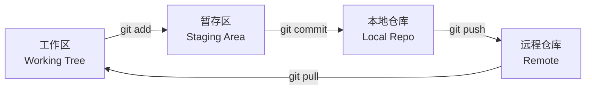
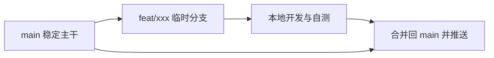

# Git 与协作开发

面向团队的轻量版本管理、分支协作与冲突处理实用指南

---

## 目录

::: toc
:::

---

## 为什么团队开发也要用好 Git

团队沟通快、节奏紧，不需要复杂的审批流程，但缺少基本 Git 习惯依然很容易互相覆盖代码：

::: cards 3

### 告别文件地狱
不再出现 `main_v2_最终版_改好了.py`，每一次改动都有清晰的历史快照，随时可对比、可回退。

|||

### 并行开发不踩脚
各自负责的模块互不干扰；做大改动时用临时分支隔离，测通再合回主干，避免把队友的本地环境搞挂。

|||

### 出错能快速定位
清晰的提交记录能直接看出「谁在什么时候改了哪几行」，排查 Bug 和回滚都省心。

:::

---

::: chapter 一、核心概念与日常工作流
理解四个区域的数据流向，养成原子提交的习惯
:::

---

## Git 的四个区域

绝大多数 Git 命令，本质上只是在下面四个区域之间搬运变更：



::: cols 1fr 1fr

- **工作区**：你正在编辑器里直接修改的文件
- **暂存区**：准备打包进下一次提交的变更清单

|||

- **本地仓库**：本机保存的完整提交历史
- **远程仓库**：团队共享的中心仓库（如 GitHub / GitLab / Gitee）

:::

---

## 首次配置与常用只读命令

::: cols 1fr 1fr

### 首次使用配置身份

```bash
git config --global user.name "你的名字"
git config --global user.email "you@example.com"
git config --global init.defaultBranch main
```

- 建议在平台配置 **SSH 公钥**，避免每次 `push` / `pull` 重复输密码

|||

### 随时可放心执行的只读命令

```bash
git status                 # 查看当前修改与暂存状态
git diff                   # 查看未暂存的具体改动
git diff --staged          # 查看已暂存、即将提交的改动
git log --oneline -n 10    # 精简查看最近 10 条提交
git branch -a              # 查看本地与远程分支
```

:::

---

## 原子提交与 Commit Message 规范

**核心原则**：一次提交只做一件事，显式暂存文件（`git add <路径>`），避免无脑 `git add .` 把不相关改动混在一起。

::: cols 1.15fr 1fr

| 前缀 | 含义 | 示例 |
| --- | --- | --- |
| `feat` | 新功能 | `feat(auth): 增加注册接口` |
| `fix` | 修复 Bug | `fix(chat): 修复流式中断报错` |
| `refactor` | 重构（不改行为） | `refactor(db): 抽取会话依赖` |
| `docs` | 文档变更 | `docs: 补充本地启动说明` |
| `test` | 补充或修改测试 | `test(auth): 覆盖登录异常路径` |
| `chore` | 依赖/脚本/杂项 | `chore: 更新 ruff 配置` |

|||

### 对比：好提交 vs 坏提交

```text
# 坏提交（看不出改了什么、难以回滚）
update
fix bug
改了一堆东西

# 好提交（语义明确、范围独立）
feat(course): 支持按章节筛选课件
fix(webui): 修复刷新后登录态丢失
docs(readme): 补充环境变量说明
```

:::

---

::: chapter 二、团队的轻量协作模式
不引入繁琐的 PR 流程，靠清晰分工与短分支保持主干稳定
:::

---

## 轻量分支工作流

**核心约定**：`main` 永远保持**能启动、能跑通**。团队协作无需走复杂的 PR 审批，按改动大小二选一：



::: cards 2

### 情况 A：独立小改动，直接提 `main`
只改自己负责的模块或文档、几分钟就能自测完的小改动：
先 `git pull` → 改完自测 → `git commit` → `git push`。

|||

### 情况 B：较大功能或修改公共代码，切临时分支
需要写半天以上、或者会动到公共目录（如 `core/`、公共组件）：
切出 `feat/xxx` 分支，写完自测通过后再合并回 `main` 并推送。

:::

---

## 临时分支从创建到合并的完整步骤

::: cols 1fr 1.15fr

::: timeline
1. **同步主干**：切到 `main` 拉取队友最新提交
2. **切出分支**：按功能命名创建临时分支
3. **开发自测**：小步原子提交，确保本地能跑通
4. **合并回主干**：更新 `main` 后把功能分支合入
5. **推送并清理**：推送到远端，删掉用完的临时分支
:::

|||

```bash
# 1. 更新 main 并切出临时分支
git switch main
git pull origin main
git switch -c feat/course-search

# 2. 开发、显式暂存并提交
git add ta-backend/modules/course/
git commit -m "feat(course): 增加课程关键词搜索接口"

# 3. 测通后合回 main 并推送
git switch main
git pull origin main
git merge feat/course-search
git push origin main

# 4. 删除已合并的本地临时分支
git branch -d feat/course-search
```

:::

---

## 多人分工与减少冲突的小技巧

多人直接协作时，最好的「解冲突」方式是**尽量少撞文件**：

::: cards 3

### 按模块划清边界
提前约定好每个人负责的目录（例如按 `modules/` 或前端页面拆分），公共配置与接口变更前在群里打一声招呼。

|||

### 勤拉取、勤推送
开工前先 `git pull`，完成一个可用小阶段就及时 `git push`；攒三天代码一次性推最容易爆出大冲突。

|||

### 推送前务必自测
因为没有 PR 拦截，`git push` 上去的代码队友立刻就会拉到——推之前至少确认**能启动、没语法报错**。

:::

---

::: chapter 三、推送被拒与解决冲突
多人协作中最常遇到的两个场景，照步骤处理即可
:::

---

## `git push` 被拒怎么办

当你推送时看到 `failed to push some refs` / `non-fast-forward`，说明**队友刚刚比你先推了新提交到远端**。

::: cols 1.1fr 1fr

```bash
# 正确做法：先拉取远端更新，再推送
git pull origin main
# 若无冲突，直接重新推送
git push origin main
```

- 如果团队想让提交历史更整洁，也可以用：
  ```bash
  git pull --rebase origin main
  git push origin main
  ```

|||

::: warn
**绝对不要**为了图省事在 `main` 上执行 `git push --force`！强制推送会直接覆盖掉队友刚刚提交的代码。
:::

::: tip
`git pull` 本质上是 `git fetch` + `git merge`：只要你和队友改的不是同一个文件的同一块，Git 会自动合并，无需手动干预。
:::

:::

---

## 遇到合并冲突怎么办

多人改到同一文件的相邻行时，Git 无法自动判断保留谁的改动，就会提示 `CONFLICT`——这完全正常，按四步解决即可：

::: cols 1.1fr 1fr

```python
<<<<<<< HEAD
def get_timeout() -> int:
    return 30
=======
def get_timeout() -> int:
    return 60  # 队友调整为 60 秒
>>>>>>> origin/main
```

- `<<<<<<< HEAD` 到 `=======`：你本地的改动
- `=======` 到 `>>>>>>>`：远端队友的改动

|||

### 冲突解决四步法

1. 运行 `git status` 找到标记为 `both modified` 的文件
2. 打开文件（不确定时直接找队友确认），**保留正确代码并删干净三个冲突标记行**
3. 本地运行确认没有合坏逻辑
4. 标记已解决并完成提交：
   ```bash
   git add <已解决的文件>
   git commit
   git push origin main
   ```

:::

---

::: chapter 四、高频踩坑与急救手册
常见误操作的安全恢复方式，以及绝不能触碰的协作红线
:::

---

## 常见误操作急救速查

| 场景 | 安全做法 | 说明 |
| --- | --- | --- |
| 改乱了文件，还没 `git add` | `git restore <文件>` | 丢弃工作区修改，恢复到上次提交 |
| `git add` 错了文件 | `git restore --staged <文件>` | 移出暂存区，工作区代码仍保留 |
| 刚提交就漏了文件 / 写错信息 | `git commit --amend` | 仅限**尚未推送**的最近一次提交 |
| 写到一半要临时切分支修 Bug | `git stash` / `git stash pop` | 临时寄存当前未提交改动，切回后恢复 |
| 已经推送到远端的提交想撤销 | `git revert <commit-id>` | 生成一条反向新提交，不改写公共历史 |

::: tip
不确定操作会不会丢代码时，先看 `git status`，或者用 `git reflog`（能找回最近 30 天内几乎所有本地提交记录）。
:::

---

## `.gitignore` 与协作红线

::: cols 1fr 1fr

### 这些文件绝不要提交到仓库

- **敏感凭据**：`.env`、API Key、数据库密码、私钥文件
- **依赖与虚拟环境**：`node_modules/`、`.venv/`、`__pycache__/`
- **构建与缓存**：`dist/`、`build/`、`*.pyc`、日志文件
- **大文件**：数据集、模型权重、大体积视频/压缩包
- **个人编辑器配置**：`.DS_Store`、个人临时笔记

|||

### 团队协作红线

::: warn
**一旦把 `.env` 或 API Key 推到远端仓库**，仅仅在下次提交里删除文件远远不够（历史记录里依然可见），必须**立即吊销并轮换密钥**！
:::

::: note
项目根目录的 `.gitignore` 应由团队统一维护；提交前养成看 `git status` 的习惯，能避开 90% 的误提交。
:::

:::

---

## 团队协作四句口诀

::: cards 2

### 1. 开工先拉、完事勤推
写代码前先 `git pull`，完成一个小功能测通就及时 `git push`，别把改动攒太久。

|||

### 2. 小改直推、大改切分支
改自己独立的小东西测通直推；动公共代码或写大功能切个临时分支，合入前先自测。

|||

### 3. 原子提交、信息清晰
显式 `git add <路径>`，一条 commit 只做一件事，写清改了什么，方便队友看懂和回滚。

|||

### 4. 严守红线、遇冲突沟通
不提交密钥和大文件，绝不对 `main` 强推，遇到冲突直接叫上队友确认再合并。

:::
