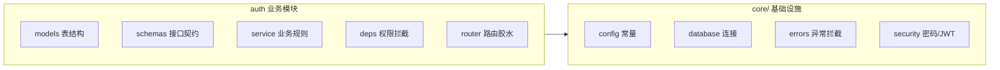
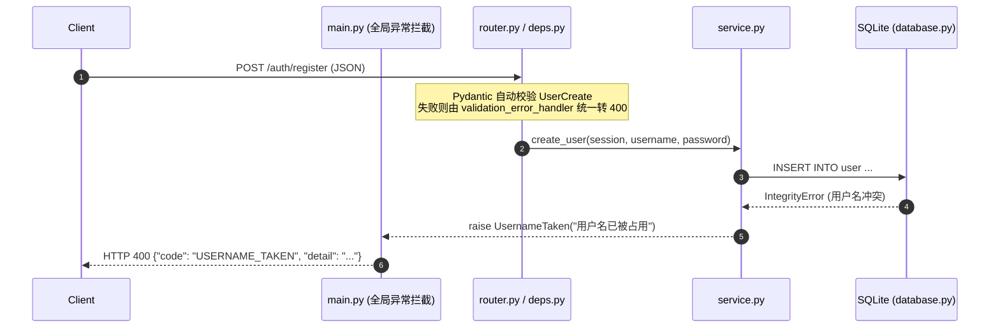

# 后端模块开发实战：从零构建一个高内聚业务模块
以 `auth` 模块为例，拆解真实工程中的分层设计与开发流

---

## 目录

::: toc
:::

---

::: chapter 一、开发前的全局心智模型
在写业务代码之前，先划清基础设施与业务边界
:::

---

## 真实开发者的第一步：不是直接写接口

拿到需求后，新手习惯直接建个文件写 `@app.post("/login")`，把数据库、密码校验、状态码全塞在一起。

成熟的工程实践遵循**关注点分离（SoC）**，先搭建全局底座（`core/`），再在统一的约束下开发业务模块（`modules/`）：



::: tip 核心原则：单向依赖
业务模块（`modules/*`）可以调用 `core/*`，但 `core/*` **绝对不能反向依赖**具体业务模块，保证底座可复用、易测试。
:::

---

## 模块内部的分层职责与依赖方向

以 `modules/auth/` 为例，文件拆分不是为了“看起来高级”，而是为了隔离变化：

| 文件 | 职责定位 | 关心什么 | 绝不碰什么 |
| --- | --- | --- | --- |
| **`models.py`** | 数据持久化映射 | 数据库字段、索引、唯一约束 | HTTP 状态码、请求参数校验 |
| **`schemas.py`** | 接口输入/输出契约 | 字段长度格式、敏感字段脱敏 | SQL 查询、密码哈希计算 |
| **`service.py`** | 纯粹的业务规则 | 数据库、密码比对、签发 Token | `Request` 对象、HTTP 异常 |
| **`deps.py`** | 路由级前置拦截器 | 提取 `Authorization` 请求头 | 具体数据库增删改查逻辑 |
| **`router.py`** | HTTP 协议胶水层 | 接收参数 -> 调 Service -> 返回 | `try/except` 捕获业务异常 |

---

## 人类真实开发时的推进顺序

我们不会同时写完 5 个文件，而是沿着「数据模型 $\rightarrow$ 契约定义 $\rightarrow$ 核心逻辑 $\rightarrow$ 协议暴露 $\rightarrow$ 全局挂载」的顺序自底向上推进：

::: timeline

1. **第一步：定数据结构（`models.py`）**：想清楚数据在数据库里长什么样，利用数据库约束兜底并发问题。
2. **第二步：定输入输出契约（`schemas.py`）**：明确接口收什么参数、吐什么字段。
3. **第三步：写纯粹业务逻辑（`service.py`）**：不考虑 HTTP，只写函数和领域异常，把业务规则跑通。
4. **第四步：补齐鉴权与路由（`deps.py` & `router.py`）**：用依赖注入提取凭证，把 Service 包装成 REST 接口。
5. **第五步：接入应用入口（`main.py`）**：注册路由、挂载全局异常处理器，完成端到端联调。
:::

---

::: chapter 二、自底向上的模块开发五步法
顺着代码演进的真实路径，看每一层是如何设计取舍的
:::

---

## Step 1 & 2：数据模型与接口契约的隔离

很多初学者习惯用一个类既当数据库表模型，又当接口返回体，这极易导致**敏感字段泄露**。

::: cols 1fr 1fr

### 1. 数据库模型 (`models.py`)

面向存储与并发安全设计：

```python
class User(SQLModel, table=True):
    id: int | None = Field(default=None, primary_key=True)
    # 唯一索引：并发下比“先查再插”更可靠
    username: str = Field(index=True, unique=True)
    # 只存加盐慢哈希，绝不存明文
    password_hash: str

```

|||

### 2. 接口契约 (`schemas.py`)

面向前端通信与安全脱敏设计：

```python
# 入参：只在注册时校验密码长度
class UserCreate(BaseModel):
    username: str = Field(min_length=3, max_length=32)
    password: str = Field(min_length=6)

# 出参：天然剔除 password_hash
class UserPublic(BaseModel):
    model_config = ConfigDict(from_attributes=True)
    id: int
    username: str

```

:::

::: warn 设计细节：为什么 `UserLogin` 不校验密码长度？
登录接口只负责与数据库比对。若在登录时做 `min_length=6` 校验，不仅会拦住历史弱密码老用户，还会把密码规则提前暴露给攻击者。
:::

---

## Step 3：业务层只讲“业务语言”（`service.py`）

`service.py` 是整个模块的大脑。写这一层时，**假装自己根本不知道 HTTP 是什么**。

::: cols 1.2fr 1fr

```python
class UsernameTaken(ServiceError):
    code = ErrorCode.USERNAME_TAKEN

def create_user(session: Session, username: str, password: str) -> User:
    user = User(username=username, password_hash=hash_password(password))
    session.add(user)
    try:
        session.commit()
    except IntegrityError:
        session.rollback()
        # 抛出领域异常，而非 HTTPException(400)
        raise UsernameTaken("用户名已被占用") from None
    session.refresh(user)
    return user

```

|||

### 为什么不直接抛 `HTTPException`？

1. **复用性**：如果未来要写 CLI 脚本或后台定时任务调用 `create_user`，它不应该收到 HTTP 异常。
2. **解耦状态码**：错误码与 HTTP 状态码的映射集中在 `core/errors.py` 维护，业务代码无需关心返回 `400` 还是 `409`。
3. **防枚举攻击**：登录失败时统一抛出 `InvalidCredentials`，不区分“用户不存在”还是“密码错”。
:::

---

## Step 4：鉴权抽离与极简路由（`deps.py` & `router.py`）

当业务逻辑在 `service.py` 写完后，HTTP 层就退化成了一层薄薄的“胶水代码”。

::: tabs 鉴权依赖 (deps.py) | 路由接口 (router.py)
跨接口复用的校验逻辑（如解析 Token）抽离为 FastAPI 依赖项，业务接口只需声明参数即可自动获得当前用户：

```python
def get_current_user(
    session: SessionDep,
    authorization: Annotated[str | None, Header()] = None,
) -> User:
    # 1. HTTP 层只负责提取格式
    if not authorization or not authorization.lower().startswith("bearer "):
        raise service.Unauthorized("未登录或 token 无效")
    # 2. 具体验签与查库依然委托给 service
    return service.authenticate_token(session, authorization.split(" ", 1)[1])

```

|||

路由函数里**没有一行 `try / except`**，只做三件事：收参数 $\rightarrow$ 调 Service $\rightarrow$ 返回 Schema。

```python
@router.post("/register")
def register(user: UserCreate, session: SessionDep) -> UserPublic:
    db_user = service.create_user(session, user.username, user.password)
    return UserPublic.model_validate(db_user)

@router.get("/me")
def read_me(current_user: Annotated[User, Depends(get_current_user)]) -> UserPublic:
    return UserPublic.model_validate(current_user)

```

:::

---

## Step 5：全局组装与生命周期（`main.py` & `core/`）

模块开发完成后，最后一步是在 `main.py` 中将其接入全局运行环境，形成完整的请求闭环：



---

## 错误映射：业务层只说“发生了什么”

`service.py` 里抛出的是 `UsernameTaken` 这类领域异常，它只说明“错在哪”，并不知道该回 400 还是 401 —— **把错误码翻译成 HTTP 状态码，是 `core/errors.py` 的事**。

::: cols 1fr 1fr

`core/errors.py` 集中维护三样东西：错误码枚举、状态码映射表、异常处理器。

| 错误 | HTTP 状态码 |
| --- | ---: |
| 参数校验失败、用户名重复、凭据错误 | 400 |
| 未登录或 Token 无效 | 401 |
| 路径或资源不存在 | 404 |
| 框架层其它错误（405 / 415 等） | 400 |

失败响应统一为 `{ "code": "...", "detail": "..." }`，前端只认 `code`。

|||

```python
# modules/auth/service.py
class UsernameTaken(ServiceError):
    code = ErrorCode.USERNAME_TAKEN

# core/errors.py（唯一映射表）
STATUS_BY_CODE: dict[ErrorCode, int] = {
    ErrorCode.USERNAME_TAKEN: status.HTTP_400_BAD_REQUEST,
    ErrorCode.UNAUTHORIZED: status.HTTP_401_UNAUTHORIZED,
    ErrorCode.NOT_FOUND: status.HTTP_404_NOT_FOUND,
}

```

:::

::: tip 为什么值得多一层映射
前端只需要认 `code`；将来把某个错误从 400 挪到 401，或者整个 Web 框架换掉，业务代码一行都不用动。
:::

---

## 全局处理器：让 Router 保持干净

`ServiceError` 由业务代码抛出，一路冒泡到全局异常处理器，由它查表、组装响应。

::: cards 2

### 业务代码负责

* 抛出带 `code` 的 `ServiceError` 子类
* 不为业务错误写 `try/except`、不构造 `JSONResponse`
* 不关心最终返回哪个状态码

|||

### 全局处理器负责

* 用 `ErrorCode` 查出 `STATUS_BY_CODE` 里的状态码
* 组装 `{ "code": "...", "detail": "..." }` 响应体
* 把 Pydantic 默认的 422 统一改成 400

:::

新增一个业务错误时，改三处就够：`ErrorCode` 加枚举值、`STATUS_BY_CODE` 加映射、模块里加一个 `ServiceError` 子类；处理器本身不用动。

::: warn 现状：403 是保留分支
框架层的 403 走兜底分支：状态码原样返回，`code` 却被换成 `UNAUTHORIZED`，`STATUS_BY_CODE` 里也没有 403。要让状态码严格收敛到 200 / 400 / 401 / 404，得同步改 `http_error_handler`。
:::

---

::: chapter 三、可复用的新模块开发清单
当你需要开发下一个模块（如 `courses` / `tasks`）时，直接套用此模式
:::

---

## 扩展新模块的标准化 Checklist

在当前架构下，新增任何业务模块都只需按以下步骤复制结构，无需改动核心框架：

::: cards 2

### 1. 创建模块目录 `modules/<name>/`

* [ ] `models.py`：定义 `SQLModel` 表结构（记得在 `core/database.py` 的 `init_db()` 中导入它以触发建表）。
* [ ] `schemas.py`：拆分 `Create` / `Update` / `Public` 模型，隔离内外部字段。
* [ ] `service.py`：编写纯 Python 业务函数，继承 `ServiceError` 定义业务异常。
* [ ] `router.py`：声明 `APIRouter(prefix="/<name>")`，保持路由函数无异常捕获。

|||

### 2. 注册进全局基础设施

* [ ] **异常枚举**：在 `core/errors.py` 的 `ErrorCode` 中补充新模块的错误码与 HTTP 状态码映射。
* [ ] **鉴权保护**：需要登录的接口，直接在路由参数中注入 `current_user: Annotated[User, Depends(get_current_user)]`。
* [ ] **挂载路由**：在 `main.py` 中执行 `app.include_router(new_router)`。
:::

::: note 架构演进提示
当单个模块的 `service.py` 超过 300 行时，可进一步拆分为 `repository.py`（纯数据库查询）和 `service.py`（纯业务编排）；在项目初期，保持当前 5 文件结构是研发效率与可维护性的最佳平衡点。
:::
