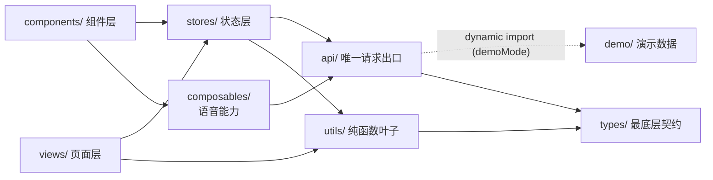
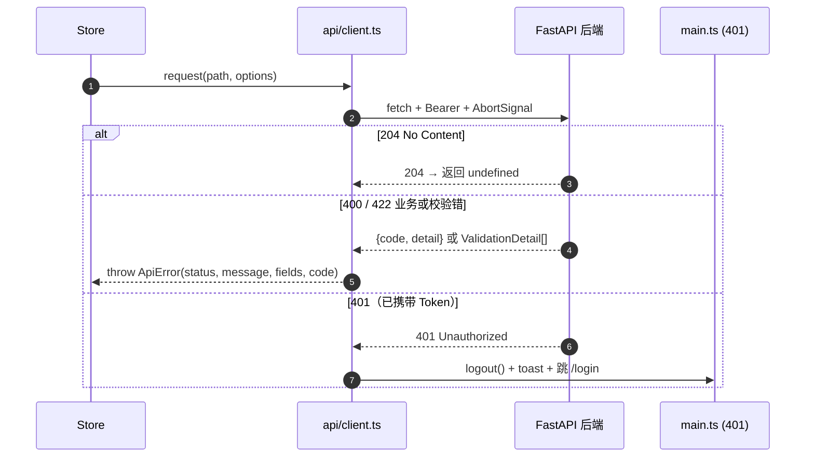

# 前端架构与开发指南

从工程底座、分层依赖到开发规范，快速理解教学智能体前端结构并上手后续迭代

---

## 目录

::: toc
:::

---

::: chapter 一、项目全貌与运行方式
先在本地把开发服务跑起来，再建立对页面路由与目录结构的整体认识
:::

---

## 本地启动与页面地图

拿到仓库后，先用 `pnpm` 安装依赖并启动开发服务器（默认代理 `/api` 到后端 `127.0.0.1:8000`）：

::: cols 0.95fr 1.4fr

```bash
cd ta-webui
pnpm install   # 安装依赖
pnpm dev       # 开发服务（5173）
pnpm check     # 格式/lint/类型
pnpm test      # 单元测试
pnpm build     # 生产构建
```

- 开发环境默认开启 `demoMode`（读 `src/demo/`），认证与探针仍走真实后端
- 关闭演示：在 `.env.local` 中设置 `VITE_DEMO_MODE=false`

|||

| 路径 | 页面 | 权限 / 布局 |
| --- | --- | --- |
| `/login` | 登录 / 注册 | `bare: true`（无导航壳） |
| `/` | 智能家教 | `fullBleed: true` · 主对话入口 |
| `/knowledge` | 知识库 | 课程列表 |
| `/knowledge/:courseId` | 课程结构 | 知识树、Markdown、先修与引用 |
| `/progress` | 学情诊断 | 课程进度、雷达图、专项诊断 |
| `/admin` | 控制台 | `requiresAdmin` · 服务中枢 |
| `/admin/resources` | 资源库 | `requiresAdmin` · 上传与切片 |
| `/admin/agent` | 智能体 | `requiresAdmin` · 工具与提示词 |
| `/system` | 系统状态 | `/health` 与 `/ready` 实时探针 |

:::

---

## 顶层目录与职责概览

`src/` 按“数据契约 → 工具/接口 → 状态/逻辑 → 视图组件”自底向上组织，约 60 个核心文件、结构轻盈：

```text
ta-webui/
  index.html         # 零外链 CDN，纯本地入口
  vite.config.ts     # Vite + Tailwind v4 + @/ 别名 + /api 代理 + vp 工具链
  tsconfig.json      # strict + noUncheckedIndexedAccess + @/* 映射
  tsconfig.vue.json  # 专供 vue-tsc（排除 vue-shim.d.ts）
  src/
    types/           # 最底层：领域 DTO、ApiError（无内部依赖）
    utils/           # 纯函数叶子：errors / labels / nav / status / tone
    config.ts        # 统一导出 apiBaseUrl 与 demoMode
    api/             # 唯一 HTTP 出口：client.ts + 按领域拆分的接口模块
    demo/            # 演示数据与内存会话，仅由 api/ 动态 import
    stores/          # Pinia：session / chat / courses / progress / resources / agent / system / toast
    composables/     # 浏览器能力封装：useRecorder（STT）、useTts（TTS）
    components/      # layout/、ui/（纯组件）、chat/、knowledge/、progress/
    views/           # 路由页面，只读 store 与 config，不直接发请求
    router/index.ts  # 懒加载路由 + 登录/管理员前置守卫
    __tests__/       # 基于 vite-plus/test 的核心单元测试
```

---

::: chapter 二、技术栈与工程底座
了解项目为什么这样选型，以及 TypeScript 与环境变量的基础约定
:::

---

## 极简依赖与一体化工具链

项目刻意控制第三方依赖体积，**不引入重型 UI 组件库，也不依赖任何外部字体或图标 CDN**：

::: cols 1fr 1fr

### 运行时依赖只有五个

| 依赖 | 用途 |
| --- | --- |
| `vue` (`^3.5`) | 组合式 API（`<script setup>`） |
| `vue-router` (`^5.4`) | 路由懒加载与权限守卫 |
| `pinia` (`^4.1`) | Setup Store 状态管理 |
| `markdown-it` (`^15.0`) | 知识单元与导师回复渲染 |
| `dompurify` (`^3.4`) | 富文本 XSS 消毒 |

|||

### 工具链与视觉底座

- **Tailwind CSS v4**：通过 `@tailwindcss/vite` 本地编译，无 CDN。
- **本地 SVG 图标**：[AppIcon.vue](src/components/ui/AppIcon.vue) 内置 23 个 24×24 stroke 图标，断网 / 内网环境完全可用。
- **Vite Plus (`vp`)**：一套工具覆盖 `dev`、`build`、`fmt`（Oxfmt）、`lint`（Oxlint + tsgolint）与 `test`（Vitest）。

:::

::: tip
测试文件统一从 `"vite-plus/test"` 导入（`describe`、`it`、`expect`、`vi`），遵守 `vite-plus/prefer-vite-plus-imports` 规则。
:::

---

## 工程底座包括路径别名、严格类型检查与环境配置

::: cols 1.15fr 1fr

### 双份类型配置与严格检查

- `tsconfig.json` 开启 `strict`、`noUncheckedIndexedAccess`、`noUnusedLocals`、`verbatimModuleSyntax`，并配置 `@/* -> ./src/*` 路径别名。
- **`vp check` 与 `vue-tsc` 分工**：`vp check` 不运行 Vue 语言服务，靠 `src/vue-shim.d.ts` 识别 `.vue`；`pnpm typecheck` 使用 `tsconfig.vue.json` 排除该 shim，执行真实的 SFC 模板类型检查。

|||

### 统一的配置中心

```ts
const DEFAULT_BASE_URL = "/api";
const configuredBaseUrl = import.meta.env.VITE_API_BASE_URL?.trim();

export const apiBaseUrl = (configuredBaseUrl || DEFAULT_BASE_URL).replace(/\/+$/, "");

export const demoMode = import.meta.env.DEV
  ? import.meta.env.VITE_DEMO_MODE !== "false"
  : import.meta.env.VITE_DEMO_MODE === "true";
```

- 全局任何需要 API 基址的地方都从 `@/config.ts` 读取，禁止硬编码 `/api` 或端口。

:::

---

::: chapter 三、分层架构与核心机制
单向依赖铁律、HTTP/401 处理、Demo 隔离与 Store 生命周期
:::

---

## 单向依赖架构图与四条铁律

上层只依赖下层，**绝对禁止反向引用或同层互相耦合**：



1. **`types/` 是最底层**：集中存放领域模型与 `ApiError`，不依赖任何项目内部模块。
2. **`utils/` 是纯函数叶子**：只允许依赖 `@/types/`，严禁 `import` `api/`、`stores/` 或任何组件。
3. **`views/` 与 `components/` 不直接调接口**：页面只读 `stores/`；通用件放 `components/ui/`，带业务轮询的放 `components/layout/`。
4. **`demo/` 只允许在 `api/` 内动态导入**：上层（Views / Stores / Composables）对“真数据还是假数据”完全无感知。

---

## 唯一的请求出口

::: cols 1.35fr 1fr



|||

### 内建统一能力

- **统一入口**：所有请求收敛到 `request` / `requestForm` / `requestBlob`。
- **超时与取消**：默认 15s 超时，支持传入外部 `AbortSignal` 合并取消。
- **错误兼容**：同时解析 `{ code, detail }` 与 FastAPI 422 校验数组，抛出强类型 `ApiError`。

> 登录页输错密码返回 401 时因未携带 Token（`hadAuth === false`），**不会**误触发全局登出跳转。

:::

---

## 演示数据的隔离机制

关闭演示后**生产包不打入任何演示数据**，删除 `src/demo/` 也不影响真实业务：

::: tabs 动态导入的边界 | 隔离状态与副本返回

`src/api/*.ts` 只在 `if (demoMode)` 分支内部动态 `await import("@/demo/...")`：

```ts
// src/api/course.ts
export async function listCourses(): Promise<CourseSummary[]> {
  if (demoMode) {
    const { demoCourses } = await import("@/demo/courses.ts");
    return demoCourses.map((course) => ({ ...course }));
  }

  return request<CourseSummary[]>("/courses");
}
```

- `vite build` 在关闭 `demoMode` 时可按需隔离或直接剔除静态引用，上层代码零耦合。

|||

演示层内部维护的模拟状态**一律对外返回浅拷贝**，绝不把内部数组引用暴露给 Store：

```ts
// src/demo/resources.ts
export function listDemoResources(): ResourceSummary[] {
  return localResources.map((item) => ({ ...item }));
}
```

- `demo/tutor.ts` 按 `sessionId` 维护 `Map<string, ChatMessage[]>`，确保点击“新会话”后上下文彻底隔离。
- `demo/resources.ts` 返回新数组与新对象，避免 `upload()` 时 Demo 与 Store 同时 `unshift` 导致出现双条记录。

:::

---

## 状态层的规范与生命周期

::: cols 1fr 1fr

### 统一的状态与竞态保护

- **异步状态机**：使用 `LoadStatus`（`"idle" | "loading" | "ready" | "error"`）配合 `isLoading()`。
- **防异步竞态**：`courses`、`progress`、`resources` 在切换课程或查看详情时使用递增请求序号（`seq`），丢弃晚到的过期响应。
- **全局通知**：`useToastStore` 收敛原分散的全局状态，由 `ToastHost.vue` 统一渲染（4 秒自动消失）。
- **引用计数轮询**：`useSystemStore` 提供 `startPolling()` / `stopPolling()`，多处挂载只维护一个定时器。

|||

### 账号登出与缓存清理

`stores/reset.ts` 集中导出 `resetDomainStores()`：

```ts
// stores/session.ts
function logout(): void {
  persist(null);
  resetDomainStores();
}
```

- 无论是用户主动退出还是 401 Token 失效触发登出，都会清空 `chat`、`courses`、`progress`、`resources`、`agent` 的内存数据，防止同浏览器切换账号时残留上一个用户的聊天记录或学情状态。

:::

---

## 组件边界与语音适配

::: cards 3

### 基础组件与布局组件

`ui/` 只放**无业务 store 耦合**的通用展示件（`AppIcon`、`AppModal`、`ErrorBanner`、`PageHeader`、`StatusBadge`、`ToastHost`、`MarkdownContent`）；依赖 `session` / `system` 的壳和状态点归入 `layout/`（如 `ApiStatus.vue`）。

|||

### 文档渲染组件的规范

`MarkdownIt` 实例与 `link_open` 规则提升为**模块级单例**，避免每条聊天消息重复实例化；调用 `DOMPurify.sanitize(..., { ADD_ATTR: ["target"] })` 保留外链 `target="_blank"` 与 `rel="noopener noreferrer"`。

|||

### 语音能力的适配

`useRecorder` 与 `useTts` 不直接判断 `demoMode`，而是调用 `api/speech.ts` 的 `speechProvider()`（`"browser" | "backend"`）决定走浏览器原生语音 API 还是后端 `/speech/*` 接口。

:::

---

::: chapter 四、开发规范、实战流程与自查清单
按标准顺序开发新功能或对接真实接口，并用自动化检查守住架构边界
:::

---

## 新增功能与对接后端的标准流程

新增一个业务模块或将现有页面从 Demo 切换到真实后端时，推荐按自底向上的顺序推进：

::: timeline
1. **定义契约（`src/types/index.ts`）**：补充请求与响应 DTO 接口（与后端 Pydantic Schema 对齐）。
2. **编写工具与徽标（`src/utils/labels.ts`）**：如需新状态枚举，在 `labels.ts` 增加文案与 `Tone` 映射。
3. **封装接口（`src/api/<domain>.ts`）**：使用 `request` / `requestForm` 暴露强类型函数；若需演示数据，仅在函数内动态 `import("@/demo/...")`。
4. **维护状态（`src/stores/<domain>.ts`）**：使用 `LoadStatus`、必要时加 `seq` 防竞态，实现 `clear()` 并在 `stores/reset.ts` 登记。
5. **组装视图与组件（`src/components/` & `src/views/`）**：图标统一用 `<AppIcon name="..." />`，错误提示用 `ErrorBanner` 或 `useToastStore`。
6. **补齐测试并验证**：在 `src/__tests__/` 增加单测，跑通 `pnpm format && pnpm check && pnpm test && pnpm build`。
:::

---

## 自查清单与常见避坑

::: cols 1.15fr 1fr

### 提交前自查清单

- 类型与 `ApiError` 只放 `src/types/`，`utils/` 不反向引用 `api/` 或 `stores/`
- `views/` 与 `stores/` 未静态或动态导入 `src/demo/`
- 多级嵌套导航（如 `/admin`）在 `isPathActive()` 传入 `exact: true`
- 详情页依赖路由参数（如 `courseId`）时用 `watch(..., { immediate: true })`
- 新增 Store 已在 `stores/reset.ts` 加入登出清理
- 全项目无外链字体/图标 CDN，图标统一登记在 `AppIcon.vue`

|||

### 自动化验证命令

```bash
pnpm format     # Oxfmt 自动格式化
pnpm typecheck  # vue-tsc 严格检查
pnpm check      # 格式 + Lint + 类型（0 警告）
pnpm test       # Vitest 单元测试
pnpm build      # 验证生产包构建通过
```

::: warn
`vp check` 对测试文件也会做严格类型与 Lint 检查，切勿在测试中使用不安全的可选链赋值或非 `vite-plus/test` 的导入来源。
:::

:::

---

## 继续阅读前后端全栈文档

了解前端工程架构后，可结合后端与各模块文档快速联调全栈链路：

::: cards 3

### 后端架构与开发指南
FastAPI 全局底座、错误码约定与 5 文件业务模块规范。

→ [打开 `intro.md`](?src=decks/intro.md)

|||

### 课程与资源模块设计与实现
多格式资料解析（`resource`）与渐进式披露知识表（`course`）。

→ [打开 `course-resource.md`](?src=decks/course-resource.md)

|||

### 智能体与语音底座指南
SSE 流式输出、工具框架及 GPU 集群 ASR/TTS 部署。

→ [打开 `agent.md`](?src=decks/agent.md) · [打开 `speech.md`](?src=decks/speech.md)

:::

也可以随时按 `L` 或点击 [返回幻灯片选择页](./) 查看全部文档。
