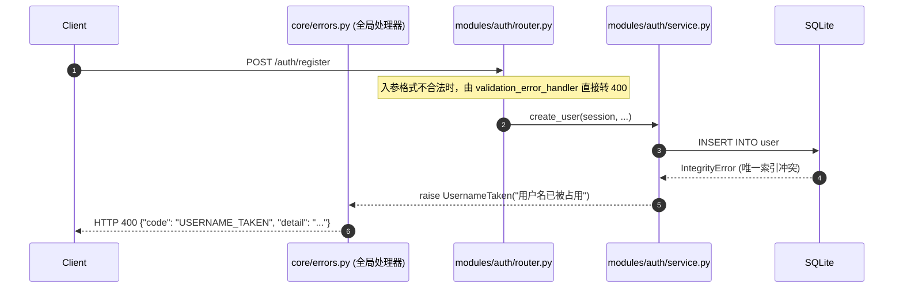
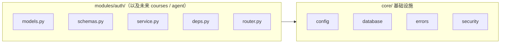

# ta-backend 架构与开发指南

以 `auth` 模块为例，理解项目的目录结构、全局底座与模块约定

---

## 目录

::: toc
:::

---

::: chapter 一、项目全貌与运行方式
先在本地把服务跑起来，再建立对目录结构的整体认识
:::

---

## 本地启动与顶层目录

拿到仓库后，先用 `uv` 把开发服务跑起来，结合 `/docs` 里的接口文档对照看目录：

::: cols 1fr 1.2fr

```bash
cd ta-backend
uv sync               # 按 uv.lock 安装依赖
uv run dev            # 启动开发服务（3000 端口，热重载）
uv run ruff check .   # 代码检查
```

- 接口文档：`http://127.0.0.1:3000/docs`
- 首次启动会自动创建 SQLite 文件 `ta.db` 并建表
- 常用参数：`uv run dev --port 3001 --no-reload`

|||

```text
ta-backend/
  main.py          # 应用入口：生命周期、错误处理器、挂载路由
  core/            # 运行期基础设施（所有业务模块共用）
    config.py      # 全局配置常量
    database.py    # 数据库引擎、建表与请求级会话
    errors.py      # 统一错误码、异常基类与全局处理器
    security.py    # 密码哈希与 JWT 签发/校验
  modules/         # 按业务领域拆分的模块（auth 是第一个样板）
    auth/          # models / schemas / service / deps / router
  scripts/         # 开发期启动脚本（uv run dev 入口）
```

:::

---

::: chapter 二、全局底座：`core/` 包含什么、为什么这样设计
先认识全项目共用的四个基础能力，再借 `auth` 看它们如何运转
:::

---

## `core/` 里有哪些东西？

写任何业务模块（现在的 `auth`，以及后续的 `courses`、`agent`）都会反复用到四类基础能力。项目把它们统一收在 `core/` 里，由所有业务模块共享：

::: cards 2

### `config.py` · 全局配置
集中存放数据库连接串、JWT 签名密钥、算法和过期时间等常量。当前是本地开发默认值，上线前统一改成从环境变量 / `.env` 读取。

|||

### `database.py` · 数据库与会话
负责创建 SQLAlchemy/SQLModel 引擎、在启动时建表，以及通过 `SessionDep` 为每个 HTTP 请求分配和回收数据库会话。

|||

### `errors.py` · 统一错误处理
定义全站共享的错误码 `ErrorCode`、业务异常基类 `ServiceError`、状态码映射表，以及接管异常的全局处理器。

|||

### `security.py` · 安全基础工具
封装密码的 `scrypt` 加盐哈希与校验，以及 JWT Token 的签发与解析，让认证逻辑无需关心底层加密细节。

:::

---

## 应用生命周期与数据库会话（`main.py` & `core/database.py`）

数据库连接的建立、建表和释放，以及每个请求的会话生命周期，都由 `main.py` 和 `core/database.py` 统一托管：

::: cols 1.15fr 1fr

```python
# main.py
@asynccontextmanager
async def lifespan(app: FastAPI):
    init_db()         # 应用启动时建表
    yield
    enging.dispose()  # 应用关闭时释放连接池

app = FastAPI(lifespan=lifespan)
install_error_handlers(app)
app.include_router(auth_router)
```

```python
# core/database.py
def get_session() -> Iterator[Session]:
    with Session(enging) as session:
        yield session

SessionDep = Annotated[Session, Depends(get_session)]
```

|||

### 为什么这样设计？

- **生命周期集中管理**：借助 FastAPI 的 `lifespan`，建表和释放连接池只在应用启停时各执行一次。
- **会话按请求自动开闭**：业务接口在参数里声明 `session: SessionDep`，请求进来时自动创建会话，结束或抛异常时自动关闭，不用在每个接口里手写资源释放。
- **在 `init_db()` 内部导入模型**：`create_all` 需要先加载所有 `table=True` 的表模型；把 `import` 写在函数内部，既能让元数据识别新表，又避免 `core/` 在顶层反向依赖具体业务。

:::

> 注：`SQLModel.metadata.create_all` 只负责创建尚不存在的新表，不会修改已有表的字段；后续涉及表结构变更时再引入 Alembic 做迁移。

---

## 统一错误处理（`core/errors.py`）

为了让前端处理错误足够简单、同时让业务代码与 HTTP 协议解耦，`core/errors.py` 用四个全局处理器把全站响应收敛到固定格式：

::: cols 1.05fr 1.15fr

### 全站状态码与分层约定

全项目只出现 **200 / 400 / 401 / 404 / 500** 五个状态码，失败响应体统一为 `{"code": "...", "detail": "..."}`：

| 来源 | 状态码 | 说明 |
| --- | :---: | --- |
| 正常返回 | 200 | 返回接口声明的 Schema |
| 业务层 `ServiceError` | 400 / 401 | 业务错误默认 400，认证失效 401 |
| 参数校验失败 | 400 | FastAPI 默认 422 统一转为 400 |
| 路由与框架 HTTP 错误 | 400 / 401 / 404 / 500 | 404 仅路径不存在触发；403/405 等压成 400 |
| 未预期异常 | 500 | 统一回 `"服务器内部错误"`，不暴露内部细节 |

|||

```python
# modules/auth/service.py：业务层只描述“发生了什么业务错”
class UsernameTaken(ServiceError):
    code = ErrorCode.USERNAME_TAKEN

# core/errors.py：业务错误码 -> 状态码（只允许 400 / 401，未列出默认 400）
STATUS_BY_CODE: dict[ErrorCode, int] = {
    ErrorCode.USERNAME_TAKEN: status.HTTP_400_BAD_REQUEST,
    ErrorCode.INVALID_CREDENTIALS: status.HTTP_400_BAD_REQUEST,
    ErrorCode.UNAUTHORIZED: status.HTTP_401_UNAUTHORIZED,
}

# main.py 调用 install_error_handlers(app) 装上四个处理器：
# ServiceError / RequestValidationError / StarletteHTTPException / Exception
```

:::

**为什么这样设计？** 业务层只需要用 `ServiceError` 表达领域语义，不用关心 HTTP 状态码，也不用处理 `401` 附带 `WWW-Authenticate: Bearer` 这类协议头；未预期异常由最外层的 `Exception` 处理器统一兜底为 `500`，既不会把堆栈漏给前端，也让前端只需按 `code` 做分支。

---

## 以 `auth` 为例：一条业务错误如何走到前端

当注册请求遇到重复用户名时，异常会直接穿过路由层，由全局处理器统一翻译成 HTTP 响应：



新增一种业务错误时，流程很轻：在 `ErrorCode` 的业务层分组里加一个枚举、在模块里建一个 `ServiceError` 子类，再按需在 `STATUS_BY_CODE` 里登记（业务错误默认 400，需要返回 401 时显式映射即可），四个全局处理器和路由本身都无需改动。

---

## 安全工具与依赖注入（`core/security.py` & `Depends`）

很多接口都需要做相同的前置工作——比如拿数据库会话、或者验证用户是否登录。项目把底层算法放在 `core/security.py`，把请求级前置校验抽成 FastAPI 依赖项：

::: cols 1.15fr 1fr

```python
# modules/auth/deps.py：从 HTTP 请求头提取凭证
def get_current_user(
    session: SessionDep,
    authorization: Annotated[str | None, Header()] = None,
) -> User:
    if not authorization or not authorization.lower().startswith("bearer "):
        raise service.Unauthorized("未登录或 token 无效")
    token = authorization.split(" ", 1)[1]
    return service.authenticate_token(session, token)
```

```python
# 其他模块受保护的接口，只需一行参数即可复用
@router.get("/me")
def read_me(
    current_user: Annotated[User, Depends(get_current_user)],
) -> UserPublic:
    return UserPublic.model_validate(current_user)
```

|||

### 为什么这样分层？

- **算法与业务解耦**：`core/security.py` 只管密码哈希和 JWT 编解码，不知道“用户表”的存在。
- **协议与校验解耦**：`deps.py` 只负责从 `Authorization` 头里切出 Token，验签和查用户委托给 `service.authenticate_token`。
- **跨模块一行复用**：后续 `courses`、`agent` 等模块需要鉴权时，直接注入 `Depends(get_current_user)` 即可，失败同样走全局错误处理器返回 401。

:::

---

::: chapter 三、业务模块怎么组织：以 `auth` 为样板
理清模块间的依赖方向，以及一个标准业务模块内部的分工
:::

---

## 模块间的依赖方向



- **单向依赖**：业务模块（`modules/*`）可以依赖 `core/*`，反过来 `core/*` 保持业务无关，方便底座复用和独立测试。
- **模块间通过公开 `service` 协作**：例如未来 `agent` 需要检索课程资料时，应调用 `courses.service` 提供的函数，而不是直接操作 `courses` 的数据库表模型。

---

## 模块内部的 5 文件职责划分

以 `modules/auth/` 为样板，把一个业务模块拆成 5 个文件，目的是将“数据存储、接口格式、业务规则、HTTP 协议”四类关注点各自隔离开：

| 文件 | 抽象职责 | 负责什么 | 职责边界 |
| --- | --- | --- | --- |
| **`models.py`** | 持久化数据模型层 | 数据库表结构、字段类型、索引与唯一约束 | 只面向存储，不掺入接口校验和 HTTP 概念 |
| **`schemas.py`** | 接口契约与脱敏层 | 请求入参校验、响应出参字段白名单 | 只描述接口外形，不做数据库读写与业务计算 |
| **`service.py`** | 核心业务逻辑层 | 业务规则、数据操作、抛出 `ServiceError` | 独立于 Web 协议，不耦合 `Request` 与状态码 |
| **`deps.py`** | 请求级依赖层 | 从 HTTP 请求提取上下文、封装可复用前置校验 | 只做请求参数提取与委托，不直接写表查询 |
| **`router.py`** | HTTP 协议适配层 | 声明路由、收参数 → 调 `service` → 返回 Schema | 保持极薄，把业务逻辑和异常转换交给下层与全局 |

---

## 这些分层落到代码上长什么样？

以 `auth` 里的精简代码为例，看两处最核心的职责拆分：

::: tabs 存储模型 vs 接口契约 (models / schemas) | 业务逻辑 vs HTTP 适配 (service / router)

把数据库表模型和接口出参分开定义，可以按读写场景独立校验，也能天然防止 `password_hash` 这类内部存储字段透传给前端：

```python
# models.py：面向数据库存储
class User(SQLModel, table=True):
    id: int | None = Field(default=None, primary_key=True)
    username: str = Field(index=True, unique=True)
    password_hash: str

# schemas.py：面向接口通信
class UserCreate(BaseModel):
    username: str = Field(min_length=3, max_length=32)
    password: str = Field(min_length=6)

class UserPublic(BaseModel):
    model_config = ConfigDict(from_attributes=True)
    id: int
    username: str
```

|||

`service.py` 独立于 Web 协议，便于单测和跨模块调用；`router.py` 只负责把 HTTP 请求转成函数调用并包装返回值：

```python
# service.py：实现业务规则，失败抛出领域异常
def create_user(session: Session, username: str, password: str) -> User:
    user = User(username=username, password_hash=hash_password(password))
    session.add(user)
    try:
        session.commit()
    except IntegrityError:
        session.rollback()
        raise UsernameTaken("用户名已被占用") from None
    session.refresh(user)
    return user

# router.py：收参数 -> 调 service -> 返回 Schema
@router.post("/register")
def register(user: UserCreate, session: SessionDep) -> UserPublic:
    db_user = service.create_user(session, user.username, user.password)
    return UserPublic.model_validate(db_user)
```

:::

---

## 开发一个新模块的推荐顺序

新建业务模块时，按自底向上的顺序推进思路最连贯：

::: timeline

1. **定义数据模型（`models.py`）**：确定需要持久化哪些表、字段和唯一约束。
2. **定义接口契约（`schemas.py`）**：明确每个接口接收什么入参、对外返回哪些字段。
3. **实现核心逻辑（`service.py`）**：独立于 HTTP 协议编写业务函数，用 `ServiceError` 子类表达业务失败。
4. **封装依赖与路由（`deps.py` & `router.py`）**：复用 `SessionDep` 与 `get_current_user`，用薄路由把能力暴露成 REST 接口。
5. **接入全局骨架**：在 `core/database.py` 注册表模型、在 `core/errors.py` 补充错误码映射、在 `main.py` 挂载路由。
:::

---

::: chapter 四、新模块 Checklist 与后续阅读
开工时对照这份清单，看完架构再进入具体功能文档
:::

---

## 新增模块 Checklist

::: cards 2

### 1. 模块内部（`modules/<name>/`）

- [ ] `models.py`：定义 `SQLModel` 表，并在 `core/database.py` 的 `init_db()` 中导入
- [ ] `schemas.py`：拆分入参和出参模型，隔离内部存储字段
- [ ] `service.py`：编写业务函数与 `ServiceError` 子类
- [ ] `router.py`：声明 `APIRouter(prefix="/<name>")`，保持路由简洁

|||

### 2. 接入全局与验证

- [ ] `core/errors.py`：在 `ErrorCode` 补充业务错误码，并在 `STATUS_BY_CODE` 中登记（业务层只出 400 / 401）
- [ ] 需要登录态的接口通过 `Depends(get_current_user)` 复用鉴权
- [ ] `main.py` 中执行 `app.include_router(...)` 挂载路由
- [ ] 用 `uv run dev` 在 `/docs` 验证接口，再运行 `uv run ruff check .`

:::

> 演进节奏：项目初期保持这 5 个文件结构最平衡；当单个模块的 `service.py` 超过 300 行、查询逻辑变复杂时，再抽出一层 `repository.py` 专门负责数据查询。

---

## 继续阅读：其他模块文档

熟悉 `ta-backend` 的全局约定后，可直接跳转到对应模块的设计与部署指南：

::: cards 2

### 教学智能体 Agent 模块
OpenAI Responses API 流式输出、工具框架、Agent Loop 与教学闭环设计。

→ [打开 `agent.md`](?src=decks/agent.md)

|||

### 实验室集群语音底座部署
在 GPU 集群上部署 Whisper（ASR）与 Fish Speech（TTS），含裸机与 Slurm 方案。

→ [打开 `speech.md`](?src=decks/speech.md)

:::

也可以随时按 `L` 或点击 [返回幻灯片选择页](./) 查看全部文档。
