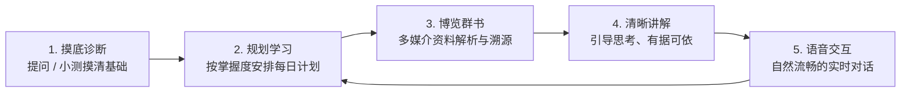
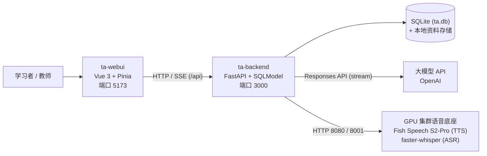
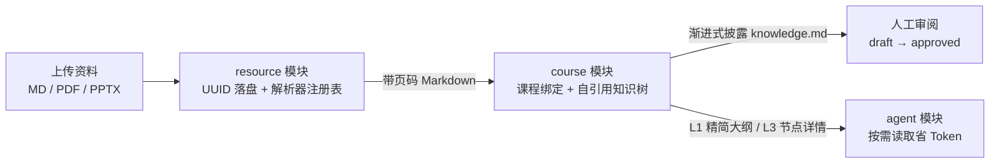
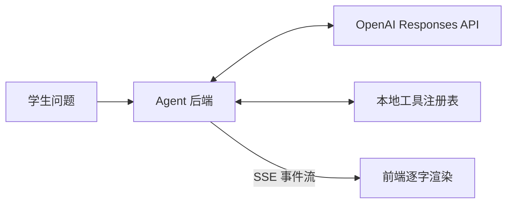
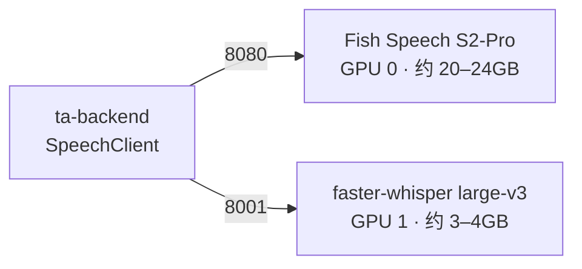

# 教学智能体项目总览

家庭教师式教学智能体（EduTutor）的产品愿景、研发理念、全栈架构与团队协作地图

---

## 目录

::: toc
:::

---

::: chapter 一、产品愿景与研发理念
先对齐「我们要做一个什么样的教学智能体」，以及 Agent 时代 3–4 人小团队如何稳步协作
:::

---

## 愿景：像家庭教师一样的教学智能体

我们不想做一个「把问题丢给大模型、吐出一大段文字」的聊天外壳，而是打造一位陪伴式**家庭教师**，打通完整的个性化学习闭环：



::: cards 3

### 摸底与规划
初次见面通过问答与小测摸清知识盲区，结合学情掌握度安排每天的学习和复习节奏。

|||

### 博览群书与清晰讲解
吃透多种格式的学习资料与讲义，面对提问能引用真实课件，用简洁易懂的方式引导学生理解。

|||

### 流畅语音对话
支持直接开口提问与自然语音播报，把「看文字聊天」升级成接近真人家教的交流体验。

:::

---

## Agent 时代与多人协作的破局之道

在 AI 辅助开发普及的当下，团队经常同时面对「失控感」与「协作内耗」两个矛盾：

::: cols 1fr 1.15fr

### 常见痛点

- **失控的 AI Slop**：Agent 一次生成海量代码和文档，人根本看不过来，只能盲目「继续许愿」。
- **多人协作反而更慢**：当个人都跟不上 Agent 的输出速度时，职责不清、互相改文件只会让冲突爆炸。

::: warn
没有清晰架构边界与审阅关口时，AI 写得越快，项目崩得越快。
:::

|||

### 本项目的两条破局原则

1. **夯实基础，拿回掌控感**：选定轻量克制的技术栈，先搞清楚核心架构、工具链与配置文件各自管什么——不出错时不必深究，出错时知道去哪查。
2. **默认正确，聚焦核心关口**：不试图逐行盯死所有输出，把精力集中在**模块边界、接口契约、人工审阅关口**（如渐进式披露的知识表），其余交由约定与自动化检查兜底。

::: tip
面向 3–4 人小团队：先搭好干净的工程底座与文档地图，再按模块切分支并行推进。
:::

:::

---

::: chapter 二、系统全景与仓库结构
一张图看清从浏览器到 GPU 算力集群的完整链路，以及代码仓库里的三大工程
:::

---

## 系统整体架构与数据流

整套系统按「前端交互 → 后端统一业务编排 → 外部模型与 GPU 语音底座」三层解耦：



::: cards 3

### 后端掌握控制权
权限校验、资料存取、工具执行、掌握度更新与流式中继全部收口在 `ta-backend`，API Key 绝不进前端。

|||

### 资料与知识解耦
原始异构文件先经 `resource` 统一解析为 Markdown，再由 `course` 组织成可审阅的渐进式知识树。

|||

### 重算力独立外置
高显存消耗的 TTS 与 ASR 独立部署在实验室 GPU 集群，通过 HTTP 与后端解耦通信。

:::

---

## 仓库目录与三大子工程

仓库根目录下只包含三个职责清晰的子工程，没有复杂的跨语言构建胶水：

::: cols 1.15fr 1fr

```text
ta-new/
├── ta-backend/          # FastAPI + SQLModel 后端
│   ├── main.py          # 入口：lifespan、错误处理器、挂载路由
│   ├── core/            # 全局底座：config / database / errors / security
│   ├── modules/         # 业务模块（已落 auth，已预留 resource）
│   └── scripts/dev.py   # 本地开发启动器（uv run dev）
├── ta-webui/            # Vue 3 + TS + Tailwind v4 前端
│   └── src/             # types → utils → api/demo → stores → views
└── PPT-Helper/          # 零构建 Markdown 幻灯片与文档中心
    ├── decks/           # 全项目总览、架构规范、模块设计与运维指南
    └── archive/         # HTTP / FastAPI / Pydantic / SQLModel 入门归档
```

|||

| 子工程 | 核心技术栈 | 默认端口 | 定位 |
| --- | --- | :---: | --- |
| `ta-backend` | Python ≥ 3.14 · `uv`<br/>FastAPI · SQLModel | `3000` | 业务中枢与统一 API |
| `ta-webui` | Vue 3 · TS · Pinia<br/>Tailwind v4 · Vite Plus | `5173` | 学习者与管理端界面 |
| `PPT-Helper` | 原生 Node.js ≥ 18<br/>零构建 · 本地化静态资源 | `8000` | 项目文档与讲稿中心 |

:::

---

::: chapter 三、五大业务模块与当前进度
把家庭教师愿景拆成职责清晰、互不踩脚的模块，先看全局分工再逐个深入
:::

---

## 五大业务模块分工与当前状态

| 模块 | 核心职责 | 关键设计要点 | 当前仓库状态 |
| --- | --- | --- | --- |
| **后端底座与认证** (`core` + `auth`) | 配置、数据库会话、全局错误处理、密码哈希与 JWT 鉴权 | 5 文件模块样板；全站只出 `200/400/401/404/500` | **已实现**（可运行验收） |
| **前端应用** (`ta-webui`) | 对话、知识树、学情诊断、资源/智能体管理、录音与朗读 | 严格单向分层；`demo/` 动态隔离、零外链 CDN | **原型与架构已就绪** |
| **内容与解析** (`resource`) | 接收 MD/TXT/PDF/PPTX，落盘并解析为统一 Markdown | 文件存磁盘不进库、UUID 防路径穿越、解析器注册表 | **目录已预留，设计完备** |
| **课程与知识表** (`course`) | 课程建表、绑定资料、知识树维护与渐进式披露导出 | `draft/approved` 人工审阅防 AI Slop；L1/L2/L3 分层 | **设计完备待开发** |
| **智能体** (`agent`) | 提示词管理、工具框架、多轮调用循环与 SSE 流式回复 | OpenAI Responses API；两段流中继；身份只取后端 `ctx` | **设计完备待开发** |
| **语音底座** (`speech`) | 实验室 GPU 集群部署 TTS 与 ASR，后端薄客户端封装 | 2×RTX 3090 分卡隔离；文本流外围按标点断句送 TTS | **部署指南完备待联调** |

::: badges
ok 工程底座、auth 样板、前端原型与全套文档已落地
info resource / course / agent / speech 按各自讲稿切分支并行开发
:::

---

## 双端工程底座：后端与前端的核心约定

项目先打磨好了前后端两套高内聚、低耦合的工程样板，后续新模块直接照模板扩展：

::: tabs 后端底座（ta-backend） | 前端底座（ta-webui）

- **全局底座 `core/`**：`config.py`（`pydantic-settings` 环境变量/`.env`）、`database.py`（SQLite + 请求级 `SessionDep`）、`errors.py`（`ServiceError` + 四大全局处理器）、`security.py`（`scrypt` + PyJWT）。
- **单向依赖铁律**：`modules/* -> core/*`，底座绝不感知具体业务；**模块间只调 `service` 函数，不跨模块直查 ORM 表**。
- **标准 5 文件拆分**：`models.py`（表）· `schemas.py`（契约脱敏）· `service.py`（业务规则与异常）· `deps.py`（请求依赖）· `router.py`（薄协议适配）。
- **统一响应**：业务错误原地继承 `ServiceError` 声明 `code`（默认 400），鉴权失效复用 `Unauthorized`（401），路由层不写 `try/except`。

|||

- **极简运行时依赖**：仅 `vue`、`vue-router`、`pinia`、`markdown-it`、`dompurify` 五个依赖；Tailwind v4 本地构建，23 个图标收口在 `AppIcon.vue`，零外链 CDN。
- **9 个核心路由页面**：智能家教（`/`）、知识库与课程树（`/knowledge`）、学情诊断与雷达图（`/progress`）、管理台/资源库/智能体（`/admin/*`）、登录（`/login`）、系统状态（`/system`）。
- **单向分层与 Demo 隔离**：`views / components -> stores / composables -> api (-dynamic-> demo) -> utils -> types`；关闭 `demoMode` 后生产包不打入演示数据。
- **Vite Plus (`vp`) 一体化工具链**：一条命令覆盖格式化、Lint、类型检查与单元测试。

:::

---

## 内容解析与课程知识表（`resource` & `course`）

把**原始资料解析**和**结构化教学知识**拆成两个模块，同时解决「多格式接入」与「拒绝 AI Slop」两大难题：



::: cols 1fr 1fr

### `resource` 模块三条底线
- **文件落磁盘，元数据入库**：不把大体积二进制塞进 SQLite；
- **UUID 重命名**：防路径穿越，出参绝不泄露本地 `storage_path`；
- **解析出口统一 Markdown**：扩展新格式只需往 `PARSERS` 注册。

|||

### `course` 渐进式披露三层结构
- **L1 课程总览**：章节目录、摘要与审阅进度，5 秒看清骨架；
- **L2 知识点清单**：难度、前置依赖、`draft/approved` 状态与资料出处；
- **L3 折叠详情**：`<details>` 包裹完整讲解与例题，人点开才审阅、Agent 调工具才加载。

:::

---

## 智能体与语音底座（`agent` & `speech`）

::: cards 2

### `agent`：后端掌权的流式教学循环



- **两段式流中继**：上游消费 `AsyncOpenAI(stream=True)`，下游翻译成项目自有 SSE 事件（`tool.started` / `tool.completed` / `message.delta` / `run.completed` / `error`），换模型供应商前端零改动。
- **权限与评估边界**：`user_id` 只从后端 `ctx` 注入，不信任模型传参；「学生说我懂了」不等于掌握，掌握度更新由后端业务规则裁决。

|||

### `speech`：实验室 GPU 集群独立部署



- **双卡隔离常驻**：实验室申请 2 张 RTX 3090（CUDA 12.x），用 `tmux` 后台常驻；本地开发机可通过 `ssh -L` 端口转发直连联调。
- **外置解耦设计**：ASR / TTS 不揉进 Agent Loop 核心代码；文本流稳定后在外围按句号/问号断句异步送 TTS，缩短首字开口延迟。

:::

---

::: chapter 四、快速上手与联调要点
拿到仓库后，用三条极简命令把文档、后端和前端都在本地跑起来
:::

---

## 本地启动三步走

::: cards 3

### 1. 打开项目讲稿（推荐先看）
```bash
cd PPT-Helper
node server.js overview
# 或 npm start 打开列表页
```
默认 `http://localhost:8000`；零构建零依赖，修改 `.md` 刷新即生效。

|||

### 2. 启动后端（`ta-backend`）
```bash
cd ta-backend
cp .env.example .env
uv sync
uv run dev
```
默认 `http://127.0.0.1:3000`，Swagger UI 见 `/docs`，首次启动自动建 SQLite `ta.db`。

|||

### 3. 启动前端（`ta-webui`）
```bash
cd ta-webui
pnpm install
pnpm dev
```
默认 `http://localhost:5173`，开发模式默认免登录开启 `demoMode`，可立即体验全部 9 个页面。

:::

::: warn
**当前阶段前后端联调的两处注意点**：
1. **端口对齐**：`ta-backend` 默认监听 `3000`（可用 `uv run dev --port 8000` 切换），`ta-webui` 的 Vite `/api` 代理默认指向 `127.0.0.1:8000`；`PPT-Helper` 默认也用 `8000`，同时启动时加 `--port 8088` 错开。
2. **契约对齐**：`ta-webui` 沿用原型字段（如登录 `email` / `role`），而 `ta-backend` 样板为 `username`，随各模块 MVP 落地逐步统一并关闭 `VITE_DEMO_MODE=false`。
:::

---

::: chapter 五、团队协作、路线图与文档导航
清晰的分工红线、四阶段演进路线，以及仓库全部讲稿的一键入口
:::

---

## 3–4 人团队协作规范与红线

::: cols 1.15fr 1fr

### 轻量分支与提交约定

- **`main` 永远保持可启动**：独立小改测通可合入，模块开发与改公共代码务必从 `main` 切分支（如 `feat/resource`、`feat/course`、`feat/agent`、`feat/speech`）。
- **原子提交**：显式 `git add <路径>`，使用 Conventional Commits（`feat(scope):` / `fix(scope):` / `refactor(scope):` / `docs:`）。
- **代码质量自检**：后端推前跑 `uv run ruff check .`；前端推前跑 `pnpm check && pnpm test && pnpm build`。

|||

### 不可触碰的协作红线

::: badges
bad 严禁提交 .env、API Key、ta.db、storage/ 与模型权重
bad 严禁在 main 分支执行 git push --force
bad 严禁把大模型 API Key 暴露到前端代码
bad 严禁跨模块直接查询其他模块的 ORM 表
warn 集群实验结束务必删除交互式实例释放 GPU
ok 开工先 pull、模块测通勤 push、遇冲突当面确认
:::

:::

---

## 项目四阶段演进路线

每个模块坚持「**先跑通最小闭环（MVP），再逐轮迭代增强**」，避免一口吃成胖子：

::: timeline

1. **阶段一 · 工程底座与蓝图就绪（当前已完成）**：完成 `ta-backend` 核心底座与 `auth` 样板、`ta-webui` 分层原型与演示数据，以及全套架构、模块与运维文档。
2. **阶段二 · 各业务模块 MVP 并行落地**：按分工切分支，分别交付 `resource` 多格式解析、`course` 知识树与 `knowledge.md`、`agent` 单工具 + SSE 流、GPU 集群 TTS/ASR 闭环。
3. **阶段三 · 全栈联调与契约收敛**：统一前后端端口与接口字段，关闭前端 `VITE_DEMO_MODE`，在真实后端上打通注册登录、上传课件、课程知识树与流式对话。
4. **阶段四 · 教学闭环深化**：补齐 LLM 自动生成知识表草稿 + 人工审阅、`LearnerMastery` 摸底与每日计划、音视频转写与按句流式语音播报，以及 Alembic 迁移与鉴权限流加固。

:::

---

## 全项目文档导航

点击下方链接可直接跳转到对应专题讲稿，或随时按 `L` 回到幻灯片选择页：

::: cards 2

### 核心架构与业务模块

- **后端架构与开发指南**（底座 + `auth` 样板）→ [打开 `intro.md`](?src=decks/intro.md)
- **前端架构与开发指南**（单向分层 + Demo 隔离）→ [打开 `intro-webui.md`](?src=decks/intro-webui.md)
- **课程与资源模块设计与实现**（解析器 + 知识表）→ [打开 `course-resource.md`](?src=decks/course-resource.md)
- **Agent 模块设计与实现**（工具循环 + SSE 流）→ [打开 `agent.md`](?src=decks/agent.md)

|||

### 算力部署与团队协作

- **语音底座部署指南**（Fish Speech + Whisper）→ [打开 `speech.md`](?src=decks/speech.md)
- **GPU 集群使用指南**（13 步申请 3090 图文实操）→ [打开 `cluster-guide.md`](?src=decks/cluster-guide.md)
- **Git 与协作开发**（轻量分支流 + 冲突急救）→ [打开 `git-collab.md`](?src=decks/git-collab.md)
- **全部幻灯片列表** → [返回选择页](./)（快捷键：`T` 目录 · `O` 概览 · `D` 深浅色）

:::
