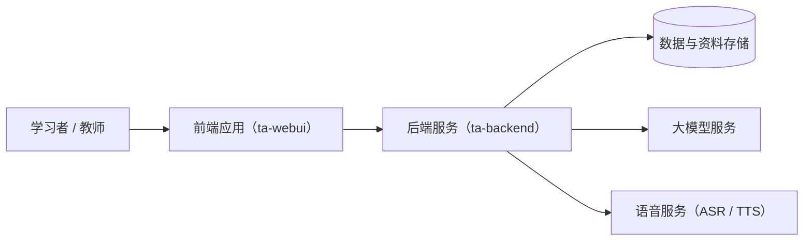
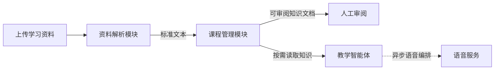

# 教学智能体项目总览

家庭教师式教学智能体的产品愿景、研发理念、系统全景与团队协作地图

---

## 目录

::: toc
:::

---

::: chapter 一、产品愿景与研发理念
先对齐我们要做一个什么样的教学智能体，以及团队如何在 AI 辅助下稳步协作
:::

---

## 愿景：像家庭教师一样的教学智能体

我们不想做一个「把问题丢给大模型、吐出一大段文字」的聊天外壳，而是打造一位陪伴式**家庭教师**，围绕以下核心能力服务个性化学习：

::: cards 3

### 摸底与规划
初次见面通过问答与小测摸清知识盲区，再结合掌握情况动态安排每天的学习和复习节奏。

|||

### 博览群书与清晰讲解
解析并吃透多种格式的学习资料与讲义，面对提问能引用真实课件，用简洁易懂的方式引导学生思考。

|||

### 流畅语音对话
支持直接开口提问与自然语音播报，把「打字看长文」升级成接近真人家教的交流体验。

:::

---

## Agent 时代与多人协作的破局之道

在 AI 辅助开发普及的当下，团队协作常同时面对「失控感」与「协作内耗」两个矛盾：

::: cols 1fr 1.15fr

### 常见痛点

- **失控的 AI Slop**：Agent 一次生成海量代码和文档，人看不过来，只能盲目继续提示。
- **多人协作反而更慢**：当个人都跟不上生成速度时，职责不清、互相改文件会让冲突迅速失控。

::: warn
没有清晰架构边界与审阅关口时，AI 写得越快，项目崩得越快。
:::

|||

### 本项目的两条破局原则

1. **夯实基础，拿回掌控感**：选择轻量克制的技术栈，先搞清楚核心架构、工具链与配置文件各自管什么——不出错时不必深究，出错时知道去哪查。
2. **默认正确，聚焦核心关口**：不试图逐行盯死所有输出，把精力集中在**模块边界、接口契约与人工审阅关口**，其余交由规范与自动化检查兜底。

::: tip
团队协作节奏：先搭好干净的工程底座与文档地图，再按模块切分支并行推进。
:::

:::

---

::: chapter 二、系统全景与仓库分工
先看清系统的整体层次，再了解仓库里三个子工程各自负责什么
:::

---

## 系统整体架构

整套系统按「前端交互 → 后端统一编排 → 外部模型与语音算力」解耦，各层只关心自己的职责：



::: cards 3

### 后端掌握控制权
权限校验、资料存取、工具执行、学情更新与流式输出全部由后端统一处理，密钥与核心逻辑绝不进入前端。

|||

### 资料与课程解耦
原始学习材料先统一解析为标准文本，再交由课程模块组织为可供人工审阅、可供智能体按需读取的教学知识。

|||

### 语音算力独立外置
高显存消耗的语音识别与语音合成独立部署在外部算力集群，通过网络接口与后端解耦，不拖累主服务开发。

:::

---

## 仓库里的三个子工程

仓库根目录下只有三个职责清晰的子工程，彼此独立、互不耦合：

::: cards 3

### 后端服务
目录：`ta-backend/`

负责认证鉴权、学习资料解析、课程管理、教学智能体编排与语音服务对接。

|||

### 前端应用
目录：`ta-webui/`

面向学习者与教师的交互界面，内置可离线体验的演示模式，不依赖后端也能先看全套页面。

|||

### 文档中心
目录：`PPT-Helper/`

存放全项目架构设计、各模块实现方案与团队协作指南，支持在本地直接以幻灯片形式浏览。

:::

---

::: chapter 三、模块分工与协作边界
把产品愿景拆成互不踩脚的模块，先看全局分工，再理解关键边界
:::

---

## 核心模块分工与当前进度

| 模块 | 核心职责 | 当前状态 |
| --- | --- | --- |
| **后端底座与认证** | 全局配置、数据库会话、统一错误处理与用户鉴权 | **已实现**，可作为新模块样板 |
| **前端应用** | 对话交互、知识库、学情诊断、管理控制台与语音适配 | **原型与分层架构已就绪** |
| **资料解析** | 接收多格式学习资料，安全存储并统一解析为标准文本 | 待开发 |
| **课程管理** | 组织课程、绑定资料，维护可审阅的分层教学知识 | 待开发 |
| **教学智能体** | 编排提示词、工具调用循环与流式对话回复 | 待开发 |
| **语音交互** | 对接外部语音识别与语音合成服务，支撑实时语音对话 | 待开发 |

::: badges
ok 工程底座、认证样板、前端原型与全套设计文档已落地
info 资料、课程、智能体与语音模块按各自讲稿切分支并行推进
:::

---

## 双端工程的边界约定

前后端已先打磨好干净的工程样板，后续新增功能遵循统一的边界原则：

::: tabs 后端原则 | 前端原则

- **单向依赖底座**：业务模块依赖全局底座，底座绝不反向感知具体业务。
- **模块间只调服务接口**：跨模块协作通过公开的服务函数完成，严禁直接查询其他模块的数据表。
- **职责按文件分层**：数据模型、接口契约、业务规则、请求依赖与路由适配各自独立，路由层保持薄适配。
- **全站统一错误出口**：业务层抛出语义化异常，由全局处理器统一收敛响应格式，避免在路由里到处写异常捕获。

|||

- **克制引入外部依赖**：只保留必要的核心依赖，样式与图标全部本地化，不依赖外部 CDN。
- **严格单向分层**：页面与组件经状态层、接口层逐级向下依赖，禁止跨层直接访问底层数据。
- **演示模式动态隔离**：离线演示数据集中在独立目录，关闭演示模式后与真实业务零耦合。
- **工具链一体化**：格式化、代码检查、类型校验与测试统一为简洁命令，降低维护成本。

:::

---

## 核心业务如何解耦协作

各个业务模块只做自己最擅长的一件事，通过清晰的数据边界串联起来：



::: cols 1fr 1fr

### 资料与课程：先解析，再建知识
- **资料模块**只管把异构文件存稳、解成干净文本，不关心它属于哪门课。
- **课程模块**只管绑定资料、组织分层知识并引入人工审阅关口，既防 AI 乱写，也让智能体按需读取。

|||

### 智能体与语音：主循环外置语音
- **智能体模块**由后端掌握工具执行、身份上下文与学情评估权，并对外输出统一的流式事件，换模型不影响前端。
- **语音模块**保持外置解耦，不揉进智能体核心循环；文本流稳定后再分段送往语音合成，兼顾清晰度与响应速度。

:::

---

::: chapter 四、本地快速上手
先理清本地工具链，再用三条命令把文档、后端和前端跑起来
:::

---

## 环境准备

本项目前端与文档工具基于 JavaScript 运行时，后端基于 Python。开始前请先安装 **Node.js**、**pnpm** 与 **uv**：

::: cards 3

### Node.js 与 npm
要求 **Node.js ≥ 22**。它是 JavaScript 运行时，安装时会自带包管理器 **npm**，可直接用来运行文档中心。

|||

### pnpm
更高效的 Node.js 包管理器，用于管理前端工程的依赖与脚本。安装 Node.js 后执行 `npm install -g pnpm` 即可安装。

|||

### uv
Python 包与环境管理工具，负责管理 Python 版本及后端虚拟环境与依赖。本项目后端要求 Python 3.14 及以上版本。

:::

---

## 三步启动本地环境

::: cards 3

### 1. 打开项目讲稿
```bash
cd PPT-Helper
node server.js overview
```
启动后在浏览器查看本讲稿，支持本地实时刷新；运行 `node server.js` 可打开全部讲稿列表页。

|||

### 2. 启动后端服务
```bash
cd ta-backend
cp .env.example .env
uv sync && uv run dev
```
首次启动会自动初始化本地数据库，并提供交互式接口文档页面。

|||

### 3. 启动前端应用
```bash
cd ta-webui
pnpm install && pnpm dev
```
前端默认使用离线演示数据，无需启动后端即可直接体验完整界面。

:::

::: tip
如需前后端联调、调整端口或查看更多开发命令，请参考 `ta-webui/README.md` 与 `ta-backend/README.md`。
:::

---

::: chapter 五、演进路线与文档导航
明确项目的推进节奏，按角色直达对应专题讲稿
:::

---

## 四阶段演进路线

项目坚持「先跑通最小闭环，再逐轮迭代增强」的节奏，分四个阶段稳步推进：

::: timeline

1. **阶段一 · 工程底座与蓝图就绪**：完成后端核心底座与认证样板、前端分层原型与离线演示，以及全套架构与协作文档。目前已完成。
2. **阶段二 · 业务模块并行落地**：按分工切分支，分别交付资料解析、课程知识管理、智能体流式对话与外部语音服务的最小闭环。
3. **阶段三 · 全栈联调与契约收敛**：统一前后端接口字段，关闭前端离线演示模式，在真实后端上跑通完整核心链路。
4. **阶段四 · 教学闭环深化**：补齐智能体辅助生成知识草稿与人工审阅、学情诊断与每日学习计划、多媒介解析与流式语音播报，并加固数据迁移与安全限流。

:::

---

## 专题讲稿导航

点击下方链接直接进入对应专题讲稿，阅读时按 `L` 可随时返回选择页：

::: cards 2

### 核心架构与业务模块

- [后端架构与开发指南](?src=decks/intro.md)
- [前端架构与开发指南](?src=decks/intro-webui.md)
- [课程与资源模块设计与实现](?src=decks/course-resource.md)
- [智能体模块设计与实现](?src=decks/agent.md)

|||

### 算力部署与团队协作

- [语音服务部署与模块开发指南](?src=decks/speech.md)
- [GPU 集群使用指南](?src=decks/cluster-guide.md)
- [Git 与协作开发](?src=decks/git-collab.md)
- [全部幻灯片列表](./)

:::
