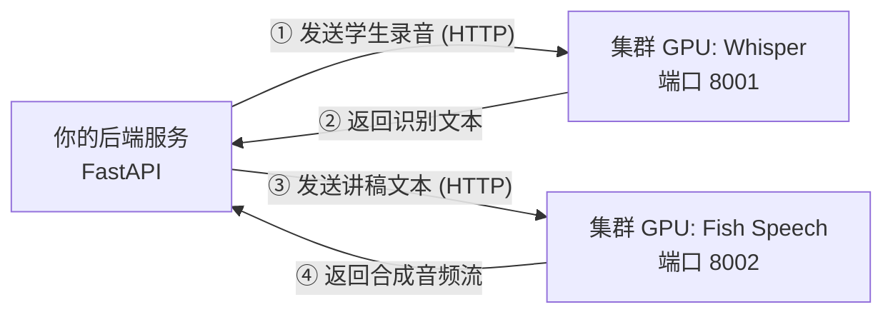

# 教学智能体语音底座部署指南
在实验室 GPU 集群上部署 Whisper（听）与 Fish Speech S2.1 Pro（说）

---

## 目录

::: toc
:::

---

::: chapter 一、建立直觉：我们在集群上做什么？
先搞懂机器在哪、端口怎么连，再动手敲命令
:::

---

## 为什么不在自己电脑上跑？

语音识别（ASR）和语音合成（TTS）都是显存密集型任务，需要跑在实验室的 **GPU 集群**上，并通过网络把能力暴露给我们的后端：



::: tip 核心心智模型
不要把集群当成神秘的黑盒——它就是一台**没有显示器的远程 Linux 电脑**。我们用 `SSH` 连上去敲命令，启动两个长期驻留的 HTTP 服务即可。
:::

---

## 新手必知：SSH 登录与保活三板斧

在本地终端（Windows PowerShell / macOS Terminal）执行以下操作，避免出现“关掉窗口服务就挂了”的经典事故：

::: cols 1fr 1fr

### 1. 连上集群与看显卡

```bash
# 1. 登录集群（输入密码时屏幕不显示，盲打回车即可）
ssh 你的用户名@集群IP地址

# 2. 登录后的第一件事：看哪张显卡空闲
nvidia-smi

```

> 观察 `Memory-Usage`（显存占用），挑一张占用接近 `0MiB` 的卡（记住它的编号，如 `0` 或 `1`）。

|||

### 2. 防断连神器：`tmux`

SSH 一旦断网，正在运行的程序会被直接杀死。**所有部署命令必须在 `tmux` 里跑**：

```bash
# 创建一个叫 speech 的后台会话
tmux new -s speech

# 即使直接关掉终端窗口，服务依然在后台运行
# 下次重新登录后，用这条命令恢复画面：
tmux attach -t speech

```

:::

---

::: chapter 二、部署 ASR 服务：Whisper（让智能体听懂提问）
使用 `faster-whisper` 搭建高并发语音转文字接口
:::

---

## 第一步：隔离环境与拉取模型

为了不污染集群公共环境，使用 `uv`（或 `conda`）创建独立虚拟环境，并配置国内镜像加速模型下载：

::: timeline

1. **创建独立目录与虚拟环境**：`mkdir -p ~/speech-services && cd ~/speech-services && uv venv && source .venv/bin/activate`
2. **安装推理引擎与接口框架**：`uv pip install faster-whisper fastapi uvicorn python-multipart`
3. **指定显卡与镜像源**：在终端执行 `export HF_ENDPOINT=https://hf-mirror.com`（解决 HuggingFace 无法直连的问题）。
4. **验证模型加载**：首次启动会自动下载 `large-v3` 模型（约 3GB），耐心等待进度条走完。
:::

::: warn 显卡指定铁律
在多卡集群上，**永远不要默认用 0 号卡**（0 号卡通常被其他人占满）。启动任何服务前，务必在命令最前面加上 `CUDA_VISIBLE_DEVICES=空闲卡号`。
:::

---

## 第二步：编写并启动 Whisper API 服务

新建 `asr_server.py`，将模型封装为标准的 HTTP 接口（兼容 OpenAI Audio API 格式，方便后续直接调用）：

::: cols 1.3fr 1fr

```python
# asr_server.py
from fastapi import FastAPI, UploadFile
from faster_whisper import WhisperModel
import tempfile

app = FastAPI()
# 加载模型到指定 GPU，float16 兼顾速度与显存（约占 3GB 显存）
model = WhisperModel("large-v3", device="cuda", compute_type="float16")

@app.post("/v1/audio/transcriptions")
async def transcribe(file: UploadFile):
    with tempfile.NamedTemporaryFile(suffix=".wav") as tmp:
        tmp.write(await file.read())
        segments, _ = model.transcribe(tmp.name, language="zh")
        text = "".join(seg.text for seg in segments)
    return {"text": text}

```

|||

### 启动与测试

1. **指定 1 号卡启动（监听 8001 端口）**：
```bash
CUDA_VISIBLE_DEVICES=1 uvicorn asr_server:app --host 0.0.0.0 --port 8001

```

2. **确认启动成功**：
看到 `Uvicorn running on http://0.0.0.0:8001` 即表示就绪。
3. **按 `Ctrl+B` 再按 `D`**：
安全退出 `tmux` 界面，让服务留在后台。
:::

---

::: chapter 三、部署 TTS 服务：Fish Speech S2.1 Pro（让智能体开口讲解）
部署工业级中文语音合成服务，支持参考音色克隆
:::

---

## 克隆项目与启动 API Server

重新开一个 `tmux` 窗口（`tmux new -s tts`），按以下标准流程启动 Fish Speech：

::: tabs 1. 环境准备 | 2. 启动推理服务 | 3. 连通性验证

```bash
cd ~/speech-services
git clone https://github.com/fishaudio/fish-speech.git
cd fish-speech

# 创建独立环境并安装依赖（包含 PyTorch CUDA 版）
uv venv && source .venv/bin/activate
uv pip install -e .

# 从镜像站下载 S2.1 Pro 权重
export HF_ENDPOINT=https://hf-mirror.com
huggingface-cli download fishaudio/fish-speech-1.5 --local-dir checkpoints/fish-speech-s2.1-pro

```

|||

Fish Speech 官方内置了开箱即用的 API Server，支持流式音频输出（`--half` 开启半精度，显存占用约 4GB）：

```bash
CUDA_VISIBLE_DEVICES=2 python -m tools.api_server \
  --listen 0.0.0.0:8002 \
  --llama-checkpoint-path checkpoints/fish-speech-s2.1-pro \
  --decoder-checkpoint-path checkpoints/fish-speech-s2.1-pro/firefly-gan-vq-fsq-8x1024-21hz-generator.pth \
  --half

```

> 同样按 `Ctrl+B` 再按 `D` 挂起后台。

|||

在**你自己的开发机**上，通过 SSH 端口转发或内网 IP 测试两个服务是否全部通畅：

```bash
# 测试 TTS 是否能正常返回音频文件
curl -X POST "http://集群IP:8002/v1/tts" \
  -H "Content-Type: application/json" \
  -d '{"text": "同学你好，今天我们来学习二叉树遍历。", "format": "wav"}' \
  --output test.wav

```

能正常播放 `test.wav`，即代表语音底座全部部署完毕！
:::

---

## 新手排错速查表（遇到报错先看这里）

| 报错现象 | 根本原因 | 解决命令 |
| --- | --- | --- |
| `CUDA out of memory` | 选到了别人正在用的显卡 | 运行 `nvidia-smi` 换一张空闲卡，修改 `CUDA_VISIBLE_DEVICES=X` |
| `Connection refused` | 服务没启动，或防火墙/端口未放行 | 检查 `tmux ls` 确认进程存活；若跨网段，使用 `ssh -L 8001:localhost:8001 用户@IP` 做本地端口映射 |
| `OSError: Can't load tokenizer` | 集群无法直连外网下载模型 | 确认当前终端已执行 `export HF_ENDPOINT=https://hf-mirror.com` |
| 终端一关服务就掉 | 直接在 SSH 窗口里运行了程序 | 务必先执行 `tmux new -s 名字`，在 tmux 内部启动服务 |
