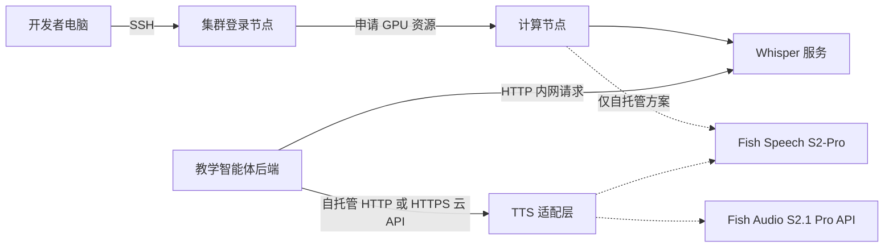
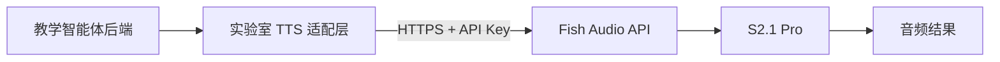

# 实验室集群语音服务部署

从第一次 SSH 登录，到把语音识别与语音合成变成可调用的服务

---

## 目录

::: toc
:::

---

::: chapter 一、先弄清楚要部署什么
语音服务不是一个模型，而是两条不同的处理链路
:::

---

## 教学智能体为什么需要两种语音服务？

智能体接收语音问题，需要先把声音变成文字；智能体生成回答后，再把文字合成为语音。


| 服务 | 输入 | 输出 | 在项目中的职责 |
| --- | --- | --- | --- |
| Whisper / ASR | 音频文件 | 文字、时间戳 | 听懂学生说了什么 |
| Fish Speech / TTS | 文字、音色参考 | 音频文件或音频流 | 把教师式回答读出来 |

::: tip 先分清方向
ASR（Automatic Speech Recognition）是语音转文字；TTS（Text-to-Speech）是文字转语音。两者是独立服务，不要把它们写成一个大接口。
:::

---

## 一个容易踩错的坑：S2.1 Pro 不等于开源 S2-Pro

先确认模型名称，再决定部署方式。当前官方公开资料中，`s2.1-pro` 是 Fish Audio 托管服务使用的模型标识；Fish Speech 本地部署文档提供的是开源权重 **S2-Pro**，两者不能当成同一个模型。

::: cols 1fr 1fr

### Fish Audio S2.1 Pro

- 官方托管 API
- 通过 API Key 调用
- 集群运行一个调用网关即可
- 不需要在实验室下载模型权重

|||

### Fish Speech S2-Pro

- 可下载公开权重
- 在实验室 GPU 节点运行
- 官方提供本地 API Server
- 权重许可需单独确认

:::

::: warn 部署决策
如果需求明确要求 **S2.1 Pro**，应调用 Fish Audio 官方 API；如果要求模型数据留在实验室、离线运行，则应评估自托管 **S2-Pro**。不要把 `s2.1-pro` 填进本地启动命令，假设它一定有可下载的 checkpoint。
:::

官方资料：[S2.1 Pro 发布说明](https://github.com/fishaudio/docs/blob/main/developer-guide/getting-started/changelog.mdx) · [Fish Speech 安装文档](https://speech.fish.audio/install/) · [Fish Speech 推理文档](https://speech.fish.audio/inference/)

---

## 部署完成后，整体应该是什么样子？

Whisper 通常运行在实验室 GPU 计算节点；TTS 则取决于选择：自托管 S2-Pro 时也运行在计算节点，使用 S2.1 Pro 时由集群后端通过 HTTPS 调用 Fish Audio。



注意：登录节点通常用于编辑文件、提交任务和查看状态，不应该直接承担模型推理。模型服务应运行在调度器分配的计算节点上。

---

::: chapter 二、第一次使用实验室集群
先学会登录、辨认机器和申请计算资源
:::

---

## 开始前，先向实验室管理员确认这些信息

集群不是一台可以随意使用的 Linux 主机。每个实验室的账号、调度器、GPU 分区和网络策略都可能不同。

::: cards 2

### 登录信息

- 登录节点地址
- 用户名与认证方式
- 是否需要 VPN 或跳板机
- SSH 公钥如何登记

|||

### 计算资源

- 调度器：Slurm、PBS 或其他
- GPU 型号与单卡显存
- 可申请的 GPU 分区
- 单个任务最长运行时间

|||

### 软件环境

- CUDA / 驱动版本
- Python、Conda 或 uv 是否可用
- 是否提供模块系统（`module`）
- 是否允许访问 Hugging Face

|||

### 网络与存储

- 模型应放在哪个目录
- 个人与公共存储配额
- 计算节点能否访问外网
- 服务端口和长期运行的规定

:::

::: warn 不要自己猜集群规则
不要尝试 `sudo` 安装驱动、修改系统 CUDA 或绕过调度器。遇到权限问题，应先查实验室文档或询问管理员。
:::

---

## 第一步：从自己的电脑 SSH 登录

SSH 可以理解为：在本地电脑打开一个远程终端，后续输入的命令会在集群上执行。

```bash
# 在自己的电脑终端中执行
ssh 用户名@登录节点地址

# 第一次连接会询问是否信任主机指纹，确认地址和指纹来源后再输入 yes
```

登录成功后，命令提示符会变化。此时执行的命令已经是在远程机器上运行。

```bash
pwd       # 当前所在目录
whoami    # 当前登录用户
hostname  # 当前机器名称
ls -la    # 查看当前目录内容
```

| 命令 | 作用 |
| --- | --- |
| `pwd` | 查看当前位置 |
| `cd 目录` | 进入目录 |
| `mkdir -p 路径` | 创建目录 |
| `ls` | 查看文件 |
| `exit` | 退出 SSH 远程会话 |

---

## 第二步：辨认登录节点和 GPU 计算节点

登录集群后，先检查当前机器，不要一上来就下载几十 GB 的模型。

```bash
hostname
nvidia-smi
which python
python --version
```

如果 `nvidia-smi` 提示找不到命令，或者没有 GPU 信息，不代表集群没有 GPU：你可能还在登录节点，或者尚未申请 GPU 资源。

::: tip 认识两个角色
**登录节点**负责入口、文件管理和任务提交；**计算节点**负责实际计算。模型推理需要 GPU 时，应先通过集群调度器申请计算节点。
:::

::: note 本地与远程不要混淆
SSH 登录前执行的命令作用于自己的电脑；登录后执行的命令作用于集群。下载模型、创建环境等操作必须确认自己已经进入正确的远程机器。
:::

---

## 第三步：申请 GPU 资源（以 Slurm 为例）

先确认实验室是否使用 Slurm。只有确认使用 Slurm，才执行下面的命令；分区名、时长和 GPU 数量都要替换成管理员给出的值。

```bash
# 申请 1 张 GPU，进入交互式计算会话
srun --partition=GPU分区名 \
     --gres=gpu:1 \
     --cpus-per-task=8 \
     --mem=32G \
     --time=04:00:00 \
     --pty bash

# 进入计算节点后，再检查 GPU
hostname
nvidia-smi
```

拿到资源后，终端通常会显示新的计算节点名称。此时才开始安装依赖、下载权重和运行模型。

::: warn 交互任务不是永久服务
交互任务会在资源时限结束或会话终止后退出。正式提供服务时，应按实验室规定提交长时间运行的作业，或申请专门的服务节点。
:::

---

::: chapter 三、在计算节点准备模型环境
先确认 GPU 与软件版本，再创建隔离环境
:::

---

## 第四步：检查 GPU、CUDA 和磁盘空间

```bash
nvidia-smi                 # GPU 型号、显存、驱动版本
python --version            # Python 版本
which python                # 当前 Python 路径

# 查看个人目录剩余空间
 df -h "$HOME"
```

如果实验室提供环境模块，可以先查看可用版本：

```bash
module avail
module load cuda/实际提供的版本
```

Fish Speech 当前安装文档使用 Python 3.12，并提供匹配 CUDA 12.6、12.8、12.9 的安装选项。实际选择要结合集群驱动、CUDA 模块和 PyTorch 轮子，不要机械照抄某个版本。

官方要求参考：[Fish Speech 安装与硬件要求](https://speech.fish.audio/install/)

---

## 第五步：创建独立 Python 环境

不要把模型依赖装进系统 Python，也不要与教学智能体后端共用一个环境。模型依赖升级频繁，独立环境更容易排错。

```bash
# 在自己的工作目录中操作
mkdir -p ~/services
cd ~/services

# Fish Speech 使用独立环境；若实验室使用 uv / venv，遵循实验室规范
conda create -n fish-speech python=3.12 -y
conda activate fish-speech

python --version
which python
```

如果需要把自己电脑上的测试音频或脚本传到集群，可以在**本地电脑的另一个终端**执行：

```bash
scp sample.wav 用户名@登录节点地址:~/services/
```

::: tip 为什么要隔离环境？
Fish Speech、PyTorch、faster-whisper 和后端 API 的依赖并不完全相同。隔离环境可以避免一次模型升级把另一个服务弄坏。
:::

---

::: chapter 四、部署语音合成服务
先确认使用托管 S2.1 Pro，还是本地 S2-Pro
:::

---

## 方案 A：在集群上调用 Fish Audio S2.1 Pro

如果必须使用 S2.1 Pro，集群的职责是运行你自己的后端调用服务，而不是下载模型权重。模型推理由 Fish Audio 托管。



先将密钥放在服务器环境变量中，不要提交到 Git，也不要放进 Vue 前端：

```bash
export FISH_API_KEY="替换为自己的 API Key"
```

最小连通性测试：

```bash
curl -X POST https://api.fish.audio/v1/tts \
  -H "Authorization: Bearer $FISH_API_KEY" \
  -H "Content-Type: application/json" \
  -H "model: s2.1-pro" \
  -d '{"text":"你好，欢迎来到数据库原理课程。","format":"mp3"}' \
  --output demo.mp3
```

截至 2026-11-20，官方公告的 `s2.1-pro-free` 免费档计划开放至 2026-11-30，且受公平使用限制、不提供生产服务保证。期限很近，不能把它当成长期生产配额；实际部署前要重新确认官方价格和服务条款。官方入口：[Fish Audio API Quickstart](https://docs.fish.audio/) · [S2.1 Pro 更新说明](https://github.com/fishaudio/docs/blob/main/developer-guide/getting-started/changelog.mdx)

::: warn 密钥不能下发给浏览器
API Key 只能由后端持有。前端请求自己的后端，由后端调用 Fish Audio；否则任何拿到网页的人都可能复制密钥。
:::

---

## 方案 B：在实验室集群自托管 Fish Speech S2-Pro

如果要求离线运行或模型数据必须留在实验室，使用公开权重 S2-Pro。官方文档当前建议 S2-Pro 使用至少约 24 GB GPU 显存；具体仍要以实际模型版本、精度和并发测试为准。

```bash
# 获取官方源码
cd ~/services
git clone https://github.com/fishaudio/fish-speech.git
cd fish-speech

# 安装 Hugging Face 下载工具
pip install -U "huggingface_hub[cli]"

# 将模型缓存放到有足够空间且允许计算节点访问的目录
export HF_HOME="$HOME/model-cache"
mkdir -p "$HF_HOME"

# 下载公开的 S2-Pro 权重
hf download fishaudio/s2-pro --local-dir checkpoints/s2-pro
```

安装依赖时，按集群 CUDA 版本选择官方提供的 extra。例如 CUDA 12.8 环境：

```bash
# 仅作 CUDA 12.8 环境示例，必须先确认集群环境匹配
pip install --extra-index-url https://download.pytorch.org/whl/cu128 -e ".[cu128]"
```

如果计算节点不能访问 Hugging Face，先确认实验室是否允许在登录节点下载并写入共享存储，或是否有模型文件离线导入流程。不要把几十 GB 权重放进空间有限的个人目录。若系统缺少音频依赖（如 ffmpeg、SoX、PortAudio），不要尝试自行修改系统；使用实验室提供的 module / Conda 包，或请管理员安装。

---

## 启动 Fish Speech API Server 并检查健康状态

在已申请 GPU 的计算节点、已激活 Fish Speech 环境的终端中启动：

```bash
python tools/api_server.py \
  --listen 0.0.0.0:8080 \
  --llama-checkpoint-path checkpoints/s2-pro \
  --decoder-checkpoint-path checkpoints/s2-pro/codec.pth \
  --decoder-config-name modded_dac_vq \
  --api-key "$FISH_INTERNAL_API_KEY"
```

先通过安全方式设置 `FISH_INTERNAL_API_KEY`，不要把真实密钥写进脚本或提交到 Git。另开一个终端，在同一计算节点测试：

```bash
curl http://127.0.0.1:8080/v1/health
```

预期返回：

```json
{"status":"ok"}
```

官方 API Server 支持 `--api-key` 参数，可以启用 Bearer Token 认证。服务端口不要直接暴露到公网；应配合集群内网、SSH 隧道或实验室网关使用。S2-Pro 权重仍有独立许可要求，实验室使用前应阅读官方仓库中的许可证。

官方参考：[Fish Speech API Server](https://speech.fish.audio/inference/)

---

::: chapter 五、部署语音识别服务
用 faster-whisper 加载 Whisper 权重，再封装成 HTTP 接口
:::

---

## 为什么选择 faster-whisper？

OpenAI Whisper 是语音识别模型与推理代码；它本身不是一个开箱即用的 HTTP 服务。`faster-whisper` 使用 CTranslate2 实现推理，提供 GPU FP16、INT8 等运行方式，适合在集群上封装内部 API。

| 方案 | 适合场景 |
| --- | --- |
| `openai-whisper` | 直接使用原始实现，方便理解基线 |
| `faster-whisper` | 希望提升推理效率、控制显存 |
| `speaches` | 希望直接部署 OpenAI 兼容的语音 API 服务 |

本教程以 `faster-whisper` 为主，先验证模型，再封装 API。

参考：[OpenAI Whisper](https://github.com/openai/whisper) · [faster-whisper](https://github.com/SYSTRAN/faster-whisper)

---

## 第一步：安装 faster-whisper 并加载模型

```bash
# Whisper 使用另一个独立环境，不和 Fish Speech 共用依赖
conda create -n whisper python=3.11 -y
conda activate whisper
pip install faster-whisper fastapi uvicorn python-multipart
```

中文课程录音可以先用 `large-v3` 做质量基线，再根据延迟和显存测试 `turbo` 等模型。GPU 推理还需要与 CTranslate2 匹配的 cuBLAS / cuDNN；当前 faster-whisper 文档说明新版本使用 CUDA 12 与 cuDNN 9，集群应优先使用管理员提供的匹配环境。Whisper 的 `turbo` 不适合承担“翻译成英语”的任务；普通转写与翻译不要混为一谈。

```python
from faster_whisper import WhisperModel

# 模型在服务启动时加载一次，不要每个请求都重新加载
model = WhisperModel("large-v3", device="cuda", compute_type="float16")

segments, info = model.transcribe("sample.wav", beam_size=5)
segments = list(segments)  # 遍历后才会真正执行识别

print("语言：", info.language)
for segment in segments:
    print(segment.start, segment.end, segment.text)
```

::: note 一个容易忽略的细节
`transcribe()` 返回的 `segments` 是惰性迭代器。只有遍历它，识别才会真正执行。测试时不要只调用函数却没有读取结果。
:::

---

## 第二步：把识别能力封装成 HTTP 服务

教学智能体不应该直接 import `WhisperModel`。把模型封装成独立服务，后端只依赖稳定的 HTTP 契约。

建议使用 FastAPI 封装三个接口：

| 方法 | 路径 | 作用 |
| --- | --- | --- |
| `GET` | `/health` | 服务是否存活 |
| `GET` | `/ready` | 模型是否加载完成 |
| `POST` | `/transcribe` | 上传音频并返回识别结果 |

最小服务结构如下。普通 `def` 路由会由 FastAPI 放到线程池执行，避免把同步模型推理直接阻塞在异步事件循环里：

---

## 第二步：把识别能力封装成 HTTP 服务（续）

```python
from pathlib import Path
from tempfile import NamedTemporaryFile
import shutil

from fastapi import FastAPI, File, UploadFile
from faster_whisper import WhisperModel

app = FastAPI()
model = WhisperModel("large-v3", device="cuda", compute_type="float16")

@app.get("/health")
def health():
    return {"status": "ok"}

@app.get("/ready")
def ready():
    return {"model_loaded": True}
```

---

## 第二步：把识别能力封装成 HTTP 服务（续）

```python
@app.post("/transcribe")
def transcribe(file: UploadFile = File(...)):
    suffix = Path(file.filename or "audio.wav").suffix or ".wav"
    with NamedTemporaryFile(suffix=suffix) as tmp:
        shutil.copyfileobj(file.file, tmp)
        tmp.flush()
        segments, info = model.transcribe(tmp.name, beam_size=5)
        segments = list(segments)

    return {
        "text": "".join(item.text for item in segments).strip(),
        "language": info.language,
        "segments": [
            {"start": x.start, "end": x.end, "text": x.text}
            for x in segments
        ],
    }
```

请求使用 `multipart/form-data` 上传音频；响应可以先统一为：

```json
{
  "text": "事务隔离级别有哪些？",
  "language": "zh",
  "segments": [
    {"start": 0.0, "end": 2.4, "text": "事务隔离级别有哪些？"}
  ]
}
```

---

## 第二步：把识别能力封装成 HTTP 服务（续）

启动服务并测试：

```bash
uvicorn app:app --host 0.0.0.0 --port 8001 --workers 1

# 另开终端测试
curl -X POST http://127.0.0.1:8001/transcribe \
  -F "file=@sample.wav"
```

模型应在服务启动时加载一次，而不是每次请求都重新加载。初期使用一个 worker，避免每个 worker 都复制一份模型占用显存；接口内部负责保存临时音频、执行转写、收集 segments 并清理临时文件。

---

## 两个服务应该如何分配 GPU？

Fish Speech S2-Pro 与 Whisper 都会占用显存。不要仅凭“能启动”判断资源足够，还要测试两种服务同时运行时的显存峰值和延迟。

::: cards 2

### 更稳妥的起步方式

- Fish Speech 独占一张 GPU
- Whisper 使用另一张 GPU
- 两个服务分别申请资源
- 先测单请求，再测并发

|||

### 资源有限时

- 先测清两种模型的显存峰值
- 限制并发和批处理大小
- 避免同时加载多个模型副本
- 预留 CUDA 与系统开销

:::

如果实验室只有一张 GPU，可以先将两个服务串行运行，或先用较小 Whisper 模型完成端到端验证。S2.1 Pro 托管 API 不占用实验室 GPU；此时集群 GPU 主要留给 Whisper。不要把显存不足当成通过调高 `workers` 就能解决的问题。

---

::: chapter 六、让服务能被访问、能长期运行
接口能在本机访问，不代表项目后端已经能访问
:::

---

## 第一步：先在计算节点本机完成验收

在运行服务的计算节点上逐个检查：

```bash
curl http://127.0.0.1:8080/v1/health  # Fish Speech
curl http://127.0.0.1:8001/health     # Whisper（端口按实际配置）
```

然后从教学智能体后端所在机器访问计算节点内网地址。若两台机器网络不通，说明需要配置集群内部访问路径，而不是修改模型代码。


---

## 第二步：开发时用 SSH 隧道访问服务

如果服务只能从集群内部访问，开发阶段可以通过 SSH 端口转发，将远程端口映射到本地电脑。具体命令取决于实验室是否有跳板机、是否允许 SSH 到计算节点。

常见形式如下，地址和主机名必须替换为管理员提供的值：

```bash
# 示例：通过登录节点转发其可访问的目标服务端口
ssh -L 18080:目标主机:8080 用户名@登录节点地址
```

隧道建立后，本地浏览器或 `curl` 访问 `http://127.0.0.1:18080`，请求会经 SSH 转发到远程服务。

::: warn SSH 隧道不是生产部署方案
隧道适合开发调试。正式服务应申请稳定的节点、内网 DNS / 固定地址、端口策略和进程托管方式，不要依赖某个人的笔记本一直开着 SSH。
:::

---

## 第三步：用调度器管理长期任务

如果集群使用 Slurm，通常通过 `sbatch` 提交非交互任务，通过 `squeue` 查看运行状态，通过 `scancel` 取消任务。

```bash
sbatch start-whisper.sbatch
squeue -u "$USER"
scancel 任务 ID
```

作业脚本应声明分区、GPU、CPU、内存、运行时长和日志路径；服务启动命令放在脚本末尾。下面是结构示例，分区、时限、环境脚本路径和启动文件都必须按实验室实际情况替换：

```bash
#!/bin/bash
#SBATCH --job-name=whisper-api
#SBATCH --partition=GPU分区名
#SBATCH --gres=gpu:1
#SBATCH --cpus-per-task=8
#SBATCH --mem=32G
#SBATCH --time=12:00:00
#SBATCH --output=logs/whisper-%j.log

source /path/to/conda/etc/profile.d/conda.sh
conda activate whisper
uvicorn app:app --host 0.0.0.0 --port 8001 --workers 1
```

---

## 第三步：用调度器管理长期任务（续）

保存为 `start-whisper.sbatch`，先创建日志目录，再提交：

```bash
mkdir -p logs
sbatch start-whisper.sbatch
```

不要在登录节点用后台 `&` 假装实现长期服务，也不要假设 `tmux` 能绕过集群的任务时限。正式提供给全组使用前，先询问管理员是否有专门的推理服务部署方式。

---

## 常见故障：先看哪一层出了问题？

| 现象 | 优先检查 |
| --- | --- |
| `nvidia-smi` 找不到 GPU | 是否在计算节点、是否申请到 GPU、驱动环境 |
| CUDA 初始化失败 | 驱动、CUDA、PyTorch / CTranslate2 版本是否匹配 |
| 下载模型失败 | 计算节点网络、Hugging Face 访问权限、缓存目录 |
| `CUDA out of memory` | 模型精度、模型大小、并发、是否重复加载 |
| 本机能访问，后端不能访问 | 计算节点网络、端口、防火墙、监听地址 |
| SSH 退出后服务停止 | 作业是否仍在运行、是否违反任务管理方式 |
| 服务偶尔卡住 | 日志、请求时长、显存峰值、进程是否退出 |

排错顺序：**先确认机器和资源，再确认环境和模型，最后检查网络与调用方。** 不要同时改五个配置，否则很难判断真正原因。

---

::: chapter 七、交付标准
最终交付的不是一条启动命令，而是两个稳定、可验证的服务
:::

---

## 部署完成 Checklist

::: cards 2

### Whisper 服务

- [ ] 确认模型版本和语言效果
- [ ] GPU 推理可用
- [ ] `/health` 与 `/ready` 正常
- [ ] `/transcribe` 能返回文字与时间戳
- [ ] 模型只加载一次
- [ ] 错误和日志可追踪

|||

### Fish Speech 服务

- [ ] 确认使用 S2.1 Pro API 或自托管 S2-Pro
- [ ] 明确权重许可和使用范围
- [ ] API Server 可以启动
- [ ] 健康检查正常
- [ ] 能生成可播放音频
- [ ] API Key 与端口受到保护

:::

### 最终应交付给项目组的信息

```text
ASR_BASE_URL=http://计算节点地址:8001
TTS_BASE_URL=http://计算节点地址:8080

ASR_MODEL=large-v3
TTS_MODEL=s2-pro 或 s2.1-pro

# 另行通过安全渠道提供访问凭证，不要把真实密钥写进文档
```

此外还要记录：GPU 型号与显存、服务启动命令、作业提交方式、日志位置、服务时限、模型权重路径和重启方法。

---

## 官方资料与下一步

- [Fish Speech 安装文档](https://speech.fish.audio/install/)：系统要求、Python 环境、权重下载与 Docker。
- [Fish Speech 推理文档](https://speech.fish.audio/inference/)：API Server 启动参数、健康检查与接口路径。
- [Fish Audio S2.1 Pro 更新记录](https://github.com/fishaudio/docs/blob/main/developer-guide/getting-started/changelog.mdx)：模型标识与托管 API 说明。
- [OpenAI Whisper](https://github.com/openai/whisper)：原始 Whisper 模型与使用方式。
- [faster-whisper](https://github.com/SYSTRAN/faster-whisper)：GPU 安装、模型加载、量化和批处理。

::: tip 下一阶段
先保证 ASR 和 TTS 各自可以独立调用，再让教学智能体后端连接它们。语音识别、智能体推理和语音合成应保持独立边界，方便分别替换模型与排查故障。
:::
