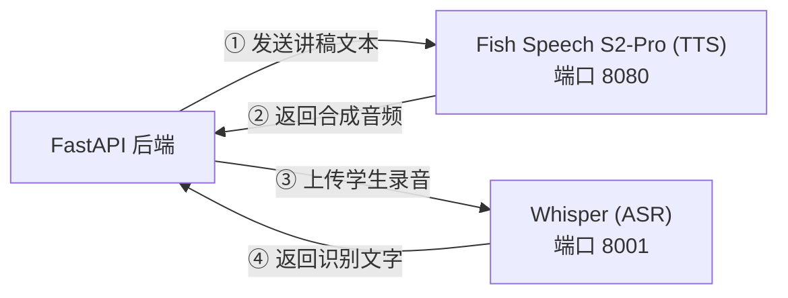

# 语音底座部署指南

在实验室 GPU 集群上，从零跑通教学智能体语音服务（Fish Speech S2-Pro 与 Whisper）

---

## 目录

::: toc
:::

---

::: chapter 一、先定范围，再选机器
先切清第一版要跑通的最小目标，再对照模型要求去网页上申请合适的算力与镜像
:::

---

## 整体链路与第一版范围

语音合成（TTS）和语音识别（ASR）都很吃显存，不直接写进 `ta-backend`，而是作为两个独立的 HTTP 服务跑在实验室 GPU 上：



::: cols 1fr 1fr

### 第一版要做到

1. 先部署 **Fish Speech S2-Pro**（自带 HTTP 服务，一条命令就能跑起来，新手最容易拿到正反馈）；
2. 再部署 **Whisper**（包一层二十多行的 FastAPI），并直接用前一步生成的 `test.wav` 测通识别；
3. 跑通「文字 → 语音 → 文字」闭环，且开发机能通过 HTTP 调通两个端口。

|||

### 先不做，留到后续完善

- 定制老师音色（参考音频克隆）；
- TTS 流式音频返回、与 Agent 文本流按句联动；
- 接口 Token 鉴权、文件大小限制与并发限流；
- 在 `ta-backend` 里封装 `modules/speech/` 客户端。

:::

---

## 申请算力前，先对照两个模型的要求选配置

实验室在网页上申请算力实例时，需要勾选 **CPU 核数、内存、GPU 卡数** 和 **预装环境镜像**。先看两个模型的胃口，一次选对能省很多折腾：

| 项目 | Fish Speech S2-Pro | faster-whisper (`large-v3`) | 申请页面建议勾选 |
| --- | --- | --- | --- |
| **显存** | 约 20–24 GB（单卡 3090 刚好） | 约 3–4 GB（`float16`） | **2 张 RTX 3090**（各占一张卡，互不干扰） |
| **CUDA** | CUDA 12.x（如 12.6 / 12.8） | CUDA 12.x + cuDNN 9 | **选 CUDA 12.x 的镜像**，两边同时满足 |
| **Python / 框架** | Python 3.10–3.12 + PyTorch ≥ 2.5 | Python ≥ 3.9 | 选 **Conda + PyTorch ≥ 2.5 (CUDA 12.x)** 的镜像 |
| **CPU / 内存** | 加载权重时需要足够内存缓冲 | 同左 | **8 核以上 CPU、32 GB 以上内存** |

如果只想先单独跑 Fish Speech，也可以先申 **1 张 RTX 3090**；等两个服务同时在线时，再选 **2 张 RTX 3090**（实验室单实例最多可选 3 张 3090）。

---

::: chapter 二、连上机器并让服务常驻
学会用网页给的 SSH 命令登录远程机器，以及如何用 `tmux` 防止关窗口掉线
:::

---

## 先登录到刚申请好的显卡机器

SSH 的作用很简单：让你在自己电脑的终端里，直接操作那台远程的 Linux GPU 机器。实例创建成功后，网页会给出一条类似下面这样的登录命令：

```bash
ssh -p 端口号 用户名@主机地址
```

按这四步就能连上：

::: timeline

1. **打开自己电脑的终端**：Windows 打开「终端 / PowerShell」，macOS 打开「终端（Terminal）」。
2. **粘贴网页给的 `ssh` 命令并回车**：命令里的 `-p`（小写）后面跟的是端口，不要漏掉。
3. **首次连接确认**：屏幕出现 `Are you sure you want to continue connecting (yes/no)?` 时，输入 `yes` 回车。
4. **输入密码**：输密码时**屏幕不会显示星号或任何字符**，这是终端正常的防窥机制，直接完整输入后回车即可。
:::

登录成功后，命令行前面的提示符会变成远程机器的名字。先敲三条命令确认刚申请的环境都就绪：

```bash
nvidia-smi       # 确认能看到申请的 RTX 3090 显卡和显存（24576MiB）
conda --version  # 确认 Conda 可用
df -h            # 看哪个挂载目录剩余空间大，后面放模型权重优先放那里
```

---

## 新手够用的四条命令，以及让服务常驻后台

::: cols 1fr 1.25fr

### 日常够用的四条目录命令

| 命令 | 作用 |
| --- | --- |
| `pwd` | 查看自己当前在哪个文件夹 |
| `ls -la` | 列出当前文件夹里的所有文件 |
| `cd 路径` | 进入某个文件夹（`cd ..` 返回上一级） |
| `mkdir -p 路径` | 创建文件夹 |

|||

### 为什么要让服务常驻后台？

如果直接在 SSH 窗口里启动模型，一旦电脑合盖、断网或关掉终端窗口，里面的程序会立刻退出。用 `tmux` 建一个留在远程机器上的后台会话，关掉本机窗口服务依然在跑：

```bash
tmux new -s tts      # 新建一个叫 tts 的会话并进入

# ……在里面执行启动服务的命令……

# 想退出回到原界面：先按 Ctrl+B，松手后再按 D（服务留在后台跑）

tmux ls              # 查看后台有哪些会话还在运行
tmux attach -t tts   # 重新连回 tts 会话查看日志
```

:::

---

::: chapter 三、部署语音合成服务
官方自带 HTTP 接口，不用写业务代码，按步骤敲命令就能把“说”跑起来
:::

---

## 第一步 复用镜像里的运行环境并安装依赖

网页申请的镜像里已经预装好了与 CUDA 配套的 PyTorch。与其从零建空环境重新下载几个 GB 的 PyTorch，更好的做法是**克隆镜像自带环境**：既把 Fish Speech 和后面的 Whisper 隔离开，又避免安装依赖时把 GPU 版 PyTorch 覆盖成 CPU 版。

先开一个 `tmux` 会话（`tmux new -s tts`），按下面三步操作：

```bash
# 1. 查看镜像里自带的 Conda 环境，并确认 GPU 版 PyTorch 正常
conda env list
python -c "import torch; print(torch.__version__, torch.version.cuda, torch.cuda.is_available())"

# 2. 克隆预装环境（如果自带 PyTorch 不在 base 里，把 base 换成上一步看到的对应环境名）
conda create -n fish-speech --clone base -y
conda activate fish-speech

# 3. 拉取代码，锁定已有 PyTorch 版本后再装其余依赖（避免覆盖成 CPU 版）
mkdir -p ~/speech && cd ~/speech
git clone https://github.com/fishaudio/fish-speech.git && cd fish-speech
pip list --format=freeze | grep -i "^torch" > /tmp/torch-lock.txt
pip install -c /tmp/torch-lock.txt -e .
```

装完后再执行一次 `python -c "import torch; print(torch.__version__, torch.cuda.is_available())"`：只要 `True` 没变，就说明预装的 GPU 版 PyTorch 原封不动。如果提示 PyTorch 版本不满足依赖，直接回网页换一个更新的 PyTorch + CUDA 12.x 镜像即可。

---

## 第二步 下载语音合成模型权重

模型权重托管在 Hugging Face 上，文件体积较大，国内实验室网络一般先配好镜像站再下载：

```bash
# 1. 安装下载工具
pip install -U "huggingface_hub[cli]"

# 2. 配置国内镜像站与缓存目录（建议指到 df -h 里空间充足的目录）
export HF_ENDPOINT=https://hf-mirror.com
export HF_HOME=~/speech/hf-cache

# 3. 下载 Fish Speech S2-Pro 权重到 checkpoints/s2-pro
hf download fishaudio/s2-pro --local-dir checkpoints/s2-pro
```

> 如果遇到 `hf: command not found`（旧版 `huggingface_hub`），把最后一条里的 `hf` 换成 `huggingface-cli` 即可。  
> **待确认**：目前暂按镜像站在线下载写；后续确认实验室 Web 面板是否支持直接上传权重文件，再决定是否补充网页上传方案。

下载完成后执行 `ls checkpoints/s2-pro`，确认目录里能看到模型配置文件以及解码器权重 `codec.pth`。

---

## 第三步 启动官方服务并验收试听

在刚才的 `tts` 会话里，指定 **0 号卡** 启动内置 API Server（`--half` 开启半精度，更稳妥地放进单张 3090 的 24GB 显存）：

```bash
CUDA_VISIBLE_DEVICES=0 python tools/api_server.py \
  --listen 0.0.0.0:8080 \
  --llama-checkpoint-path checkpoints/s2-pro \
  --decoder-checkpoint-path checkpoints/s2-pro/codec.pth \
  --decoder-config-name modded_dac_vq \
  --half
```

看到日志提示正在监听 `0.0.0.0:8080` 后，按 **`Ctrl+B` 松手再按 `D`** 退回原终端（不要在服务日志窗口里直接敲命令），然后验收：

::: cols 1.2fr 1fr

```bash
# 1. 健康检查，预期返回 {"status":"ok"}
curl http://127.0.0.1:8080/v1/health

# 2. 发送一段中文，把合成的语音保存成 test.wav
curl -X POST http://127.0.0.1:8080/v1/tts \
  -H "Content-Type: application/json" \
  -d '{"text": "同学你好，今天我们来学习数据库事务。", "format": "wav"}' \
  --output ~/speech/test.wav
```

|||

### 把音频拷回自己电脑试听

在**自己电脑**另开一个终端，用 `scp` 把远程生成的 `test.wav` 下载到当前目录（注意 `scp` 的端口参数是**大写 `-P`**）：

```bash
scp -P 端口号 用户名@主机地址:~/speech/test.wav ./
```

双击播放 `test.wav`，听到清晰的中文朗读，MVP 的上半段就完成了。

:::

---

::: chapter 四、部署语音识别服务并闭环验收
先拿刚生成的 `test.wav` 测通识别，再包一层 FastAPI，最后从开发机联调通两个端口
:::

---

## 第四步 建独立环境，先用测试音频跑通本地识别

新开一个 `tmux` 会话（`tmux new -s asr`），给 Whisper 单独建一个 Conda 环境并安装 `faster-whisper`（基于 CTranslate2 的加速实现，比原版更快且省显存）：

```bash
mkdir -p ~/speech/asr && cd ~/speech/asr
conda create -n whisper python=3.11 -y
conda activate whisper
pip install faster-whisper fastapi uvicorn python-multipart
```

先不急着写接口，直接拿刚才 Fish Speech 生成的 `test.wav` 测一下 GPU 转写能不能跑通（首次运行会自动下载约 3GB 的 `large-v3` 权重）：

```bash
export HF_ENDPOINT=https://hf-mirror.com
CUDA_VISIBLE_DEVICES=1 python -c '
import os
from faster_whisper import WhisperModel
model = WhisperModel("large-v3", device="cuda", compute_type="float16")
segments, info = model.transcribe(os.path.expanduser("~/speech/test.wav"), language="zh")
print(info.language, "".join(s.text for s in segments))
'
```

> 说明：`transcribe()` 返回的 `segments` 是惰性迭代器，遍历它时才会真正执行推理。如果报缺少 `libcudnn` / `libcublas`，在当前环境执行 `pip install nvidia-cublas-cu12 nvidia-cudnn-cu12` 即可。

---

## 第五步 写入服务脚本，给识别模型包一层接口

确认模型能识别出刚才那句话后，在 `~/speech/asr/` 执行下面命令创建 `asr_server.py`：

::: cols 1.35fr 1fr

```bash
cat << 'EOF' > ~/speech/asr/asr_server.py
import shutil
from pathlib import Path
from tempfile import NamedTemporaryFile
from fastapi import FastAPI, File, UploadFile
from faster_whisper import WhisperModel

app = FastAPI()
model = WhisperModel("large-v3", device="cuda", compute_type="float16")

@app.get("/health")
def health(): return {"status": "ok"}

@app.post("/transcribe")
def transcribe(file: UploadFile = File(...)):
    suffix = Path(file.filename or "audio.wav").suffix or ".wav"
    with NamedTemporaryFile(suffix=suffix) as tmp:
        shutil.copyfileobj(file.file, tmp); tmp.flush()
        segs, info = model.transcribe(tmp.name, language="zh", beam_size=5)
        segs = list(segs)
    return {"text": "".join(s.text for s in segs).strip(), "language": info.language,
            "segments": [{"start": s.start, "end": s.end, "text": s.text} for s in segs]}
EOF
```

|||

### 三个编写细节

- **全局加载一次**：`WhisperModel` 放在文件顶层，随服务启动进显存，后续请求直接复用。
- **普通 `def` 路由**：`transcribe()` 是同步耗时操作，普通 `def` 会由 FastAPI 丢进线程池，不会卡住异步循环。
- **保留原始后缀**：上传的可能是 `.wav`、`.mp3` 或 `.webm`，按原文件名写临时文件，处理完自动清理。

:::

---

## 第六步 放到另一张显卡启动，完成闭环验收

在 `asr` 会话里把 Whisper 放到 **1 号卡**（避开 0 号卡的 Fish Speech），监听 `8001` 端口，并保持 `--workers 1`（每个 worker 都会各自占一份显存）：

```bash
cd ~/speech/asr
CUDA_VISIBLE_DEVICES=1 uvicorn asr_server:app --host 0.0.0.0 --port 8001 --workers 1
```

按 `Ctrl+B` 再按 `D` 挂到后台，分别在**远程本机**和**自己电脑**做最后验收：

::: cols 1fr 1.15fr

### 远程本机闭环验收

```bash
curl http://127.0.0.1:8001/health

curl -X POST http://127.0.0.1:8001/transcribe \
  -F "file=@$HOME/speech/test.wav"
```

返回里准确还原出 `"同学你好，今天我们来学习数据库事务。"`，闭环跑通。

|||

### 开发机通过端口转发联调

如果实例端口只对内网开放，在**自己电脑**跑一条端口转发，把远程两个端口映射回本机：

```bash
ssh -p 端口号 \
  -L 18080:127.0.0.1:8080 \
  -L 18001:127.0.0.1:8001 \
  用户名@主机地址
```

保持窗口开启，本地访问 `http://127.0.0.1:18080` 与 `18001` 即可联调。到这里 **MVP 正式完成！**

:::

---

::: chapter 五、接进后端并做好加固
MVP 跑通后，按三轮迭代把两个独立端口真正接进教学智能体项目
:::

---

## 迭代一 在后端中封装语音客户端

不要在 Agent 循环里到处散落 `httpx.post("http://...")`，而是按项目分层在 `ta-backend` 里建一个薄薄的客户端模块，由配置统一管理地址：

::: cols 1.25fr 1fr

```python
# ta-backend/modules/speech/client.py
import httpx

class SpeechClient:
    def __init__(self, asr_url: str, tts_url: str):
        self.asr_url = asr_url.rstrip("/")
        self.tts_url = tts_url.rstrip("/")
        self.http = httpx.AsyncClient(timeout=30.0)

    async def transcribe(self, filename: str, content: bytes) -> str:
        resp = await self.http.post(
            f"{self.asr_url}/transcribe",
            files={"file": (filename, content)},
        )
        resp.raise_for_status()
        return resp.json()["text"]

    async def synthesize(self, text: str) -> bytes:
        resp = await self.http.post(
            f"{self.tts_url}/v1/tts",
            json={"text": text, "format": "mp3"},
        )
        resp.raise_for_status()
        return resp.content
```

|||

### 接入后端的三件事

1. 在 `ta-backend` 执行 `uv add httpx`；
2. 把 `ASR_BASE_URL` / `TTS_BASE_URL` 配进环境变量（本地联调填隧道地址 `127.0.0.1:18001` / `18080`，上线换集群内网地址）；
3. `SpeechClient` 放进 `main.py` 的 `lifespan` 复用连接，应用关闭时 `await client.http.aclose()`。

:::

---

## 迭代二与三 体验升级与稳定加固

::: cards 2

### 迭代二 音色定制与低延迟播报

- **固定助教音色**：准备一段 10–30 秒干净的老师朗读参考音频 + 对应字幕，通过 Fish Speech 的参考音频参数固定讲课声线，避免每次合成音色飘移。
- **缩短开口等待**：配合 Agent 的 SSE 文本流，在后端按句号、问号断句，每攒够一句就异步请求一次 TTS（也可开启 Fish Speech 的流式音频输出），边生成边播放。

|||

### 迭代三 安全、限流与运维脚本

- **接口鉴权与输入限制**：Fish Speech 启动时加上 `--api-key "$FISH_INTERNAL_API_KEY"`；`asr_server.py` 校验内部请求头并限制单文件体积（例如 ≤ 20MB）。
- **防 OOM 并发控制**：实测双服务同时推理时的显存峰值，在 `ta-backend` 用 `asyncio.Semaphore` 限制同时发往 GPU 的请求数。
- **一键重启脚本**：把 `conda activate` 和启动命令写成 `start_tts.sh` / `start_asr.sh` 并把日志输出到 `logs/`，实例重启后两条命令就能拉起。

:::

---

## 常见现象排查表与交付清单

排错按 **「显卡与磁盘 → Conda 环境与依赖 → 端口与网络」** 顺序查，一次只改一处：

| 现象 | 常见原因 | 处理方法 |
| --- | --- | --- |
| `ssh` 连不上 / 提示超时 | 端口漏写 `-p`、校园网/VPN 没连、实例已关机 | 检查网页实例状态和完整 `ssh` 命令 |
| 模型下载极慢或失败 | 没配 Hugging Face 镜像源 | 执行 `export HF_ENDPOINT=https://hf-mirror.com` 后重试 |
| `CUDA out of memory` | 两个服务挤在同一张卡，或开了多 worker | 分别设 `CUDA_VISIBLE_DEVICES=0` 和 `1`，确认 `--workers 1`、TTS 加 `--half` |
| 报找不到 `libcudnn` / `libcublas` | CTranslate2 找不到 CUDA 12 / cuDNN 9 动态库 | 在 `whisper` 环境执行 `pip install nvidia-cublas-cu12 nvidia-cudnn-cu12` |
| 关掉终端后接口访问不了 | 没在 `tmux` 里启动，进程随 SSH 断开退出 | 用 `tmux new -s ...` 重启，按 `Ctrl+B` 再按 `D` 退回后台 |

::: cols 1fr 1fr

```env
# 交付给 ta-backend 的配置
TTS_BASE_URL=http://服务地址:8080
ASR_BASE_URL=http://服务地址:8001
TTS_MODEL=s2-pro
ASR_MODEL=large-v3
```

|||

**继续阅读**：[后端架构与开发指南](?src=decks/intro.md) · [前端架构与开发指南](?src=decks/intro-webui.md) · [课程与资源模块设计与实现](?src=decks/course-resource.md) · [Agent 模块设计与实现](?src=decks/agent.md) · [返回选择页](./)

:::
