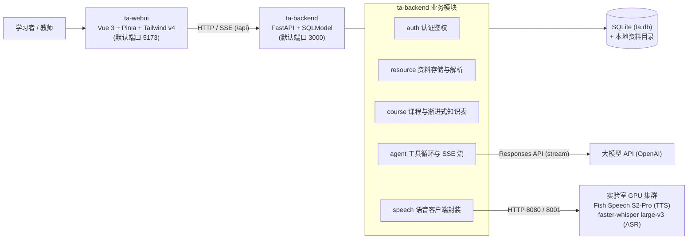

# 教学智能体（EduTutor / Teaching Agent）

面向小团队模块化协作开发的**家庭教师式教学智能体**全栈项目，包含 Python FastAPI 后端（`ta-backend`）、Vue 3 前端应用（`ta-webui`）以及配套的零构建 Markdown 幻灯片与设计文档中心（`PPT-Helper`）。

---

## 项目愿景与设计理念

与单纯转发大模型的问答外壳不同，本项目希望以**「家庭教师」**的形态组织完整的个人学习闭环：

- **摸底诊断**：初次见面通过提问或测验了解学习者的知识薄弱点与前置基础；
- **博览群书**：接入并解析多媒介学习资料（Markdown、PDF、PPTX，后续扩展音视频等），做到讲解有据可查；
- **清晰讲解**：围绕当前课程与知识点，用简洁易懂、启发思考的方式分步讲解并实时流式响应；
- **规划学习**：基于知识点掌握情况与学习记录，动态安排每日学习与复习计划；
- **流畅语音对话**：支持低延迟的语音输入（ASR）与语音播报（TTS），像和真人老师交流一样自然对话。

### Agent 时代的协作开发原则

针对「AI 一次生成海量代码难以审阅（AI Slop）」与「多人协作边界不清」两类痛点，项目在工程上约定两条核心原则：

1. **夯实基础，克制选型**：前后端均选择轻量、清晰的技术栈与目录规范，团队成员先理解工程底座与核心配置各自负责什么，拿回对系统的掌控感；
2. **默认正确，聚焦关键关口**：把人的注意力集中在**架构边界、接口契约与人工审阅关口**（如课程知识表采用渐进式披露的 Markdown + `draft`/`approved` 审阅状态），其余部分依靠类型检查、Lint、单测与约定护航。

---

## 系统整体架构



---

## 仓库目录结构

```text
ta-new/
├── ta-backend/          # FastAPI + SQLModel 后端工程（Python >= 3.14, uv）
│   ├── main.py          # 应用入口：lifespan 建表/释放连接池、统一错误处理、挂载路由
│   ├── core/            # 全局底座：config / database / errors / security
│   ├── modules/         # 按业务领域拆分的模块（已实现 auth 样板，已预留 resource）
│   └── scripts/         # 开发期启动脚本（uv run dev）
├── ta-webui/            # Vue 3 + TypeScript + Tailwind v4 前端工程（EduTutor）
│   ├── src/types/       # 最底层领域 DTO 与 ApiError
│   ├── src/utils/       # 纯函数工具层
│   ├── src/api/         # 唯一 HTTP 出口（含 demoMode 动态隔离分支）
│   ├── src/demo/        # 演示数据与内存导师会话（关闭演示后不耦合真实业务）
│   ├── src/stores/      # Pinia 状态管理（session/chat/courses/progress/resources/agent/system/toast）
│   ├── src/composables/ # 浏览器语音能力适配（useRecorder / useTts）
│   ├── src/components/  # layout / ui / chat / knowledge / progress 组件
│   └── src/views/       # 9 个核心业务页面与 404 页面
└── PPT-Helper/          # 零构建 Markdown 幻灯片工具与项目文档中心（Node.js >= 18）
    ├── decks/           # 全项目总览、架构规范、模块设计与运维协作讲稿
    └── archive/         # 后端基础概念学习归档（HTTP / REST / FastAPI / Pydantic / SQLModel）
```

---

## 模块分工与当前进度

本项目面向 **3–4 人小团队**按模块并行推进，各模块在仓库中的落地进度如下：

| 模块 | 职责与核心能力 | 当前状态 | 参考代码 / 文档 |
| --- | --- | --- | --- |
| **后端底座与认证 (`core` + `auth`)** | 环境变量配置、SQLite 会话管理、全站统一错误码、scrypt + JWT 鉴权样板 | **已实现** | [ta-backend/README.md](ta-backend/README.md) · [后端架构讲稿](PPT-Helper/decks/intro.md) |
| **前端应用 (`ta-webui`)** | 智能家教对话、知识库树、学情雷达图、资源/智能体管理台、语音适配与 Demo 模式 | **原型与分层架构已就绪** | [ta-webui/README.md](ta-webui/README.md) · [前端架构讲稿](PPT-Helper/decks/intro-webui.md) |
| **内容与解析 (`resource`)** | 多格式资料上传（MD/TXT/PDF/PPTX）、UUID 安全落盘、解析器分发为带页码 Markdown | **目录已预留，设计完备待开发** | [课程与资源讲稿](PPT-Helper/decks/course-resource.md) |
| **课程与知识表 (`course`)** | 课程与自引用知识树、资源溯源、`draft/approved` 人工审阅流、L1/L2/L3 渐进式披露导出 | **设计完备待开发** | [课程与资源讲稿](PPT-Helper/decks/course-resource.md) |
| **智能体 (`agent`)** | OpenAI Responses API、强类型工具注册表、后端掌权多轮循环、两段式 SSE 流式推送 | **设计完备待开发** | [Agent 模块讲稿](PPT-Helper/decks/agent.md) |
| **语音交互 (`speech`)** | GPU 集群独立部署 Fish Speech S2-Pro（TTS）与 faster-whisper（ASR），后端客户端封装 | **部署指南完备待联调** | [语音底座讲稿](PPT-Helper/decks/speech.md) · [GPU 集群指南](PPT-Helper/decks/cluster-guide.md) |

---

## 快速开始

### 1. 浏览项目总览与全套设计讲稿（推荐第一步）

文档中心基于 `PPT-Helper`（零构建、零依赖，断网可用），建议先打开项目总览讲稿建立全局认知：

```bash
cd PPT-Helper
node server.js overview           # 直接打开全项目总览讲稿（默认端口 8000）
# 或运行 npm start 打开全部讲稿选择页；若 8000 被占用可加 --port 8088
```

播放快捷键：`←` / `→` 翻页、`T` 目录面板、`O` 缩略图概览、`D` 深浅色切换、`L` 返回列表页、`F` 全屏。

### 2. 启动后端开发服务（`ta-backend`）

环境要求：Python ≥ 3.14、[uv](https://docs.astral.sh/uv/)。

```bash
cd ta-backend
cp .env.example .env              # 首次运行复制配置模板（勿将 .env 提交到 Git）
uv sync                           # 按 uv.lock 安装依赖到 .venv
uv run dev                        # 默认监听 http://127.0.0.1:3000（热重载）
```

- 交互式接口文档（Swagger UI）：`http://127.0.0.1:3000/docs`
- 首次启动会自动初始化 SQLite 文件 `ta.db` 并建表；已内置 `/auth/register`、`/auth/login`、`/auth/me` 三个样板接口。

### 3. 启动前端开发服务（`ta-webui`）

环境要求：Node.js `^22.18.0 || ^24.12.0 || >=26.0.0`、`pnpm`（`packageManager` 为 `pnpm@12.15.0`）。

```bash
cd ta-webui
pnpm install
pnpm dev                          # 默认监听 http://localhost:5173
```

- 开发环境默认开启 `demoMode`（自动以演示管理员身份免登录进入，数据来自 `src/demo/`），无需先启动后端即可离线体验对话、知识树、学情诊断与管理控制台等全部页面；
- 如需关闭演示模式连接真实后端，复制 `ta-webui/.env.example` 为 `.env.local` 并设置 `VITE_DEMO_MODE=false`。

> **前后端联调注意点**
> - **端口对齐**：`ta-backend` 的 `uv run dev` 默认监听 **`3000`**（可通过 `uv run dev --port 8000` 调整），而 `ta-webui` 的 Vite `/api` 代理默认指向 **`127.0.0.1:8000`**；同时 `PPT-Helper` 默认也使用 `8000` 端口，多服务同开时请错开端口（如 `node server.js --port 8088`）。
> - **接口契约演进**：`ta-webui` 由原前端工程迁移而来，当前认证字段（`email` / `role`）与 `ta-backend` 样板（`username`）存在阶段性差异，随各业务模块落地逐步收敛统一。

---

## 文档中心导航（`PPT-Helper/decks/`）

所有架构设计、模块实现方案与团队协作指南都维护在 [`PPT-Helper/decks/`](PPT-Helper/decks/) 中，可按角色按需阅读：

| 讲稿文件 | 主题 | 适合读者 | 快速启动命令 |
| --- | --- | --- | --- |
| [`overview.md`](PPT-Helper/decks/overview.md) | **教学智能体项目总览** | 全体成员（首读） | `node server.js overview` |
| [`intro.md`](PPT-Helper/decks/intro.md) | 后端架构与开发指南（`core` 底座 + `auth` 5 文件样板） | 后端开发者 | `node server.js intro` |
| [`intro-webui.md`](PPT-Helper/decks/intro-webui.md) | 前端架构与开发指南（单向分层、Demo 隔离与规范） | 前端开发者 | `node server.js intro-webui` |
| [`course-resource.md`](PPT-Helper/decks/course-resource.md) | 课程与资源模块设计与实现（解析器 + 渐进式知识表） | `resource` / `course` 负责人 | `node server.js course-resource` |
| [`agent.md`](PPT-Helper/decks/agent.md) | Agent 模块设计与实现（工具循环 + 两段 SSE 流） | `agent` 负责人 | `node server.js agent` |
| [`speech.md`](PPT-Helper/decks/speech.md) | 语音底座部署指南（Fish Speech S2-Pro + Whisper） | `speech` 负责人 | `node server.js speech` |
| [`cluster-guide.md`](PPT-Helper/decks/cluster-guide.md) | GPU 集群使用指南（13 步申请 3090 与环境配置实操） | 算力部署与运维 | `node server.js cluster-guide` |
| [`git-collab.md`](PPT-Helper/decks/git-collab.md) | Git 与协作开发（3–4 人小团队轻量分支流与冲突急救） | 全体成员 | `node server.js git-collab` |

此外，[`PPT-Helper/SYNTAX.md`](PPT-Helper/SYNTAX.md) 记录了幻灯片扩展语法，[`PPT-Helper/archive/`](PPT-Helper/archive/) 收录了 HTTP、REST、FastAPI、Pydantic、SQLModel 等后端入门资料。

---

## 核心技术约定

### 后端约定（`ta-backend`）

- **单向依赖**：业务模块 `modules/*` 依赖全局底座 `core/*`，底座绝不反向依赖业务模块；模块之间只通过公开 `service` 函数协作，**禁止跨模块直接查对方的 ORM 表**。
- **标准 5 文件拆分**：每个业务模块按 `models.py`（表模型）、`schemas.py`（接口契约与脱敏）、`service.py`（纯业务规则）、`deps.py`（请求级依赖）、`router.py`（薄协议适配）组织，必要时增加专职文件（如 `parsers.py`、`markdown.py`、`tools.py`、`prompts.py`）。
- **统一错误处理**：全站仅返回 **`200 / 400 / 401 / 404 / 500`** 五个状态码，失败响应体统一为 `{"code": "...", "detail": "..."}`。业务模块原地继承 `ServiceError` 声明唯一 `code`，路由层不写 `try/except`。
- **数据库建表**：新增 `table=True` 的模型必须在 `core/database.py` 的 `init_db()` 中导入；`create_all` 仅建新表不改已有表结构，后续变更表结构时引入 Alembic。

### 前端约定（`ta-webui`）

- **极简依赖、零外链 CDN**：仅 5 个运行时依赖（`vue`、`vue-router`、`pinia`、`markdown-it`、`dompurify`），Tailwind CSS v4 本地构建，图标全部收口于本地 `AppIcon.vue`。
- **单向分层依赖**：`views / components -> stores / composables -> api (-dynamic-> demo) -> utils -> types`，`views` 与 `stores` 严禁直接导入 `src/demo/`。
- **统一请求与生命周期**：所有 HTTP 请求经 `src/api/client.ts` 收口（统一超时、Bearer Token、401 自动登出与 `AbortSignal`），登出时由 `stores/reset.ts` 集中清空全部领域 Store 缓存。

---

## 团队协作与 Git 规范

详细流程与冲突排查见 [`PPT-Helper/decks/git-collab.md`](PPT-Helper/decks/git-collab.md)，核心红线如下：

1. **分支隔离开发**：较大功能或模块开发从 `main` 切出独立分支（如 `feat/resource`、`feat/course`、`feat/agent`、`feat/speech`），本地自测通过后再合回 `main`，严禁在 `main` 上执行 `git push --force`。
2. **原子提交**：按单一职责显式 `git add <路径>`，采用 Conventional Commits 风格（`feat(scope): ...`、`fix(scope): ...`、`refactor(scope): ...`、`docs: ...`）。
3. **敏感与大文件红线**：严禁提交 `.env`、API Key、数据库文件（`ta.db`）、上传目录（`storage/`）、模型权重与依赖目录（`.venv/`、`node_modules/`）。

---

## 常用命令速查

| 工程 | 命令 | 作用 |
| --- | --- | --- |
| `ta-backend` | `uv sync` / `uv run dev` | 安装依赖 / 启动开发服务（默认 3000 端口） |
| `ta-backend` | `uv run ruff check .` / `uv run ruff format .` | 代码 Lint 检查 / 自动格式化 |
| `ta-webui` | `pnpm dev` / `pnpm build` | 启动开发服务（5173 端口） / 类型检查并构建生产包 |
| `ta-webui` | `pnpm check` / `pnpm typecheck` / `pnpm test` | 格式化+Lint+类型检查 / `vue-tsc` 检查 / 运行单元测试 |
| `PPT-Helper` | `npm start` / `node server.js <名称>` | 启动幻灯片选择页 / 直接预览指定讲稿（默认 8000 端口） |
