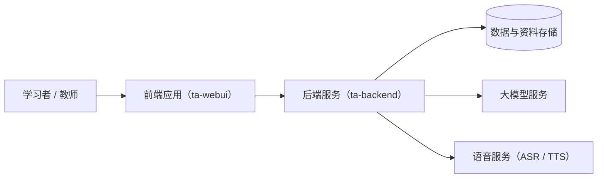

# 教学智能体

面向小团队模块化协作开发的**家庭教师式教学智能体**全栈项目，支持摸底诊断、学习规划、多媒介资料解析、启发式讲解与实时语音交互等个性化学习能力。

## 系统整体架构



## 仓库结构

- [`ta-backend/`](ta-backend/README.md) — 后端服务：负责认证鉴权、学习资料解析、课程管理、教学智能体编排与语音服务对接
- [`ta-webui/`](ta-webui/README.md) — 前端应用：面向学习者与教师的交互界面，内置可离线体验的演示模式
- [`PPT-Helper/`](PPT-Helper/decks/) — 文档中心：存放全项目架构设计、各模块实现方案与团队协作指南，支持本地幻灯片浏览

## 快速开始

### 环境准备

- **Node.js** ≥ 22：JavaScript 运行时，安装时自带包管理器 **npm**，可直接运行文档工具 `PPT-Helper`。
- **pnpm**：更高效的 Node.js 包管理器，用于管理前端 `ta-webui` 的依赖与运行脚本，可在安装 Node.js 后执行 `npm install -g pnpm` 安装。
- **[uv](https://docs.astral.sh/uv/)**：Python 包与环境管理工具，负责管理 Python 版本及后端 `ta-backend` 的虚拟环境与依赖，本项目需 Python 3.14 及以上版本。

开始前请确保本地已安装 **Node.js**、**pnpm** 与 **uv**。

### 1. 预览项目设计讲稿

```bash
cd PPT-Helper
node server.js overview   # 打开项目总览，默认端口 8000，可用 --port 8088 避让
```

### 2. 启动后端

```bash
cd ta-backend
cp .env.example .env
uv sync && uv run dev     # 默认监听 http://127.0.0.1:3000，Swagger: /docs
```

### 3. 启动前端

```bash
cd ta-webui
pnpm install && pnpm dev  # 默认监听 http://localhost:5173
```

> 前端默认使用离线演示数据；如需前后端联调或查看更多命令与配置说明，请参考 [`ta-webui/README.md`](ta-webui/README.md) 与 [`ta-backend/README.md`](ta-backend/README.md)。

## 模块进度与延伸阅读

详细架构规范、模块设计与协作流程维护在 [`PPT-Helper/decks/`](PPT-Helper/decks/)，可通过 `cd PPT-Helper && node server.js` 浏览：

| 主题 / 模块 | 当前状态 | 参考文档 |
| --- | --- | --- |
| 项目总览 | — | [`overview.md`](PPT-Helper/decks/overview.md) |
| 后端底座与认证 (`core` + `auth`) | 已实现 | [`ta-backend/README.md`](ta-backend/README.md) · [`intro.md`](PPT-Helper/decks/intro.md) |
| 前端应用 (`ta-webui`) | 原型与分层就绪 | [`ta-webui/README.md`](ta-webui/README.md) · [`intro-webui.md`](PPT-Helper/decks/intro-webui.md) |
| 资料解析与课程知识表 (`resource` / `course`) | 设计完备，待开发 | [`course-resource.md`](PPT-Helper/decks/course-resource.md) |
| 智能体 (`agent`) | 设计完备，待开发 | [`agent.md`](PPT-Helper/decks/agent.md) |
| 语音交互 (`speech`) | 设计完备，待开发 | [`speech.md`](PPT-Helper/decks/speech.md) · [`cluster-guide.md`](PPT-Helper/decks/cluster-guide.md) |
| Git 分支流与团队协作规范 | — | [`git-collab.md`](PPT-Helper/decks/git-collab.md) |
